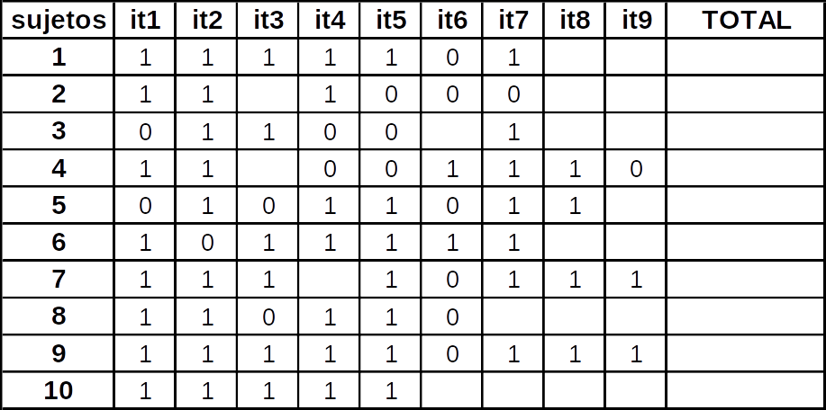

  
```{r setup, include=FALSE}
knitr::opts_chunk$set(echo = FALSE, fig.align='center', fig.dim=c(6,5))
library(latex2exp)

if (!exists('nimaIA')) { nimaIA = 50 } else nimaIA = params$nimaIA
```


<!-- Dos columnas --> <div class='cabecera center vcenter'> <div class='item-flex item-first'>
<div class="jumbo">
  <h2>Fiabilidad</h2>
</div>
<!-- Separador -->  </div> <div class="item-flex item-second">
)` ){.myimg .border width="600"}
<!-- Fin -->  </div></div>


<!-- ------------------------------------------- -->
## Introducción


\

<div class="jumbo">
<h4>
La fiabilidad es la consistencia de un instrumento ante repetidas aplicaciones del mismo</h4>
</div>


\


En Psicología al medir cambias el atributo: Aprendizaje, cansancio y maduración

\

En Psicología las diferencias en las puntuaciones se pueden deber a:

- Errores en la medición (errores de medida)
- Cambios reales en el atributo 

\

También disponemos de métodos de consistencia interna

\

Pregunta de examen: ¿Los errores sistemáticos afectan la fiabilidad? 


<!-- ------------------------------------------- -->
## Muy importante

\

Si no conoces la fiabilidad del test no sabes cómo de creíble es la puntuación que has obtenido


\


Podría ser todo error y nada de puntuación verdadera

\


Hay que ser siempre cautelosos al interpretar una puntuación de un test 

\
\


<div class="jumbo">
<h4>
Siempre, siempre, siempre, calcula el Intervalo de Confianza para la puntuación verdadera
</h4>
</div>


<!-- ------------------------------------------- -->
## Coeficiente de Fiabilidad

\

La TCT define la fiabilidad como 
$$\rho_{XV}^{2}=\frac{\sigma_{V}^{2}}{\sigma_{X}^{2}}$$

- Es el coeficiente de determinación de XV
- Es la proporción de la variación en X que se puede explicar (que depende) con la variación en V

<hr>


Recuerda que como no puede ser calculado directamente, se calcula a través de la correlación entre dos test paralelos

$$\rho_{XX'}=\rho_{XV}^{2}=\frac{\sigma_{V}^{2}}{\sigma_{X}^{2}}$$

<!-- ------------------------------------------- -->
## Fiabilidad (*cont.*)

Como es un coeficiente de determinación se puede interpretar en el contexto de la regresión

```{r include=FALSE}
set.seed(1)

x <- seq(0,5,0.1)
y <- x

```


<!-- Dos columnas --> <div class='cabecera vcenter'> <div class='item-flex item-first'>
```{r}
plot(y~x, type="p", col="blue", xlab="V", ylab="X", xlim = c(0, 5), ylim = c(0, 5))
lines(y~x, col="blue")

```

<!-- Separador -->  </div> <div class="item-flex item-second">

$$\rho_{XV}^{2}=1$$
$$X=V$$
$$E=0$$

<!-- Fin -->  </div></div>

<hr>


<!-- Dos columnas --> <div class='cabecera vcenter'> <div class='item-flex item-first'>
```{r}
plot(rnorm(length(x),2.5, 3)~x, type="p", col="blue", xlab="V", ylab="X", xlim = c(0, 5), ylim = c(0, 5))
lines(y~x, col="blue")
# abline(h=2.5, col="blue")
```
<!-- Separador -->  </div> <div class="item-flex item-second">
$$\rho_{XV}^{2}=0$$
$$X=E$$
$$V=0$$
<!-- Fin -->  </div></div>


<!-- ------------------------------------------- -->
## Fiabilidad (*cont.*)

<!-- Dos columnas --> <div class='cabecera vcenter'> <div class='item-flex item-first'>

```{r}
plot((x+rnorm(length(x),0, 0.3))~x, type="p", col="blue", xlab="V", ylab="X")
lines(y~x, col="blue")
```

<!-- Separador -->  </div> <div class="item-flex item-second">

$$\rho_{XV}^{2}= [0 \dots 1]$$
$$X=V+E$$
$$V=X-E$$
<!-- Fin -->  </div></div>


<hr>
\

<center> 

Valor | Interpretación
:-- | :--
mayor 0.90| Excelente
0.80 - 0.89 | Muy buena
0.70 - 0.79 | Buena
menor 0.70 | Interpretación cautelosa
</center>

\
\

Esto siempre depende de los objetivos para los qué se usa el test: investigación,  evaluación o diagnóstico


<!-- ------------------------------------------- -->
## Índice de Fiabilidad

\

Lo importante en la TCT es el **Coeficiente de Fiabilidad**

\


Pero en muchas fórmulas se utiliza el **Índice de Fiabilidad**

\

No es más que la raíz cuadrada del coeficiente

\


$$\textit{Coeficiente de Fiabilidad} \Rightarrow \rho_{XV}^{2}=\rho_{XX'}$$
$$\textit{Índice de Fiabilidad} \Rightarrow \rho_{XV}=\sqrt{\rho_{XX'}}$$

\
<hr>


El significado de ambos es distinto:

- El coeficiente es un **coeficiente de determinación** (está al cuadrado) por la tanto es **la proporción de varianza explicada**
- El índice es **solo una correlación** (no está al cuadrado) por lo tanto es **solo la relación lineal** entre X y V


<!-- ------------------------------------------- -->
---

<!-- Dos columnas --> <div class='cabecera'> <div class='item-flex item-first'>
<div class="jumbo">
  <h2>Propiedades de la Fiabilidad</h2>
</div>
<!-- Separador -->  </div> <div class="item-flex item-second">
)` ){.myimg .border width="600"}
<!-- Fin -->  </div></div>

\
<hr>
\

La Fiabilidad se ve afectada por distintos factores:

- La varianza de las muestras

- La longitud del test


<!-- ------------------------------------------- -->
## Fiabilidad y Varianza (*cont.*)

<center>
Muestra 1 | Muestra 2
:----:|:----:
Baja varianza | Alta varianza
$\sigma_{1}^{2}$ | $\sigma_{2}^{2}$
$\rho_{11'}^{2}$ |$\rho_{22'}^{2}$ 
</center>

<hr>


Entonces:

  $$\rho_{22'}=1-\frac{\sigma_{X_{1}}^{2}}{\sigma_{X_{2}}^{2}}(1-\rho_{11'})$$
  
  
  $$\sigma_{X_{2}}^{2}=\sigma_{X_{1}}^{2}\left(\frac{1-\rho_{11'}}{1-\rho_{22'}} \right)$$

Para que sea cierto debe cumplirse que:

$$\sigma_{E_{1}}^{2}=\sigma_{E_{2}}^{2}$$
\
pregunta: ¿Es creíble que se cumpla esta condición?

<!-- ------------------------------------------- -->
## Ejercicio:

En una muestra se ha encontrado que la fiabilidad es 0.64 y la varianza 36

1. Cuánto sería la fiabilidad si la varianza fuese 100
1. Cuánto tendría que ser la varianza de la segunda muestra para alcanzar una fiabilidad de 0.90


<!-- ------------------------------------------- -->
## Fiabilidad y Longitud

\

<!-- Dos columnas --> <div class='cabecera vcenter'> <div class='item-flex item-first'>
Introducir más items en el test 

$\Rightarrow$ Aumento la muestra de conductas 

$\Rightarrow$ Mejoro el muestreo de conductas 

$\Rightarrow$ **Aumento la fiabilidad**

<!-- Separador -->  </div> <div class="item-flex item-second">
Se entiende que son items ***paralelos*** a los que ya hay
<!-- Fin -->  </div></div>


\
<hr>


$$k=\frac{n'}{n}$$


$$\begin{array}{rcl}
n &\Rightarrow& n'
\\\rho_{xx'}&\Rightarrow&\rho_{XX'} = \frac{k\rho_{xx'}}{1+(k-1)\rho_{xx'}}\Leftarrow \textit{Spearman-Brown}
\\& &k=\frac{\rho_{XX'}(1-\rho_{xx'})}{\rho_{xx'}(1-\rho_{XX'})}
\\\mu_{x}&\Rightarrow&\mu_{X}=k\mu_{x}
\\\sigma_{x}^{2}&\Rightarrow&\sigma_{X}^{2}=k\sigma_{x}^{2}+k(k-1)\rho_{xx'}\sigma_{x}^{2}
\\\sigma_{v}^{2}&\Rightarrow&\sigma_{V}^{2}=k^{2}\sigma_{v}^{2}
\\\sigma_{e}^{2}&\Rightarrow&\sigma_{E}^{2}=k\sigma_{e}^{2}
\end{array}$$

<hr>
La fórmula de ***Spearman-Brown*** (también se llama de la ***profecía***)  es muy importante en psicometría


<!-- ------------------------------------------- -->
## Ejercicio:

En un test de 40 elementos hemos obtenido que la media ha sido 25, la varianza empírica 36 y la fiabilidad 0.80. 

1. Si aumentamos a 100 el número de elementos cuánto serán ahora todos los parámetros del test
1. Cuántos items tengo que añadir para obtener una fiabilidad de 0.95


<!-- ------------------------------------------- -->
## Manipulación de la fiabilidad


<!-- Dos columnas --> <div class='cabecera'> <div class='item-flex item-first'>
### Con la varianza

```{r}
v1 <- 1
r1 <- 0.1
v2 <- seq(1,20,0.1)
r2 <- 1-(v1/v2)*(1-r1)

plot(r2~v2, type="l", col="blue", 
     xlab=TeX(r'($\sigma_{2}^{2}$)'), ylab=TeX(r'($\rho_{22'}$)'), 
     ylim = c(0, 1))


```
<!-- Separador -->  </div> <div class="item-flex item-second">

### Con la longitud

```{r}
k <- seq(1,100,0.1)
r1 <- 0.1
r2 <- (k*r1)/(1+(k-1)*r1)
plot(r2~k, type="l", col="blue", 
     xlab=TeX(r'($k$)'), ylab=TeX(r'($\rho_{22'}$)'), 
     ylim = c(0, 1))

```

<!-- Fin -->  </div></div>


<!-- ------------------------------------------- -->
## Índices de Velocidad y Potencia

<!-- Dos columnas --> <div class='cabecera'> <div class='item-flex item-first'>
### Gulliksen

$$IV=\frac{\sigma_{F}^{2}}{\sigma_{I}^{2}}$$
$$I=F+O$$

\

Siendo: 

- $F$:Fallos
- $O$:Omisiones
- $I$: Incorrectas 


<!-- Separador -->  </div> <div class="item-flex item-second">
### Stafford

$$CV=\frac{\sum Ni}{\sum Ni+\sum O + \sum F}100$$

\

Siendo: 

- $F$:Fallos
- $O$:Omisiones
- $Ni$: No intentados
<!-- Fin -->  </div></div>


<hr>

- Gulliksen no diferencia entre Omisiones y No intentados, pero Stafford sí
- No se pueden calcular los métodos de consistencia interna con los test de velocidad


<!-- ------------------------------------------- -->
## Ejercicio de velocidad y potencia





