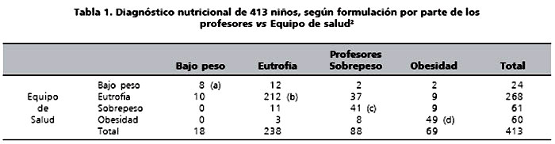
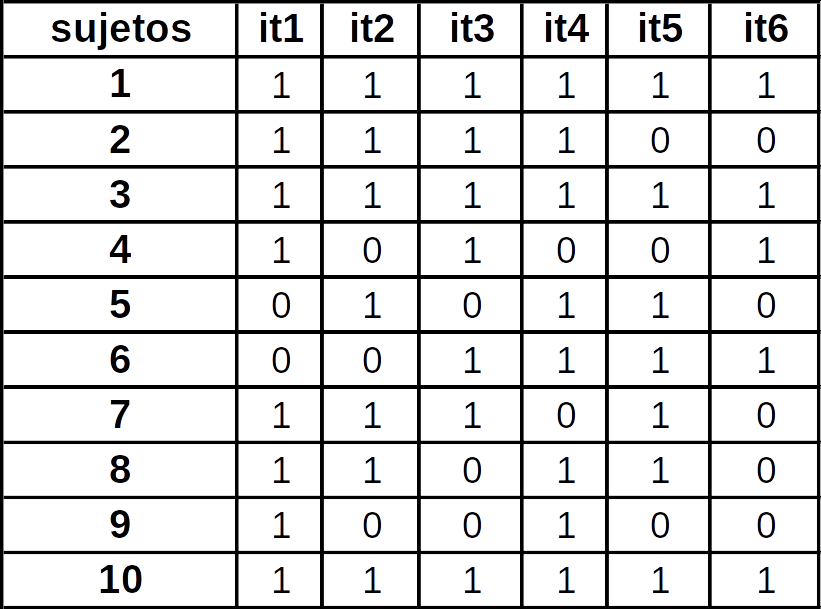
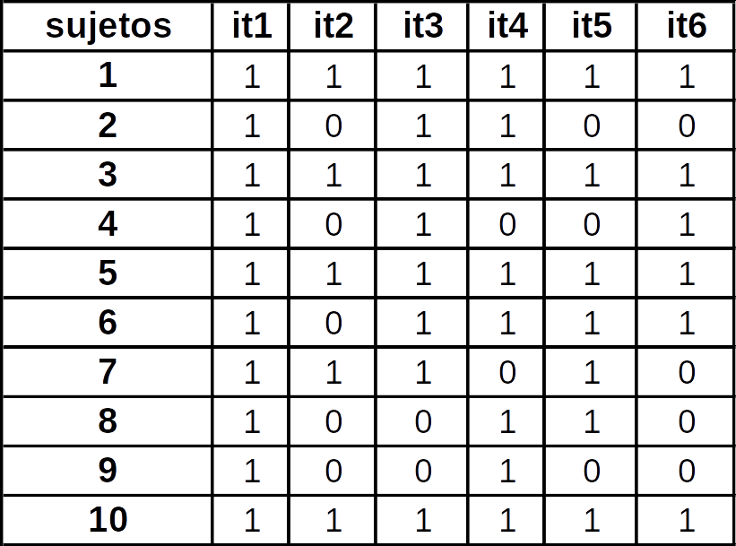

  
```{r setup, include=FALSE}
knitr::opts_chunk$set(echo = FALSE, fig.align='center', fig.dim=c(6,5))
library(latex2exp)

if (!exists('nimaIA')) { nimaIA = 50 } else nimaIA = params$nimaIA
```


<!-- Dos columnas --> <div class='cabecera'> <div class='item-flex item-first'>
<div class="jumbo">
  <h2>Estimación empírica de la Fiabilidad</h2>
</div>
<!-- Separador -->  </div> <div class="item-flex item-second">
)` ){.myimg .border width="600"}
<!-- Fin -->  </div></div>

<hr>

\


<!-- Dos columnas --> <div class='cabecera'> <div class='item-flex item-first'>

Basados en la consistencia entre jueces:

- Kappa de Cohen

Basados en la consistencia temporal:

- Formas paralelas
- Test-retest

<!-- Separador -->  </div> <div class="item-flex item-second">

Basados en la consistencia interna:

- Dos mitades
- $\alpha$ de Cronbach
- Otros

<!-- Fin -->  </div></div>


<!-- ------------------------------------------- -->
## Consistencia entre jueces: **Kappa de Cohen (1960)**


<!-- Dos columnas --> <div class='cabecera vtop'> <div class='item-flex item-first'>
$$\kappa=\frac{p_{o}-p_{e}}{1-p_{e}}$$

$$p_{o}=\sum p_{jj}$$
$$ p_{e}= \sum \frac{N_{i}N_{j}}{N^{2}}$$

<!-- Separador -->  </div> <div class="item-flex item-second">
Donde:

- $p_{o}$: Es la proporción observada de acuerdos
- $p_{e}$: Es la proporción esperada de acuerdos

<!-- Fin -->  </div></div>


<hr>
\


<!-- Dos columnas --> <div class='cabecera '> <div class='item-flex item-first'>

Sujeto|Observador A| Observador B
--|:--:|:--:
1|TOC|Dep
2|TOC|TOC
3|Ans|TOC
...|...|...
973|Dep|Dep

<!-- Separador -->  </div> <div class="item-flex item-second">

Obs A/B|Depresión|Ansiedad|TOC|Total
--:|:--:|:--:|:--:|:--:
Depresión|75|2|3|80
Ansiedad|3|300|90|393
TOC|20|80|400|500
Total|98|382|493|973

<!-- Fin -->  </div></div>


<!-- ------------------------------------------- -->
## Kappa de Cohen *(cont.)*
<!-- Dos columnas --> <div class='cabecera'> <div class='item-flex item-first'>

Obs A/B|Depresión|Ansiedad|TOC|Total
--:|:--:|:--:|:--:|:--:
Depresión|75|2|3|80
Ansiedad|3|300|90|393
TOC|20|80|400|500
Total|98|382|493|973

<!-- Separador -->  </div> <div class="item-flex item-second">

$$p_{o}=\frac{75}{973}+\frac{300}{973}+\frac{400}{973}=0.79$$
$$p_{e}=\frac{80*98}{973^{2}}+\frac{393*382}{973^{2}}+\frac{500*493}{973^{2}}=0.42$$
$$\kappa=\frac{0.79-0.42}{1-0.42}=0.64$$

<!-- Fin -->  </div></div>

\
<hr>
\

- Pueden ser observadores o cualquier instrumento que genere categorías
- Se puede calcular un error típico para $\kappa$ y crear intervalos de confianza para él

$$\sigma_{\kappa}=\sqrt{\frac{p_{e}}{N(1-p_{e})}}$$
$$IC: \kappa \pm Z_{\alpha/2}\sigma_{\kappa}$$

<!-- ------------------------------------------- -->
## Ejercicio de Kappa 

{width="1000"}
<h5>[*Enlace a los datos*](https://www.scielo.cl/scielo.php?pid=S0370-41062008000100008&script=sci_arttext&tlng=pt)</h5>

- Calcular $\kappa$ e interpretarlo
- Dónde están las diferencias (a ojillo)

<!-- ------------------------------------------- -->
## Consistencia temporal vs consistencia interna


- Diferentes métodos pueden dar distintos resultados
- ¿Por qué no usar siempre paralelos? porque es inviable

\

- La "*buena*" es la consistencia temporal (es la fiabilidad) pero es problemática por la repetición

\

- La consistencia interna se demuestra que es una excelente aproximación a la fiabilidad y solo requiere pasar una vez el test

<hr>

\


<!-- Dos columnas --> <div class='cabecera'> <div class='item-flex item-first'>
<center>

sj | X1 | X2
--|--|--
1 | 8| 4
2 | 15| 21
3 | 6| 9
... | ...| ...
n | $X1_{n}$| $X2_{n}$

</center>
<!-- Separador -->  </div> <div class="item-flex item-second">
<center>

sj | X
--|--
1 | 8
2 | 15
3 | 6
... | ...
n | $X_{n}$

</center>
<!-- Fin -->  </div></div>

 


<!-- ------------------------------------------- -->
## Condiciones para una buena estimación

### Los cálculos siempre se realizan con muestras, no con poblaciones

\


Se entiende que la fiabilidad real es desconocida y que lo que hacemos es realizar una estimación

\

Para que sea correcta debemos tener en cuenta lo siguiente:

1. Tamaño muestral
1. Representatividad
1. Independencia experimental de las medidas
1. Administraciones idénticas


<!-- ------------------------------------------- -->
## Formas Paralelas

Método de consistencia temporal

\

### Está basado en la definición de paralelismo de *Spearman*

\

Procedimiento:

- Se construyen dos formas paralelas X y X'
- Se pasan ambos a la muestra de sujetos
- Se calcula la correlación $\rho_{XX'}$, donde X y X' representan las puntuaciones en las dos formas paralelas

\
<hr>
\

Interpretación:

- Si las formas son paralelas es ***exactamente*** la fiabilidad
- Si las formas son tau-equivalentes es ***aproximadamente*** la fiabilidad
- Si no son una de las anteriores entonces ***no es*** la fiabilidad


<!-- ------------------------------------------- -->
## Test-Retest

Método de consistencia temporal

\

### Similar al anterior pero solo se utiliza una versión del test

\

Procedimiento:

- Se pasa el test a la muestra (X)
- Se deja pasar un tiempo $\textit{t}$
- Se pasa por segunda vez el test a la muestra (X')
- Se calcula la correlación $\rho_{XX'}$, donde X y X' representan dos momentos diferentes para el mismo test

\
<hr>
\

- Ahora no hay problema de que las formas sean paralelas
- Aparecen los problemas de aprendizaje, cansancio, maduración, práctica, etc.
- Solo se debería usar con test que generen poco impacto


<!-- ------------------------------------------- -->
## Dos mitades

### Método de consistencia interna

\

Procedimiento:

- Partimos un test de longitud $l$
- Se pasa el test a la muestra (X)
- Se divide el test en dos mitades, una con los items **par** y la otra con los items **impar**, quedando dos *subtest* de longitud $l/2$ y $l/2$
- Se calculan las puntuaciones empíricas de las dos mitades: $X_{p}$ y $X_{i}$
- Se calcula la correlación entre las dos mitades $\rho_{pi}$
- Se calcula la fiabilidad usando la fórmula de Spearman-Brown con k=2

$$\rho_{XX'}=\frac{2\rho_{pi}}{1+\rho_{pi}}$$
<hr>

\

La correlación entre dos mitades ha sido 0.6, ¿cuánto es la fiabilidad del test?

<!-- ------------------------------------------- -->
## Dos mitades (*cont.*)


- Es necesario recurrir a *Spearman-Brow*n porque la longitud de cada mitad es solo $l/2$ y queremos conocer la fiabilidad del test completo de longitud $l$

- La interpretación de la fiabilidad depende de si las dos mitades han salido paralelas o no (igual que en paralelismo)

- Existen otros procedimientos para hacer la división que garantizan mejor que las mitades sean paralelas:

  - Ordenar por dificultad y luego par/impar
  - Remuestreo de items hasta que se obtenga paralelismo
  - Remuestreo de items y luego calcular la media de las fiabilidades encontradas
  
<!-- ------------------------------------------- -->
## Ejercicio dos mitades



 
<!-- ------------------------------------------ -->
## $\alpha$ de Cronbach *(Guttman, 1945)*

### Método de consistencia interna


- No tiene los problemas de partir en dos mitades
- Está basado en las varianzas y covarianzas entre todos los items del test

  $$\alpha=\frac{ni}{ni-1}\left ( 1-\frac{\sum{\sigma_{j}^{2}}}{\sigma_{X}^{2}} \right )$$
Donde $ni$: número de items y $j=1\cdots n_{i}$

\
<hr>
\


### Propiedades:
- $\alpha=\rho_{XX'}$ cuando los items son paralelos entre sí
- $\alpha\leq\rho_{XX'}$ cuando los items no paralelos entre sí
- Es el límite inferior de la fiabilidad, la fiabilidad no puede ser inferior que $\alpha$


<!-- ------------------------------------------- -->
## Otras versiones de $\alpha$

  $$\textrm{KR}_{20}=\frac{n_{i}}{n_{i}-1}\left ( 1-\frac{\sum{p_{j}q_{j}}}{\sigma_{X}^{2}} \right )$$
  
  
  $$\textrm{KR}_{21}=\frac{n_{i}}{n_{i}-1}\left ( 1-\frac{\mu_{X}-\frac{(\mu_{X})^{2}}{n_{i}}}{\sigma_{X}^{2}} \right )$$

\
<hr>
\

- Desarrolladas por *Kuder-Richardson*
- Son dos fórmulas que aceleran un poco el tiempo de cálculo de $\alpha$
- $KR_{20}$: Se utiliza cuando los items son dicotómicos (sustituye $\sigma_{j}^{2}$ por $p_{j}q_{j}$)
- $KR_{21}$: Se utiliza cuando los items son dicotómicos y equiprobables (mismo valor de $p_{j}$)


<!-- ------------------------------------------- -->
## Ejercicio de $\alpha$ (KR20)




<!-- ------------------------------------------- -->
## Otras formas de consistencia interna

\

### Alfa estandarizado:

$$\alpha_{std}=\frac{n\overline{r}}{1+(n-1)\overline{r}}$$

donde $\overline{r}$ es la media de las correlaciones entre los items

- Si hay mucha diferencia con el normal es porque las varianzas de los items son muy diferentes


\
<hr>
\


<!-- ------------------------------------------- -->
## Otras formas de consistencia interna *(cont.)*

### Beta (Raju, 1977)

- Permite agrupar items en partes o componentes (*parcel*)
- Permite tener items de distinto formato


$$\beta=\frac{\sigma_{X}^{2}-\sum\sigma_{j}^{2}}{\sigma_{X}^{2}\left [1-\sum \left (  \frac{n_{j}}{n}  \right )^{2} \right ]}$$

donde:

- $n$: longitud total del test
- $n_{j}$: longitud de la parte j
- $\sigma_{X}^{2}$: varianza empírica o total del test
- $\sigma_{j}^{2}$: varianza de la parte j

\

### Cuando las partes están compuestas por un único ítem ($n_{j}=1$) entonces $\beta=\alpha$


<!-- ------------------------------------------- -->
## Otras formas de consistencia interna *(cont.)*

### Omega


Existen formas para estimar la consistencia interna basadas en el Análisis Factorial


