  
```{r setup, include=FALSE}
knitr::opts_chunk$set(echo = FALSE, fig.align='center', fig.dim=c(6,5))
# library(latex2exp)

if (!exists('nimaIA')) { nimaIA = 50 } else nimaIA = params$nimaIA
```


<!-- Dos columnas --> <div class='cabecera center vcenter'> <div class='item-flex item-first'>
<div class="jumbo">
  <h2>Tipos de Items</h2>
</div>
<!-- Separador -->  </div> <div class="item-flex item-second">
)` ){.myimg .border width="600"}
<!-- Fin -->  </div></div>


<!-- ------------------------------------------- -->
## Tipos de Items Cognitivos

### 1. Analogías
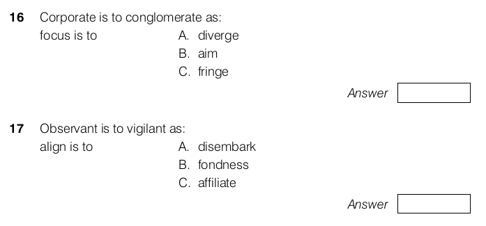{width="600px"}
<hr>
### 2. Secuencias
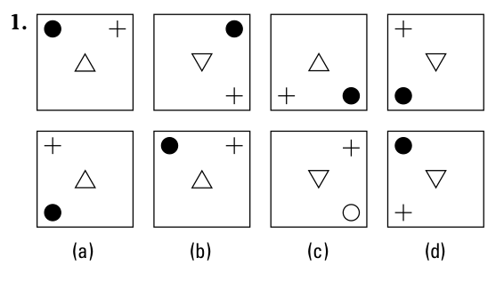{width="400px"}


<hr>
### 3. Ítem que no encaja en la secuencia

1. 20, 22, 26, 28, 30 
2. árbol, trigo, mosquito, cemento

<!-- ------------------------------------------- -->
## Tipos de Items Cognitivos

### 4. Elección múltiple

<!-- Dos columnas --> <div class='cabecera'> <div class='item-flex item-first'>
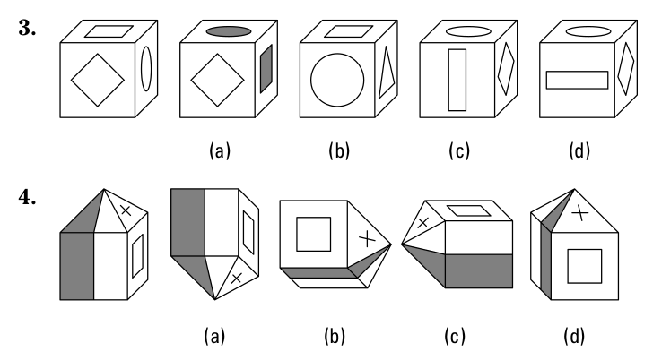{width="600px"}

<!-- Separador -->  </div> <div class="item-flex item-second">
- Una opción correcta
- Distractores equiprobables
<!-- Fin -->  </div></div>
<hr>


### 5. Emparejamiento
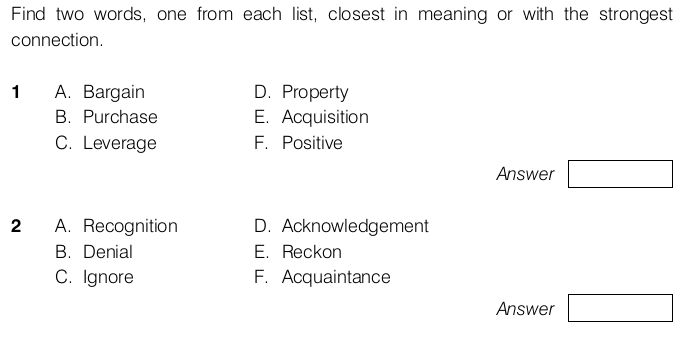{width="600px"}

<!-- ------------------------------------------- -->
## Tipos de Items Cognitivos

### 6. Items de respuesta corta


<!-- Dos columnas --> <div class='cabecera'> <div class='item-flex item-first'>
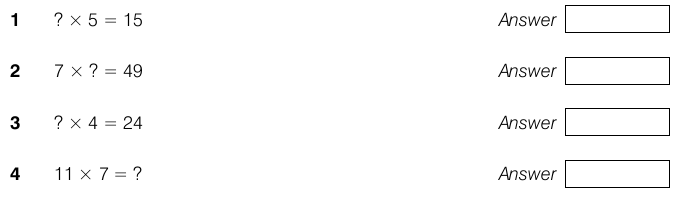{width="600px"}
<!-- Separador -->  </div> <div class="item-flex item-second">
- Problemas para la corrección automática
<!-- Fin -->  </div></div>

<hr>

### 7. Items de respuesta libre (ensayo)

<!-- Dos columnas --> <div class='cabecera'> <div class='item-flex item-first'>

\

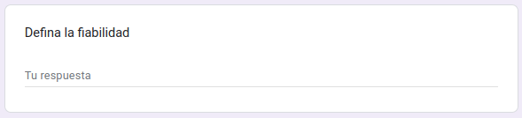{width="600px"}

<!-- Separador -->  </div> <div class="item-flex item-second">
- Complejos de corregir
- Uso de rúbricas y criterios de corrección

<!-- Fin -->  </div></div>


<!-- ------------------------------------------- -->
## Tipos de Items No Cognitivos


### 1. Sí/No

<center> 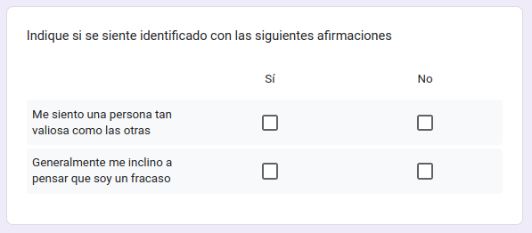{width="600px"}</center>

\

- Cuidado con la aquiescencia

<hr>

### 2. Verdadero/Falso
<center> 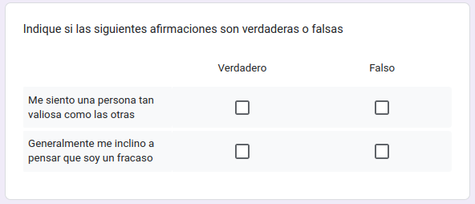{width="600px"}</center>

\

- Cuidado con la aquiescencia


<!-- ------------------------------------------- -->
## Tipos de Items No Cognitivos

### 3. Respuestas graduadas (Likert)

<center> 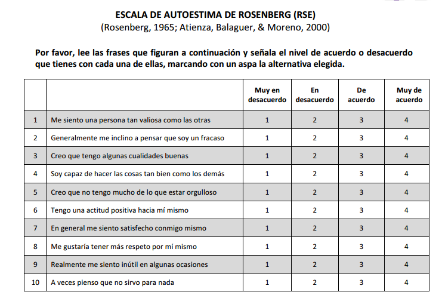{width="800px"}</center>

\

- Categorías no equidistantes que se convierten en números equidistantes
- No más de 5
- Si es impar cuidado con la tendencia central

<!-- ------------------------------------------- -->
## Tipos de Items No Cognitivos

### 4. Escalas numéricas con anclas en los extremos

\
<center> 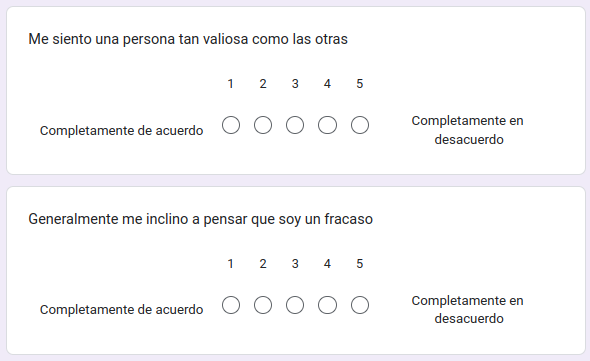{width="600px"}</center>

\
\

- Como la anterior (las Likert) pero evitamos el problema de encontrar los adjetivos
- Te posicionas sobre la afirmación hecha en el enunciado

<!-- ------------------------------------------- -->
## Tipos de Items No Cognitivos

### 5. Diferencial semántico

- Como el anterior, pero te posicionas sobre dos adjetivos en una escala inventada. 
- Por ejemplo, evaluando una asignatura:

\

<center> 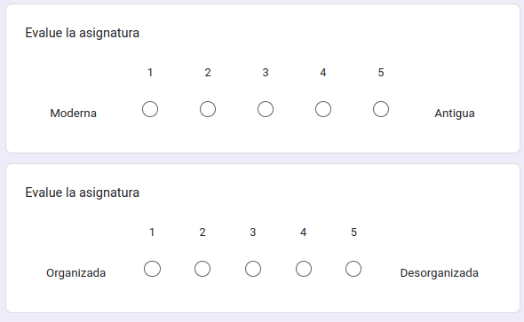{width="600px"}</center>


<!-- ------------------------------------------- -->
## Tipos de Items No Cognitivos

### 6. Análogos visuales

<center> 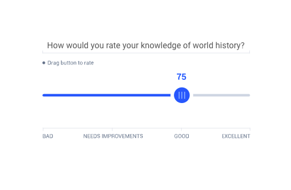{width="600px"}</center>


<!-- ------------------------------------------- -->
## Tipos de Items No Cognitivos

### 7. Elección u ordenación forzosa

- Afirmaciones que tienes que elegir u ordenar, normalmente sobre el mismo rasgo
- No están conectadas entre sí, pero son del mismo rasgo
- Por ejemplo, midiendo la **apertura** del **Big Five**

\

<center> 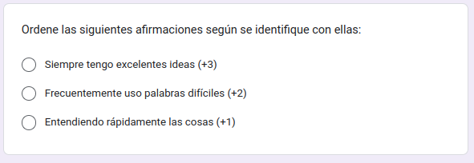{width="600px"}</center>


<!-- ------------------------------------------- -->
## Tipos de Items No Cognitivos

### 8. Items/test Ipsativos

- Cada alternativa es un rasgo diferente
- Ordenación, a veces selección de una de ellas
- Creadas para evitar efectos de *deseabilidad* y sesgo
- Problemas para entender el significado de las puntuaciones

\

<center> 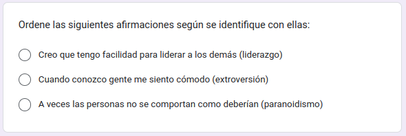{width="600px"}</center>


<!-- ------------------------------------------- -->
## Cómo construir buenos items

- Claridad de los enunciados y las respuestas
- No escribir ambiguamente
- Frases sencillas
- Lenguaje adaptado a la población
- Cuidado con las negaciones y dobles negaciones
- Coherencia entre los enunciados y las alternativas
- Es necesaria cierta redundancia
- Evitar enunciados tendenciosos
- No juzgar
- No utilizar el humor o el *"colegueo"*


<!-- ------------------------------------------- -->
## Cómo construir buenos items

- Respecto a las alternativas:
  - Equiprobables
  - Igual longitud
  - Evitar pistas de respuesta
  - Evitar: Todas son ciertas, todas son falsas, etc.
  
<hr>

  
- Items positivos/negativos:
  - Pueden evitar la aquiescencia
  - Pueden generar serios problemas psicométricos (en la fiabilidad y en los factoriales)
  

<hr>

- Items dicotómicos 
  - Llevan a puntuaciones muy sesgadas
  - Más fáciles de procesar

