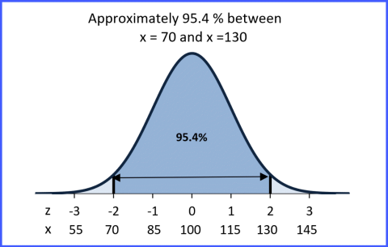
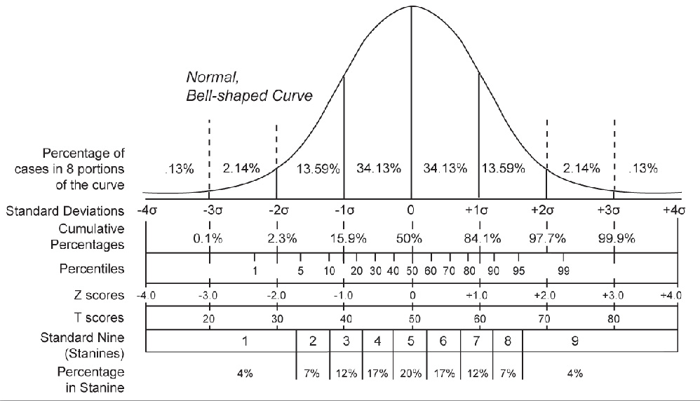

  
```{r setup, include=FALSE}
knitr::opts_chunk$set(echo = FALSE, fig.align='center', fig.dim=c(6,5))
# library(latex2exp)

if (!exists('nimaIA')) { nimaIA = 50 } else nimaIA = params$nimaIA
```

<!-- Dos columnas --> <div class='cabecera center vcenter'> <div class='item-flex item-first'>
<div class="jumbo">
  <h2>Puntuaciones en los Test</h2>
</div>
<!-- Separador -->  </div> <div class="item-flex item-second">
)` ){.myimg .border width="600"}
<!-- Fin -->  </div></div>

<!-- ------------------------------------------- -->
## Puntuaciones

- La puntuación empírica ($x$) es solo el resultado del escalamiento
- Para que tenga un significado real hay compararla con el resto de puntuaciones
- Esto además "*parchea*" algunos de los problemas de la TCT
- Es lo que se llaman los baremos
- Transforman las puntuaciones de los sujetos en otras puntuaciones que ayuden a la interpretación
- Antes eran tablas, ahora por ordenador


- Se debe planificar adecuadamente la recogida de los datos:

  - Determinar qué grupos normativos construir (sexo, edad, raza, estatus, etc) dependiendo del rasgo y los objetivos
  - Realizar un muestreo adecuado (tamaño y representatividad)
  - Ponderar los valores si se desvían mucho de la población
  - Determinar y calcular las transformaciones más adecuadas
  - Llevar a cabo actualizaciones periódicas


---

<!-- Dos columnas --> <div class='cabecera vcenter'> <div class='item-flex item-first'>
<div class="jumbo">
  <h3>Tipos de Transformaciones</h3>
</div>
<!-- Separador -->  </div> <div class="item-flex item-second">
)` ){.myimg .border width="400"}
<!-- Fin -->  </div></div>

\
<hr>
\


### Lineales: 

Puntuaciones Típicas ($Z_{x}$), Puntuaciones Típicas Derivadas ($ZD_{x}$)


### No Lineales: 

Percentiles ($P_{p}$), Típicas Normalizadas ($ZN_{x}$), Típicas Normalizadas Derivadas ($ZND_{x}$)

### Edad (C.I.)


<!-- ------------------------------------------- -->
## Puntuaciones Típicas ($Z_{x}$)

Ya estudiadas en Estadística I y II

$$Z_{x}=\frac{x-\overline{X}}{\sigma_{X}}$$

- Realizan un cambio a una escala estandarizada donde:
 - $\overline{X}=0$
 - $\sigma_{X}=1$
 
- Cada puntuación nos indica cuántas desviaciones típicas se separa de la media
- Son muy buenas y muy informativas

<center>

{width="500"}
 </center>

<!-- ------------------------------------------- -->
##  Ejercicio

X|Frecuencia
:--:|:--:
6|90
5|150
4|280
3|400
2|300
1|190
0|115


<!-- ------------------------------------------- -->
## Puntuaciones Típicas Derivadas ($ZD_{x}$)

- Las $Z_{x}$ tienen el problema de tener números negativos
- la escala [0,1] no es muy intuitiva para no profesionales
- Por eso se calculan las Típicas Derivadas

$$ZD_{x}=\overline{X}^{*}+\sigma_{X}^{*}Z_{x}$$

Donde: $\overline{X}^{*}$ y $\sigma_{X}^{*}$ son dos valores elegidos arbitrariamente

- Realiza un cambio de escala

$$[0,1] \Rightarrow [\overline{X}^{*}, \sigma_{X}^{*}]$$

<!-- ------------------------------------------- -->
## Puntuaciones Típicas Derivadas ($ZD_{x}$) *(cont.)*

Distintos test pueden tener distintas transformaciones (son arbitrarias)

- CI Test 1: [100, 15] (WAIS)
- CI Test 2: [100, 16] (Stanford-Binet)
- CI Test 3: [100, 10]

\


### T de McCall [50, 10]

- En honor de Terman y Thorndike
- Una ZD con nombre propio
- Se utiliza para personalidad pero poco en inteligencia  
- En inteligencia se intenta que no estén centradas en 50 para que no parezcan un examen que hay que aprobar


## Percentiles ($P_{p}$)

- $P_{10}=80$ se lee como que el percentil 10 corresponde la puntuación empírica de 80; es decir, alguien con una puntuación empírica de 80 deja por debajo el 10% de la población (y tendrá por encima el 90%)

- Indica la posición del sujeto en el grupo
- Es la más utilizada
- Muy intuitiva y fácil de interpretar

\
<hr>
\

### Están en una escala ordinal:
 - Se puede ver el orden de los sujetos
 - No se pueden interpretar los valores
 
\
<hr>
\
 
 
### Distribuciones simétricas y asimétricas


## Típicas Normalizadas ($ZN_{x}$)

- Son típicas que se calculan, no con la fórmula, sino con la distribución normal (las tablas)
- Se calculan a partir de los percentiles
- Previamente es necesario comprobar si la distribución de los datos es normal, para ello:

  - $\chi^{2}$ y *Bondad de Ajuste*
  - Kolmogorov-Smirnov (Lilliefors)
  - Shapiro

- Si se aleja mucho, dos posturas:
  - Mejor no aplicarlas
  - Aplicarlas si la muestra es pequeña y el rasgo en la población sí es normal


<!-- ------------------------------------------- -->
## Típicas Normalizadas ($ZN_{x}$) *(cont.)*

Cálculo:

- Calculamos los percentiles
- Convertimos los percentiles en probabilidades (prob = percentil/100)
- Buscamos la puntuación típica asociada a esa prob:
  - En la tabla normal
  - En R, con la función qnorm

\
<hr>
\


Es muy fácil calcularlo en R

```{r echo=TRUE}
# ZN para un percentil de 10
qnorm(10/100)
```

## Típicas Normalizadas Derivadas ($ZND_{x}$)

- Mismo problema que con las típicas: escala con negativos
- Misma solución: Transformar


$$ZND_{x}=\overline{X}^{*}+\sigma_{X}^{*}ZN_{x}$$
\
<hr>

<!-- Dos columnas --> <div class='cabecera vtop'> <div class='item-flex item-first'>
#### Eneatipos o estaninos: Dos formas

- Antigua: $En_{x}=5+2ZN_{x}$ 
- Moderna: Se parte en porcentajes

<!-- Separador -->  </div> <div class="item-flex item-second">
#### Decatipos: 

$Dc_{x}=5.5+2ZN_{x}$

<!-- Fin -->  </div></div>


| Eneatipo  | 1   | 2     | 3      | 4      | 5      | 6      | 7      | 8     | 9     |
| --------- | :---: | :-----: | :------: | :------: | :------: | :------: | :------: | :-----: | :-----: |
| **%**         | 4%  | 7% | 12% | 17% | 20% | 17% | 12% | 7% | 4     |
| **Percentil** | < 4 | (4 - 11]  | (11 - 23]  | (23 - 40]  | (40 - 60]  | (60 - 77]  | (77 - 89]  | (89 - 96] | \> 96 |


\
<hr>


- Son enteros y acotados por arriba y abajo a 1 y 9
- Se pierde mucha información
- En las traducciones al castellano hay confusión entre ellos


## Comparativa entre Lineales y No Lineales


<center> 


</center>

## La Edad

- Es el clásico y famoso CI (Cociente de Inteligencia)

$$C.I.=\frac{\textit{Edad mental}}{\textit{Edad Cronológica}}100$$

- Efecto techo de la edad
- Ya no se usa mucho se prefiere usar otras puntuaciones y tener baremos por edades (pe: 5 años, 6 años, etc.)


