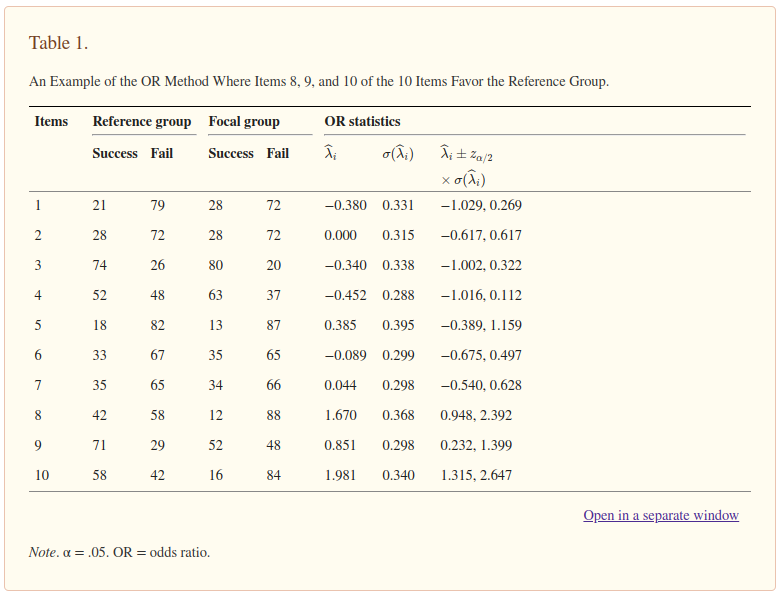

  
```{r setup, include=FALSE}
knitr::opts_chunk$set(echo = FALSE, fig.align='center', fig.dim=c(6,5))
# library(latex2exp)

if (!exists('nimaIA')) { nimaIA = 50 } else nimaIA = params$nimaIA
```


<!-- Dos columnas --> <div class='cabecera center vcenter'> <div class='item-flex item-first'>
<div class="jumbo">
  <h2>Funcionamiento Diferencial de los Items (DIF)</h2>
</div>
<!-- Separador -->  </div> <div class="item-flex item-second">
)` ){.myimg .border width="600"}
<!-- Fin -->  </div></div>


<!-- ------------------------------------------- -->
## Qué es DIF 

- ***Differential item functioning (DIF)***
- Tradicionalmente estudio del Sesgo
- Empieza a ser relevante en los 60 con los movimientos por los derechos civiles (USA)
- Relacionado con la justicia, equidadad, igualdad de oportunidades, etc.
- Muchos estudios mostraron que los test exageraban o mantenían los prejuicios en sus puntuaciones
\

### Hay sesgo si dos personas igualmente competentes obtienen puntuaciones distintas por pertenecer a grupos distintos

\

- Es un tipo de **Error Sistemático**
- Suelen ser de tipo económico o sociocultural
- También hay sesgos no culturales

\

<hr>


- La mejor manera de controlarlo es con **expertos**
- También hay métodos empíricos


<!-- ------------------------------------------- -->
## $\chi^{2}$ de los aciertos

<!-- Dos columnas --> <div class='cabecera vcenter'> <div class='item-flex item-first'>

- Similar al análisis de alternativas
- Un análisis por cada ítem
- Creamos grupos en x (la empírica)
- Representamos la dificultad en tablas de grupos x poblaciones

<!-- Separador -->  </div> <div class="item-flex item-second">
$$\chi^{2}=\frac{\sum (fo-ft)^{2} }{ft} \Rightarrow \chi^{2}_{1-\alpha, (k-1)(j-1)}$$
<!-- Fin -->  </div></div>


<hr>
\

<!-- Dos columnas --> <div class='cabecera'> <div class='item-flex item-first'>
```{r echo=FALSE}
tab <- matrix(c(0.3, 0.3, 0.5, 0.8, 0.85,
                0.25, 0.33, 0.42, 0.82, 0.83)
              , ncol=5, byrow=TRUE)
colnames(tab) <- c('(0,5]','(5,10]','(19,15]', '(15,20]', '(20,25]')
rownames(tab) <- c('Hombres','Mujeres')
tab <- as.table(tab)

tab

par(mar=c(3, 2, 2, 7), xpd=TRUE)
matplot(t(tab),
        main="Alternativas del item 1",
        xaxt='n', type="b"
        , ylim = c(0, 1)
)
axis(side=1,at=1:5,labels=colnames(tab))
legend("topright", inset=c(-0.26, 0), legend = rownames(tab), col=1:5, pch=1)

```

<!-- Separador -->  </div> <div class="item-flex item-second">
```{r echo=FALSE}
tab <- matrix(c(0.3, 0.3, 0.5, 0.8, 0.85,
                0.25, 0.33, 0.42, 0.58, 0.62)
              , ncol=5, byrow=TRUE)
colnames(tab) <- c('(0,5]','(5,10]','(19,15]', '(15,20]', '(20,25]')
rownames(tab) <- c('Hombres','Mujeres')
tab <- as.table(tab)

tab

par(mar=c(3, 2, 2, 7), xpd=TRUE)
matplot(t(tab),
        main="Alternativas del item 1",
        xaxt='n', type="b"
        , ylim = c(0, 1)
)
axis(side=1,at=1:5,labels=colnames(tab))
legend("topright", inset=c(-0.26, 0), legend = rownames(tab), col=1:5, pch=1)


```

<!-- Fin -->  </div></div>


<!-- ------------------------------------------- -->
## Mantel-Haenszel

<!-- Dos columnas --> <div class='cabecera'> <div class='item-flex item-first'>

- Un análisis por cada ítem
- Se divide X en subgrupos o niveles (como en $\chi^{2}$)
- Se calcula ($\alpha_{h/m}$) y $\Delta_{h/m}$

<!-- Separador -->  </div> <div class="item-flex item-second">
$$\alpha_{h/m}=\frac{\sum \frac{AD}{N}}{\sum \frac{BC}{N}}$$
$$\Delta_{h/m}=-2.35ln(\alpha_{h/m})$$
<!-- Fin -->  </div></div>

<hr>

<center>


|   |              | (0,5\] | (5,10\] | (10,15\] | (15,20\] | (20,25\] | SUM   |
| - | ------------ | ------ | ------- | -------- | -------- | -------- | ----- |
| A | Aciertos (H) | 5      | 20      | 30       | 85       | 10       |       |
| B | Fallos (H)   | 5      | 10      | 10       | 20       | 5        |       |
| C | Aciertos (M) | 0      | 5       | 10       | 70       | 15       |       |
| D | Fallos (M)   | 10     | 15      | 40       | 30       | 5        |       |
| N | Total        | 20     | 45      | 90       | 205      | 35       |       |
|   |              |        |         |          |          |          |       |
|   | numerador    | 2.50   | 6.67    | 13.33    | 12.44    | 1.43     | 36.37 |
|   | denominador  | 0.00   | 1.11    | 1.11     | 6.83     | 2.14     | 11.19 |

</center>

<hr>
 
$$\alpha_{h/m}=\frac{36.37}{11.19}=3.24$$
$$\Delta_{h/m}=-2.35ln(3.24)=-2.76$$
Al ser negativo y desviarse de 0 se interpreta como fuerte sesgo contra el grupo de las mujeres

También tienen un contraste de hipótesis


<!-- ------------------------------------------- -->
## Método Delta

- Un único análisis para todo el test
- Se calcula el índice de dificultad de cada ítem en cada grupo
- Se tipifican
- Se transforman a la escala delta $\delta = Z_{IDi} 4 + 13$
- Se representan gráficamente las deltas

<hr>

<!-- Dos columnas --> <div class='cabecera'> <div class='item-flex item-first'>
```{r}

df <- data.frame(
  item = 1:10,
  idH = c(0.3, 0.15, 0.3, 0.9, 0.5, 0.6, 0.7, 0.8, 0.9, 0.95),
  idM = c(0.3, 0.15, 0.3, 0.4, 0.5, 0.6, 0.7, 0.8, 0.9, 0.95)
)

s <- scale(c(df$idH, df$idM))

df$zH <- s[1:10]
df$zM <- s[11:20]
df$dH <- df$zH*4+13
df$dM <- df$zM*4+13

par(pty="s")
plot(df$dH, df$dM,
     type="p",
     xlab="Delta de Hombres",
     ylab="Delta de Mujeres",
     xlim = c(0,25),
     ylim = c(0,25)
)
abline(a = 0, b=1, col="blue", lty=2)


```

<!-- Separador -->  </div> <div class="item-flex item-second">
```{r}

df <- data.frame(
  item = 1:10,
  idH = c(0.3, 0.15, 0.3, 0.4, 0.5, 0.6, 0.7, 0.8, 0.9, 0.95),
  idM = c(0.1, 0.0, 0.1, 0.2, 0.2, 0.2, 0.3, 0.3, 0.85, 0.4)
)

s <- scale(c(df$idH, df$idM))

df$zH <- s[1:10]
df$zM <- s[11:20]
df$dH <- df$zH*4+13
df$dM <- df$zM*4+13

par(pty="s")
plot(df$dH, df$dM,
     type="p",
     xlab="Delta de Hombres",
     ylab="Delta de Mujeres",
     xlim = c(0,25),
     ylim = c(0,25)
     )
abline(a = 0, b=1, col="blue", lty=2)
abline(a = 0, b=0.7, col="red", lty=3)

```

<!-- Fin -->  </div></div>


<!-- ------------------------------------------- -->
## Odds Ratio

### Odds

- Un Odd son los casos (o proporciones o porcentajes) favorables entre los casos no favorables
- Importante: No es una proporción (se divide entre el total)

$$Odd=\frac{frec+}{frec-}=\frac{Prop+}{Prop-}$$
\

Ejemplo: De 100 personas con cáncer la supervivencia a 5 años ha sido de 60 personas (40 no lo han superado)

$$Odd=\frac{60}{40}=\frac{0.6}{0.4}=1.5$$

Tienes 1.5 más posibilidades de superar el cáncer que de no superarlo

<!-- ------------------------------------------- -->
## Odds Ratio

\

### Odds Ratio

$$OR = \frac{Odd_{1}}{Odd_{2}}$$

- Un Odd Ratio es la división de dos Odds, cada uno de un grupo o población distinta

\

Ejemplo: Para las mujeres la proporción de supervivencia a un cáncer es del 80% y para los hombres del 60%

$$OR_{m/h}=\frac{Odd_{mujeres}}{Odd_{hombres}}=\frac{\frac{0.8}{0.2}}{\frac{0.6}{0.4}}=\frac{4}{1.5}=2.6$$

Tienes 2.6 más posibilidades de superar el cáncer siendo mujer que siendo hombre

<hr>


- Los OR son asimétricos: [0,1,$+\infty$]
- Se pueden transformar para que sean simétricos: ln(OR) [$-\infty$,0,$+\infty$]

$OR = 4/2 = 2 \Rightarrow ln(2)=   0.69$

$OR = 2/4 = 0.5  \Rightarrow ln(0.5)= -0.69$

- Conectan perfectamente con las regresiones logísticas


<!-- ------------------------------------------- -->
## Odds Ratio (Agresti, 2002)


- Se pueden calcular para todos los items comparando las dos poblaciones

$$\lambda_{i}=ln \left ( \frac{OR_{R}}{OR_{F}} \right )$$
R y F son el grupo Focal y el de Referencia

- Si el ítem se ajusta al modelo de Rasch entonces:

$$\sigma(\lambda_{i})=\sqrt{\sum frec^{-1}}$$

Y por tanto se pueden construir Intervalos de confianza para el sesgo de cada ítem

$$IC_{i}=\lambda_{i} \pm |Z_{\alpha/2}|\sigma(\lambda_{i})$$
La interpretación es sencilla:

- Cuanto más se aleje de 0 mayor sesgo
- Si el intervalo no incluye el 0 se puede decir que el sesgo es estadísticamente significativo


<!-- ------------------------------------------- -->
## Odds Ratio (Agresti, 2002)

{width="1000px"}


https://www.ncbi.nlm.nih.gov/pmc/articles/PMC6291892/

<!-- ------------------------------------------- -->
## Comentarios

- En $\chi^{2}$, Delta y Mantel-Haenszel es necesario suponer que el conjunto de los items ($x$) no está sesgado

- En Odds Ratio no

\
<hr>
\


- En $\chi^{2}$ y Mantel-Haenszel se hace un análisis por ítem

- En Delta y Odds Ratio un análisis para todos

\
<hr>
\


- Muchas técnicas clásicas

\

### El estudio del DIF se hace mejor desde la TRI


<!-- ------------------------------------------- -->
## Ejercicio 1

Analizar el DIF con $\chi^{2}$ y Mantel-Haenszel para el siguiente ítem

|              | (0,5\] | (5,10\] | (10,15\] | (15,20\] | (20,25\] |
| ------------ | ------ | ------- | -------- | -------- | -------- |
| Aciertos (H) | 3      | 23      | 30       | 28       | 13       |
| Fallos (H)   | 4      | 21      | 24       | 31       | 5        |
| Aciertos (M) | 12     | 21      | 22       | 21       | 10       |
| Fallos (M)   | 14     | 12      | 13       | 8        | 2        |

<!-- ------------------------------------------- -->
## Ejercicio 2

Analizar el DIF con el método Delta y Odds Ratio para el siguiente test (5 items)

Media = 0.50
Desvición típica = 0.20

|   | Acierto (H) | Fallo (H) | Acierto (M) | Fallo (M) |
| - | ----------- | --------- | ----------- | --------- |
| 1 | 12          | 23        | 15          | 45        |
| 2 | 10          | 10        | 18          | 64        |
| 3 | 60          | 21        | 30          | 30        |
| 4 | 22          | 21        | 35          | 3         |
| 5 | 13          | 14        | 22          | 21        |


<!-- ------------------------------------------- -->
--- 

<!-- Dos columnas --> <div class='cabecera center vcenter'> <div class='item-flex item-first'>
<div class="jumbo">
  <h2>Equiparación de Puntuaciones</h2>
</div>
<!-- Separador -->  </div> <div class="item-flex item-second">
)` ){.myimg .border width="600"}
<!-- Fin -->  </div></div>


<!-- ------------------------------------------- -->
## Equiparación de Puntuaciones (*Equating*)

- Correspondencia entre las puntuaciones de dos test ($X_{1}$ y $X_{2}$)
- Condiciones:
  - Mismo atributo
  - Misma fiabilidad


- Mejor desde la TRI


<!-- ------------------------------------------- -->
##  Diseños en la Equiparación

### Grupo único: 
- Se pasan los dos test
- Se contrabalancea la aplicación para evitar efectos


### Dos grupos equivalentes 

- Dos grupos de sujetos distintos
- Necesario usar aleatorización o bloqueos

### Dos grupos no equivalentes (anclajes)

- Se forman dos grupos de sujetos distintos
- Se añaden items de cada test en el otro


<!-- ------------------------------------------- -->
## Métodos para la Equiparación

Métodos:

### Media

- Se calculan las puntuaciones diferenciales
- Misma diferencial $\Rightarrow$ Misma cantidad del rasgo

Ejercicio:

$\overline{X_{1}}$ = 40 , $\sigma_{X_{1}}$= 15
$\overline{X_{2}}$ = 55, $\sigma_{X_{1}}$ = 10

¿Qué puntuación en $X_{2}$ sería equivalente a una puntuación de 50 en $X_{1}$

\
<hr>
\

### Transformación lineal
- Se calculan las puntuaciones típicas
- Misma típica $\Rightarrow$ Misma cantidad del rasgo

Ejercicio:

¿Quién sería más inteligente, alguien que sacase 60 en $X_{1}$ o 60 en $X_{2}$?

¿Qué puntuación en $X_{2}$ equivaldría a una de 60 en $X_{1}$?

<!-- ------------------------------------------- -->
## Métodos para la Equiparación (cont.)


### Percentiles

- Se calculan los percentiles
- Mismo percentil $\Rightarrow$ Misma cantidad del rasgo
- La más utilizada

Ejemplo:

<!-- Dos columnas --> <div class='cabecera'> <div class='item-flex item-first'>

| P  | $X_{1}$ |
| -- | -- |
| 10 | 12 |
| 20 | 22 |
| 30 | 36 |
| 40 | 54 |
| 50 | 59 |
| 60 | 68 |
| 70 | 72 |
| 80 | 78 |
| 90 | 81 |

<!-- Separador -->  </div> <div class="item-flex item-second">
| P  | $X_{2}$  |
| -- | --- |
| 10 | 10  |
| 20 | 15  |
| 30 | 21  |
| 40 | 60  |
| 50 | 65  |
| 60 | 80  |
| 70 | 100 |
| 80 | 112 |
| 90 | 125 |
<!-- Fin -->  </div></div>

\

¿Quién es más inteligente, alguien con 80 aciertos en el primer test o alguien con 80 en el segundo?


