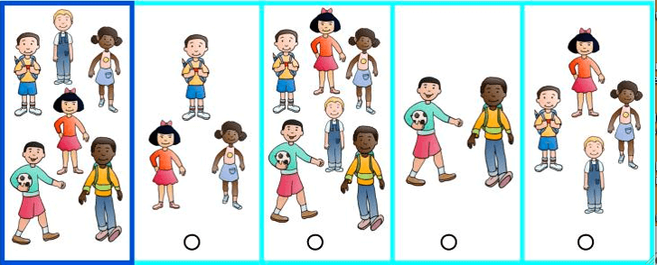

```{r setup, include=FALSE}
knitr::opts_chunk$set(echo = FALSE)
# library(latex2exp)

if (!exists('nimaIA')) { nimaIA = 50 } else nimaIA = params$nimaIA
```

<!-- Dos columnas --> <div class='cabecera center vcenter'> <div class='item-flex item-first'>
<div class="jumbo">
  <h2>La Validez en los Test</h2>
</div>
<!-- Separador -->  </div> <div class="item-flex item-second">
)` ){.myimg .border width="600"}
<!-- Fin -->  </div></div>


<!-- ------------------------------------------- -->
## Definición de Validez

- Es el concepto más cambiante y fluctuante de la Psicometría

- Su percepción y estimación ha cambiado mucho con el tiempo

- No es sencilla de estimar (la fiabilidad sí lo es)

- Es el aspecto más importante de un test

- Su definición siempre ha sido algo muy controvertido

\

### Evolución

Reflejada en los estándares, seguiremos en clase los de 2014

- Origen: 

  - Correlación con un criterio único (objetivo, seguro y perfecto) 
  - Guilford (1937)
  - No es mala definición, el problema es obtener ese criterio
  
- Actualidad:

  - Búsqueda de evidencias empíricas

<!-- ------------------------------------------- -->
## Definición de Validez

### Definición clásica: 

<div class="jumbo">
<h4>
“Un test es válido si mide lo que dice medir”
</h4>
</div>
\
<hr>
\


### Definición actual: 

<div class="jumbo">
<h4>
“Grado en que la evidencia y la teoría apoyan la interpretación de las puntuaciones de los tests, para el propósito con el que éstos son utilizados” 
</h4>
<h4 align="right">(SEPT, 2014)</h4>
</div>

\
\

Muy ligada a los trabajos de

- Cronbach (1971, 1988)
- Messick (1981, 1988, 1989, 1996)


<!-- ------------------------------------------- -->
## Características

- La validez está asociada al uso del test, no al test en sí mismo

- Depende de la situación concreta (objetivos, a quién se aplica, cómo se interpretan los resultados, etc.)

- Un test puede ser válido para una situación pero no para otra

- No hay test válidos, sino usos válidos del test

- No existe un número que represente la validez sino evidencias empíricas de que el test se comporta de forma correcta para una situación dada con las que se realiza un juicio razonado

- La validación es un proceso, nunca termina, siempre se van aportando nuevas evidencias y revisando las anteriores

- Es el marco teórico (la teoría) y los objetivos del test el que determina que fuentes de evidencia se deben buscar para la validación

  - Por ejemplo, en un test clínico para la evaluación de un trastorno que se sabe que cambia bien con la terapia deberíamos comprobar que efectivamente nuestro test refleja adecuadamente esos cambios

  - Otro ejemplo, si un rasgo evoluciona con la edad (niños), el test debería reflejar ese cambio


<!-- ------------------------------------------- -->
## Movimientos civiles de los 70

- Meritocracia, derechos e igualdad de oportunidades

- Diferencias entre grupos culturales y étnicos marcadas por  los test

- Sesgo de los test

\
<hr>
\

Si los test generan estas diferencias, ¿qué estamos midiendo?

\

### Y si es cierto, ¿el test debe reflejarlo o compensarlo?

\

- Preocupación por las consecuencias sociales del uso de los test (Cronbach, 1971, 1988)


<!-- ------------------------------------------- -->
## La validez unificada

- La validez es única: **la validez de constructo**

- Las evidencias aportan información sobre esa única validez

- El término constructo se utiliza de manera amplia, equivalente a **rasgo** o atributo

- No todo el mundo está de acuerdo en esa unificación

\
<hr>
\


En los manuales de  los test puedes encontrar concepciones antiguas y modernas de la validez, pero eso es necesario saber cómo se llamaban antes

<!-- ------------------------------------------- -->
## Los 5 tipos de evidencia (2014)

Los estándares hablan de 5 tipos de evidencia:
\
\

1. Evidencias basadas en el contenido
2. Evidencias basadas en el proceso de respuesta 
3. Evidencias basadas en las consecuencias del test
4. Evidencias basadas en las relaciones con otras variables
5. Evidencias basadas en la estructura interna

\
<hr>
\


- Van apareciendo nuevos conceptos y técnicas
- Los estándares tratan de unificar y dar coherencia al conocimiento que hay

<!-- ------------------------------------------- -->
## Validez de Contenido

<div class="jumbo">
<h4>
Es alta cuando el test constituye una muestra adecuada y representativa de los contenidos que se pretenden evaluar con él
</h4>
</div>

\
<hr>
\


- No es fácil representarla numéricamente
- Suele ser un análisis razonado
- Se suelen utilizar expertos que indiquen las áreas que deben incluirse

\
<hr>
\


Dos grandes problemas:

- Pobre representación del constructo
- Varianza irrelevante (se incluyen cosas que no son)

<!-- ------------------------------------------- -->
## Validez Aparente

Antes se hablaba también de validez aparente

\
\

<center>

</center>


<!-- ------------------------------------------- -->
## Evidencia basada en el análisis de los procesos de respuesta


Se comprueba que el proceso de respuesta coincide con lo hipotetizado por la teoría

\
\

- Estudios experimentales
- Técnicas *Neuro* (potenciales evocados, frmi, etc.)
- Entrevistas cognitivas
- *Think aloud protocol*


<!-- ------------------------------------------- -->
## Evidencias basadas en las consecuencias del test

Se demuestra que el test se está comportando de manera justa

\
\

Ejemplos:

- No tiene sesgo contra poblaciones
- Genera igualdad de oportunidades
- No discrimina a ciertas poblaciones
- Los errores del test no generan situaciones graves
- Hace que las terapias sean más eficaces


<!-- ------------------------------------------- -->
## Relación con otras variables

- Tiene otros nombres como validez de *criterio* o *predictiva*
- La idea es siempre la misma, ver cómo se relaciona nuestro test con otras variables de interés (el/los criterios)

- Se calcula como la correlación entre el test y el criterio

$$\rho_{XY}=\frac{\sigma_{XY}}{\sigma_{X}\sigma_{Y}}$$


- Estos criterios pueden ser cualquier variable medible y que consideremos relevante

- El objetivo es validar la **red nomológica** de nuestro test y demostrar la coherencia de las relaciones


<center>
```{r}
# https://rich-iannone.github.io/DiagrammeR/graphviz_and_mermaid.html
library(DiagrammeR)

grViz("digraph {
  graph [layout = neato]
  
  node [shape = circle]
  r1 [label = 'TEST']
  
  node [shape = circle]
  r2 [label = 'r2']
  r3 [label =  'r3']
  r4 [label = 'r4']
  
  # edge definitions with the node IDs
  r1 -> {r2 r3 r4}
  }", height=400)

```
</center>


Esta red se construye con la evidencia y conocimientos disponibles


<!-- ------------------------------------------- -->
## Validación cruzada

- Se produce cuando se utilizan otros test para validar un test

- Especialmente en test clásicos

<center>
```{r}
# https://rich-iannone.github.io/DiagrammeR/graphviz_and_mermaid.html
library(DiagrammeR)

grViz("digraph {
  graph [layout = neato]
  
  node [shape = circle]
  t [label = 'TEST']
  
  node [shape = circle]
  t1 [label = 't1']
  t2 [label = 't2']
  t3 [label =  't3']
  t4 [label = 't4']
  
  # edge definitions with the node IDs
  t -> {t1 t2 t3}
  t2 -> {t t3}
  t3 -> {t2 t4}
  t4 -> t
  }", height=400)

```
</center>

<!-- ------------------------------------------- -->
## Relación con otras variables

Tradicionalmente, dentro del relación con otras variables, se suele hablar de:

- Concurrente
- Predictiva
- Retrospectiva

\
\

y en la actualidad también se habla de

\

- Incremental: lo que aporta el uso del test frente a otros procedimientos o test

<!-- ------------------------------------------- -->
## Evidencia basada en la estructura interna

- Antes se la llamaba *validez de constructo*

- Nunca falta en los análisis

\
<hr>


<div class="jumbo">
<h4>
El objetivo es demostrar que el test presenta un estructura interna que es coherente con el rasgo que se está midiendo
</h4>
</div>


<hr>
\


Su análisis se basa principalmente en las siguientes técnicas:

- Análisis factorial exploratorio
- Análisis factorial confirmatorio
- SEM (*Structural Equation Modeling*)
- Otras técnicas multidimensionales

\
Estas técnicas permiten analizar cómo se relacionan los item entre sí y comprobar las estructuras que subyacen a las respuestas de los sujetos

\

Antes se hablaba de validez factorial como un tipo de validez independiente, hoy se habla como una evidencia a la estructura interna
