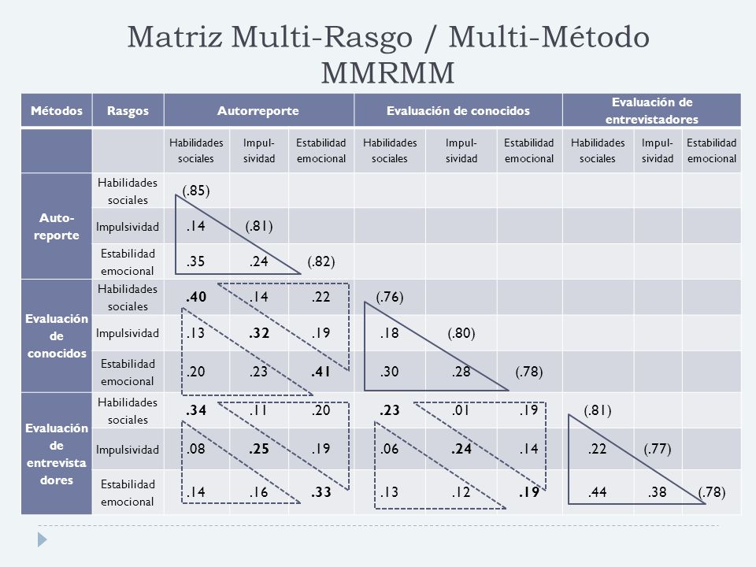

```{r setup, include=FALSE}
knitr::opts_chunk$set(echo = FALSE)
# library(latex2exp)

if (!exists('nimaIA')) { nimaIA = 50 } else nimaIA = params$nimaIA
```

```{r}

marca <- function(f){
  load(f)
  for(i in 1:length(coords$x)){
    text(x=coords$x[i], y=coords$y[i], label=i)  
  }
}

```


<!-- Dos columnas --> <div class='cabecera center vcenter'> <div class='item-flex item-first'>
<div class="jumbo">
  <h2>Validez: Relación con otras variables</h2>
</div>
<!-- Separador -->  </div> <div class="item-flex item-second">
)` ){.myimg .border width="600"}
<!-- Fin -->  </div></div>

<!-- ------------------------------------------- -->
## Objetivo

<div class="jumbo">
  <h3>Establecer la red nomológica</h3>
</div>

\
\

Con esta definición prácticamente cualquier técnica estadística se puede utilizar:


- Correlaciones
- Regresión lineal
- Otros tipos de regresión
- Análisis discriminante
- Modelos de ecuaciones estructurales (SEM)
- Matrices MTMM
- Meta-análisis
- Curvas ROC (sensibilidad y especificidad)
- etc.

<!-- ------------------------------------------- -->
## Validez Convergente / Discriminante

- Se estudia con las matrices Multi-Método Multi-Rasgo (MM-MR)
- No es más que una matriz de correlaciones con esta forma
- Hoy se consideran parte de la red nomológica pero un su día eran un tipo de validez independiente Campbell y Fiske (1959)



Fuente: https://slideplayer.es/slide/9305390/

<!-- ------------------------------------------- -->
--

Información disponible en la matriz:

- Fiabilidad (en la diagonal)
- Validez convergente:
  - heterométodo-monorasgo (2 test - 1 rasgo)
  - Buena si es alta
- Validez  discriminante:
  - monométodo-heterorasgo (1 test - 2 rasgos)
  - Buena si es baja
- Resto de correlaciones:
  - Difíciles de interpretar
  - Se dejan para modelos más complejos: (SEM, factoriales, etc)


<!-- ------------------------------------------- -->
---


<!-- Dos columnas --> <div class='cabecera center vcenter'> <div class='item-flex item-first'>
<div class="jumbo">
  <h2>Propiedades de la Validez como correlación</h2>
</div>
<!-- Separador -->  </div> <div class="item-flex item-second">
)` ){.myimg .border width="600"}
<!-- Fin -->  </div></div>

<!-- ------------------------------------------- -->
## Validez y Fiabilidad


<!-- Dos columnas --> <div class='cabecera'> <div class='item-flex item-first'>

<center> 
### Medición perfecta
</center>

```{r echo=FALSE, out.width="600px"}

set.seed(10)

x <- seq(90,110,1)

z <- 5 + scale(x)*2
y <- z+rnorm(length(x),0, 1)
plot(y~x, type="p", col="blue", xlab="CI (X, Criterio)", ylab="Rendimiento (Y)"
     # , xlim = c(0, 5), ylim = c(0, 5)
     )
marca("RmkdFiles/coords_fig1.rda")
```

```{r echo=TRUE}
cor(y,x)
```

<!-- Separador -->  </div> <div class="item-flex item-second">

<center> 
### Medición con errores
</center>

```{r echo=FALSE, out.width="600px" }
x2 <- x + rnorm(length(x),0, 2)
y2 <- y + rnorm(length(x),0, 2)
plot(y2~x2, type="p", col="blue", xlab="CI (X, Test)", ylab="Rendimiento (Y)", 
     # xlim = c(0, 5), ylim = c(0, 5)
     )
marca("RmkdFiles/coords_fig2.rda")
```

```{r echo=TRUE}

cor(y2,x2)

```

<!-- Fin -->  </div></div>


\
<hr>

- Los errores aleatorios enmascaran la correlación
- Está "contaminada" por los errores aleatorios


<!-- ------------------------------------------- -->
## Validez y Fiabilidad (*cont.*)

La validez es una correlación por tanto se ve influida por lo mismo que cualquier correlación

- Si conseguimos eliminar algo de error nos acercaremos a la validez correcta (sin contaminar)
- ¿Cómo se eliminan los errores? Pues aumentando la fiabilidad de las medidas (tanto del test como del criterio)


<center>
```{r}
# https://rich-iannone.github.io/DiagrammeR/graphviz_and_mermaid.html
library(DiagrammeR)

grViz("digraph {
  graph [layout = dot, rankdir = LR]
  
  node [shape = box]
  l [label = 'Longitud']
  v [label = 'Varianza']
  ft [label =  'Fiabilidad del Test']
  fc [label =  'Fiabilidad del Criterio']
  validez [label = 'Validez']
  
  # edge definitions with the node IDs
  {l v} -> ft
  {ft fc} -> validez
  }", height=200)

```
</center>

\
\

### ¿Por qué no tenemos que alcanzar una validez perfecta?

<!-- ------------------------------------------- -->
## Fórmula de la atenuación

$$\rho_{XY}=\frac{\rho_{xy}\sqrt{\rho_{XX'}}\sqrt{\rho_{YY'}}}{\sqrt{\rho_{xx'}}\sqrt{\rho_{yy'}}}$$

\
<hr>
\

Un test tiene una fiabilidad de 0.7 y el criterio de 0.8. Si la validez del test con ese criterio es o.60. Cuánto será la validez si:

- Aumento la fiabilidad del test a 0.75 y la del criterio a 0.90
- Aumento sólo la fiabilidad del test
- Aumento sólo la fiabilidad del criterio
- Consigo una situación de medición perfecta

<!-- ------------------------------------------- -->
## Valor máximo del coeficiente de validez

### El coeficiente de validez siempre es menor o igual que el índice de fiabilidad

$$\rho_{XY}\leq \rho_{XV}$$ 
$$\rho_{XY}\leq\sqrt{\rho_{XX'}}$$
  
  
\
<hr>
\

Si la fiabilidad de un test es 0.8, ¿cuál será el valor máximo de la validez?

\
\

### Puede ser mayor que el coeficiente de fiabilidad


<!-- ------------------------------------------- -->
## Validez y longitud del test

$$k=n'/n$$
$$\rho_{Xy}=\frac{\rho_{xy}\sqrt{k}}{\sqrt{1+(k-1))\rho_{xx'}}}$$
$$k=\frac{(1-\rho_{xx'})\rho_{Xy}^{2}}{\rho_{xy}^{2}-\rho_{xy}^{2}\rho_{xx'}}$$

\
<hr>
\

La fiabilidad del test es 0.8 y su validez es 0.60

- Cuánto será la validez si doblo la longitud del test
- Suponiendo que tengo 50 items, ¿cuántos tendría que añadir para obtener una validez de 0.65
- Cuántos para obtener una validez de 0.95


<!-- ------------------------------------------- -->
## Validez y la variabilidad de la muestra

<center> 

```{r}
set.seed(100)

x <- seq(0,50,1)

z <- 500 + scale(x)*200
y <- z+rnorm(length(x),0, 100)
plot(y~x, type="p", col="blue", xlab="Test selección (X)", ylab="ventas primer año (Y)"
     # , xlim = c(0, 5), ylim = c(0, 5)
)
abline(v=38.5, col="red")

df <- data.frame(x=x, y=y)

todos <- df
admitidos <- df[df$x>38.5,]
```
</center>

```{r echo=TRUE}
cor(admitidos$x, admitidos$y)
cor(todos$x, todos$y)
```


<!-- ------------------------------------------- -->
## Validez y la variabilidad de la muestra (*cont.*)

$$\rho_{XY}=\frac{\sigma_{X}\rho_{xy}}{\sqrt{\sigma_{X}^{2}\rho_{xy}^{2}+\sigma_{x}^{2}-\sigma_{x}^{2}\rho_{xy}^{2}}}$$
\
<hr>

Supuestos:

- Pendientes iguales

$$\rho_{xy}\frac{\sigma_{y}}{\sigma_{x}}=\rho_{XY}\frac{\sigma_{Y}}{\sigma_{X}}$$

- Error típico de estimación iguales (igual dispersión en las bubes de puntos)


$$\sigma_{y}\sqrt{1-\rho_{xy}^{2}}=\sigma_{Y}\sqrt{1-\rho_{XY}^{2}}$$


<hr>
\

En un test con una muestra de admitidos hemos obtenido una validez 0.25. Cuánto sería la validez teniendo en cuenta todo el grupo si:

- La desviación típica en el test para los admitidos ha sido 5
- La desviación típica en el test para todos los candidatos ha sido 20


<!-- ------------------------------------------- -->
## Pronóstico en Y conociendo X


Procedimiento:

  $$Y'=\rho_{xy}\frac{\sigma_{X}}{\sigma_{Y}} (X-\overline{X})+\overline{Y}$$
  $$\sigma_{Y\cdot X}=\sigma_{Y}\sqrt{1-\rho_{xy}^{2}}$$
  $$I.C.=Y'\pm \left | Z_{\alpha/2} \right |\sigma_{Y\cdot X}$$

\
<hr>
\

Un participante ha obtenido una puntuación de 25 en nuestro test. Con un $\alpha=0.05$, qué puntuación le pronosticaremos en el criterio sabiendo que:

- La media del test del test es 30
- La desviación típica del test es 15
- La  varianza del criterio es 100
- La validez es 0.81

<!-- ------------------------------------------- -->
## Pronóstico en Y conociendo X (*cont.*)


Indicadores de calidad del pronóstico

| |Nombre|Tipo|Interpretación|
|:--|:--|:--:|:--|
$\rho_{XY}$|Coeficiente de validez|Coeficiente de correlación|Es la relación lineal entre el test y el criterio
$\rho_{XY}^{2}$| |Coeficiente de determinación|Es la proporción de varianza común entre el test y el criterio
$K=\sqrt{1-\rho_{XY}^{2}}$|Coeficiente de Alienación| |Es el porcentaje de incertidumbre en el pronóstico|
$E=1-K$|Eficiencia| |Es el porcentaje de seguridad en el pronóstico


\
<hr>
\

### Calcule e interprete estos índices para el ejemplo anterior