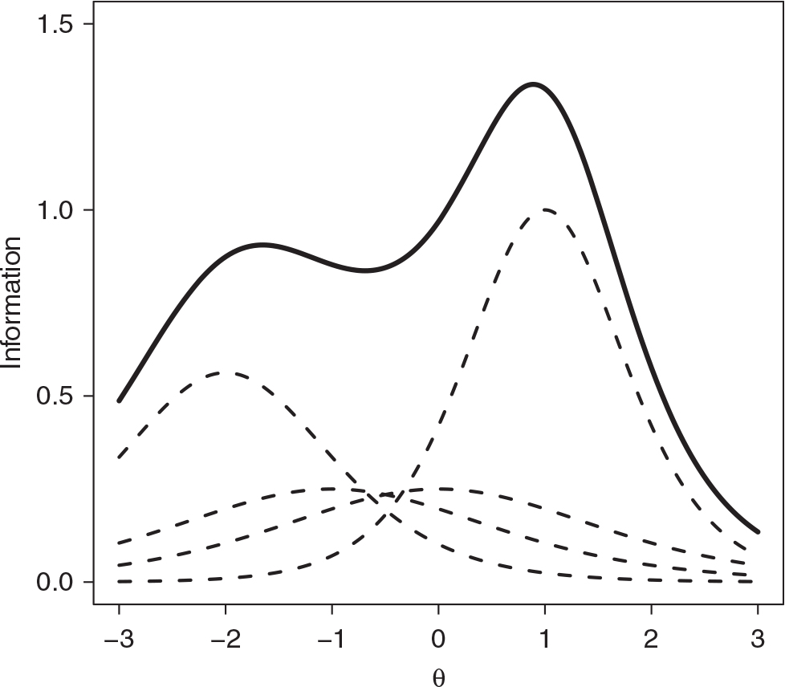
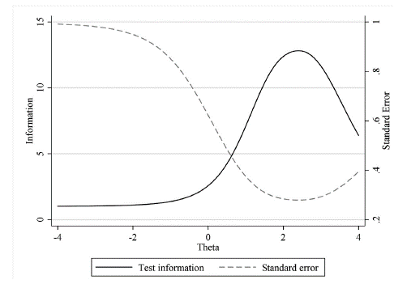
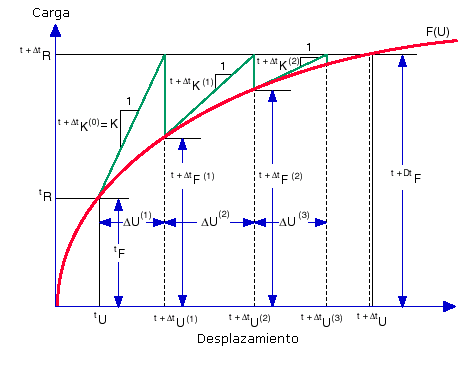
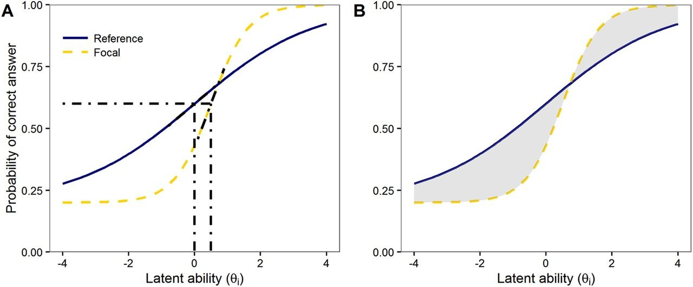

```{r setup, include=FALSE}
knitr::opts_chunk$set(echo = FALSE, fig.align='center', fig.dim=c(6,5))
library(latex2exp)

if (!exists('nimaIA')) { nimaIA = 50 } else nimaIA = params$nimaIA

```

```{r}
rasch <- function(x,b){
  D <- 1.7
  y <- exp(D*(x-b))/(1+exp(D*(x-b)))
  
}

birnbaum <- function(x,b,a){
  D <- 1.7
  y <- exp(D*a*(x-b))/(1+exp(D*a*(x-b)))
  
}

f3P <- function(x,b,a,c){
  D <- 1.7
  y <- c+(1-c)*(exp(D*a*(x-b))/(1+exp(D*a*(x-b))))
  
}

f4P <- function(x,b,a,c,d){
  D <- 1.7
  y <- c+(d-c)*(exp(D*a*(x-b))/(1+exp(D*a*(x-b))))
  
}

x <- seq(-10,10,0.1)

marca <- function(f){
  load(f)
  for(i in 1:length(coords$x)){
    text(x=coords$x[i], y=coords$y[i], label=i)  
  }
}


```

## <!-- Sección Nueva -->

<!-- Dos columnas --> <div class='cabecera center vcenter'> <div class='item-flex item-first'>
<div class="jumbo">
  <h2>TRI: Conceptos avanzados</h2>
</div>
<!-- Separador -->  </div> <div class="item-flex item-second">
)` ){.myimg .border width="600"}
<!-- Fin -->  </div></div>


## Fiabilidad en la TRI


- En la TCT la fiabilidad se expresa como $\rho_{XV}^{2}$
$$\rho_{XV}^{2}=\frac{\sigma_{V}^{2}}{\sigma_{X}^{2}}=1-\frac{\sigma_{E}^{2}}{\sigma_{X}^{2}}$$
- Es un valor único para cualquier aplicación del test

\

<!-- Dos columnas --> <div class='cabecera'> <div class='item-flex item-first'>
- En la TRI la fiabilidad no es un número sino una función
- Se representa con la ***Función de Información*** ($I(\theta)$)

<!-- Separador -->  </div> <div class="item-flex item-second">
<center> 
{ width="500"}
</center>

<!-- Fin -->  </div></div>


<!-- ------------------------------------------- -->
## Función de Información del item

- Una para cada ítem
- Se define como:

$$I_{i}(\theta)=\frac{P'_{i}(\theta)^{2}}{P_{i}(\theta)Q_{i}(\theta)}$$

- Donde $P'_{i}(\theta)$ es la derivada primera de la CCI para cada $\theta$
- Resolviendo esa derivada para cada uno de los tres modelos nos da lo siguiente:


<!-- Dos columnas --> <div class='cabecera vcenter'> <div class='item-flex item-first'>
### 1P
<!-- Separador -->  </div> <div class="item-flex item-second">
$$I_{i}(\theta)=D^{2}P_{i}(\theta)Q_{i}(\theta)$$
<!-- Fin -->  </div></div>
<hr>

<!-- Dos columnas --> <div class='cabecera vcenter'> <div class='item-flex item-first'>
### 2P
<!-- Separador -->  </div> <div class="item-flex item-second">
$$I_{i}(\theta)=D^{2}a_{i}^{2}P_{i}(\theta)Q_{i}(\theta)$$
<!-- Fin -->  </div></div>
<hr>

<!-- Dos columnas --> <div class='cabecera vcenter'> <div class='item-flex item-first'>
### 3P
<!-- Separador -->  </div> <div class="item-flex item-second">
$$I_{i}(\theta)=\frac{D^{2}a_{i}^{2}Q_{i}(\theta)[P_{i}(\theta)-c_{i}]^{2}}{(1-c_{i})^{2}P_{i}(\theta)}$$
<!-- Fin -->  </div></div>


<!-- ------------------------------------------- -->
## Punto de máxima información para el ítem

Cada ítem tendrá un punto en el que su función de Información sea máxima

\

<!-- Dos columnas --> <div class='cabecera vcenter'> <div class='item-flex item-first'>
### 1P
<!-- Separador -->  </div> <div class="item-flex item-second">
$$I_{max}(\theta)=b_{i}$$
<!-- Fin -->  </div></div>
<hr>

<!-- Dos columnas --> <div class='cabecera vcenter'> <div class='item-flex item-first'>
### 2P
<!-- Separador -->  </div> <div class="item-flex item-second">
$$I_{max}(\theta)=b_{i}$$
<!-- Fin -->  </div></div>
<hr>

<!-- Dos columnas --> <div class='cabecera vcenter'> <div class='item-flex item-first'>
### 3P
<!-- Separador -->  </div> <div class="item-flex item-second">
$$I_{max}(\theta)=b_{i}+\frac{1}{Da_{i}}ln (0.5 [1+\sqrt{1+8c_{i}}])$$
<!-- Fin -->  </div></div>
<hr>


<!-- ------------------------------------------- -->
## Función de Información para el test

- Es la suma de las Funciones de Información de los items

$$I(\theta)=\sum_{i=1}^{n}I_{i}\theta$$

\

<center> 
{ width="500"}
</center>

<!-- ------------------------------------------- -->
## Error Típico de Estimación del TEST

- Es la inversa de la Función de Información del Test
- Da la misma información

$$ET=\frac{1}{\sqrt{I(\theta)}}$$
<center> { width="700"}</center>


### CUIDADO: no confundir con el error típico de medida que se calcula para la V


<!-- ------------------------------------------- -->
---

<!-- Dos columnas --> <div class='cabecera vcenter'> <div class='item-flex item-first'>
<div class="jumbo">
  <h2>Estimación de Parámetros</h2>
</div>
<!-- Separador -->  </div> <div class="item-flex item-second">
)` ){.myimg .border width="500"}
<!-- Fin -->  </div></div>

<hr>

- Hay dos grandes técnicas para hacerlo:
  - Máxima Verosimilitud
  - Bayes
  

<!-- ------------------------------------------- -->
## Máxima Verosimilitud

- Una moneda trucada con una probabilidad de obtener cara $p$ desconocida 
- En un experimento he obtenido 70 caras de 100 intentos
- El objetivo es encontrar el valor $p$ que más probablemente haya generado ese resultado empírico (70 caras y 30 cruces)

```{r}
set.seed(12)
p <- seq(0,1,0.05)
q <- 70-abs(70-rbinom(21,100,p))
plot(p,q, type="l", ylab="Distancia con el dato empírico", col="blue")
abline(v=0.7, col="red")

```

- Se puede concluir que $p=0.7$ porque es el valor más probable


<!-- ------------------------------------------- -->
## Máxima Verosimilitud

- Es un método Iterativo
- Es complejo de calcular
- Consiste en construir una función de verosimilitud ($L$) que relacione uno (o varios) parámetros con la probabilidad de obtener unos datos empíricos.

- En la TRI:
  - Los datos empíricos son las respuestas de los sujetos a los items
  - Los parámetros son las $\theta$ de los sujetos y los parámetros de los items (a, b y c)

- En la TRI hay varias funciones de verosimilitud dependiendo de la situación
- Solo vamos a ver una, la más sencilla


<!-- ------------------------------------------- -->
## Máxima Verosimilitud

### Tenemos las respuestas de los sujetos y queremos encontrar su $\theta$
  
- Tenemos el patrón ($U$) de respuesta del sujeto, $s$, en los $n$ items
- En ese caso la función de verosimilitud (L) viene dada por:

$$L(u_{1s}, u_{1s}, \dots, u_{ns}|\theta_{s})=\prod_{i=1}^{n}P_{i}(\theta_{s})^{u_{is}}Q_{i}(\theta_{s})^{1-u_{is}}$$

- $L$ relaciona los posibles valores de $\theta$ con el patrón de aciertos/fallos del sujeto ($u_{1s}, u_{1s}, \dots, u_{ns}$)
- Cuanto mayor sea L más probable es que ese valor de $\theta$ haya generado el patrón
- En este caso es obligatorio conocer los parámetros de los items para poder calcular las P y Q de los items

<!-- Dos columnas --> <div class='cabecera vcenter'> <div class='item-flex item-first'>
- Para encontrar el máximo se calcula la derivada 

$$\frac{\partial L(U|\theta)}{\partial \theta_{s}}=0$$

- Se resuelve utilizando procedimientos iterativos como ***Newton-Raphson***
<!-- Separador -->  </div> <div class="item-flex item-second">

<center> {width="600px"}</center>

<!-- Fin -->  </div></div>


<!-- ------------------------------------------- -->
## Máxima Verosimilitud

Ejemplo: U=(1, 0, 0)
$$ L(1, 0, 0|\theta)=P_{1}(\theta)^{1}Q_{1}(\theta)^{1-1} \cdot P_{2}(\theta)^{0}Q_{2}(\theta)^{1-0} \cdot P_{3}(\theta)^{0}Q_{3}(\theta)^{1-0}$$
$$L(1, 0, 0|\theta)=P_{1}(\theta) \cdot Q_{2}(\theta) \cdot Q_{3}(\theta)$$

$$max(L(1, 0, 0|\theta))=1.5$$

<hr>


```{r include=FALSE}
set.seed(10)
data <- rnorm(10000,2, 2)
hist_list <- hist(data); 

```


```{r}
plot(hist_list$counts/10000 ~ hist_list$mids, type = "l"
     , ylab="Verosimilitud (L)", xlab="Theta"
     ,col="blue")
abline(v=1.5, col="red")

```


<!-- ------------------------------------------- -->
## Estimación Condicional y Estimación Conjunta

### Estimación Condicional

- Acabamos de verla
- Conoces los parámetros de los items $\Rightarrow$ estimas las $\theta$ de los sujetos
- Se usa cuando está *"calibrado"* el test


### Estimación Conjunta

- No conoces nada, es la *"calibración"* del test
- Estimas todo a la vez (las $\theta$ y los parámetros)
- No existe una solución única, infinitas soluciones son igualmente válidas
- ***NO EXISTE UNA MÉTRICA ÚNICA para $\theta$***

<!-- Dos columnas --> <div class='cabecera vcenter'> <div class='item-flex item-first'>


<!-- Separador -->  </div> <div class="item-flex item-second">
### Las relaciones Sí se mantienen (*intervalo*)
<!-- Fin -->  </div></div>


<!-- ------------------------------------------- -->
## Estimación Condicional y Estimación Conjunta

- ***Estrictamente NO se cumple la invarianza de parámetros y de sujetos***
- Soluciones:

  - Transformación a una escala común
  - Ahormamiento bayesiano
  - Anclaje de items


<!-- ------------------------------------------- -->
## Transformaciones de las puntuaciones

- Ayudan a la interpretación de las puntuaciones
- Siendo M y S dos valores "*arbitrarios*"


$$1P: \theta' = M + \theta \Rightarrow \left\{\begin{matrix} b' = M + b \end{matrix}\right.$$

$$2P: \theta' = M + S \theta \Rightarrow \left\{\begin{matrix}a' = \frac{a}{S}
\\ b' = M + Sb \end{matrix}\right.$$


$$3P: \theta' = M + S \theta \Rightarrow \left\{\begin{matrix}a' = \frac{a}{S}
\\ b' = M + Sb
\\ c' = c \end{matrix}\right.$$


<hr>

Lo interesante es acabar en una escala "cómoda" como la [100,15], T, etc.
\
Para ello:

1. Conseguimos que $\theta$ esté en una escala 0, 1
   - Ahormamiento, tipificación, etc.
1. Elegimos M y S que deseemos (los de la escala final)
1. Transformamos los valores de $\theta$, a, b y c


<hr>

Otras transformaciones habituales: logits y wits


<!-- ------------------------------------------- -->
## Ajuste del modelo

Se comprueba cómo el modelo predice resultados que coinciden con los datos empíricos que tenemos

- Hay muchos procedimientos
- Un análisis para cada ítem
- Hay que partir $\theta$ en intervalos


### Basados en $\chi^{2}$

<!-- Dos columnas --> <div class='cabecera'> <div class='item-flex item-first'>
$$Q_{1}=\sum_{j=1}^{k}\frac{n_{j}[P(\theta_{j})-P_{e}(\theta_{j})]^{2}}{P(\theta_{j})[1-P(\theta_{j})]} \Rightarrow \chi^{2}_{(k-p)}$$
<!-- Separador -->  </div> <div class="item-flex item-second">
- $n_{j}$ frecuencia de casos en la categoría j
- $P_{e}(\theta_{j})$ proporción de aciertos empíricos
- $P(\theta_{j})$ proporción de aciertos predicho por el modelo
<!-- Fin -->  </div></div>


### Basados en los Residuos Estandarizados (RE)

<!-- Dos columnas --> <div class='cabecera'> <div class='item-flex item-first'>
$$RE = \frac{P(\theta_{j})-P_{e}(\theta_{j})}{\sqrt{\frac{P(\theta_{j})Q(\theta_{j})}{n_{j}}}}$$
<!-- Separador -->  </div> <div class="item-flex item-second">

- Cuanto más se alejen del 0 mayor diferencia
- Valores entre -2 y +2 son razonables

<!-- Fin -->  </div></div>


<!-- ------------------------------------------- -->
## Ejercicio

Sabiendo que el ítem ha sido ajustado con el modelo de Rasch (b=2). Calcular el ajuste por el método de $\chi^{2}$ y de los Residuos Estandarizados


\

| $\theta$| $n_{j}$   | $P_{e}(\theta_{j})$   | $P(\theta_{j})$ |
| ----- | --- | ---- | - |
| (4-5] | 70  | 0.97 |   |
| (3-4] | 90  | 0.95 |   |
| (2-3] | 200 | 0.70 |   |
| (1-2] | 300 | 0.35 |   |
| (0-1] | 340 | 0.10 |   |


<!-- ------------------------------------------- -->
## Aplicaciones de la TRI


### Estudiar la Eficiencia Relativa de dos test

$$ER(X,Y,\theta)=\frac{I_{X}(\theta)}{I_{Y}(\theta)}$$

- 1: Igualmente informativos
- en el rango [1, $+\infty$]: X es más informativo
- en el rango [0,1]: Y es más informativo

\
<hr>

### Crear Bancos de Items

Podemos elegir items que maximicen algún criterio, pe: 

  - Mínimos items para ser máximamente informativo
  - Test máximamente informativo en puntuaciones altas (altas capacidades)
  - Etc.


<!-- ------------------------------------------- -->
## Aplicaciones de la TRI

### Estudio del DIF

Se ajusta una CCI para cada grupo

\

<center> 
{ width="900"} 
</center>


- Comparación de parámetros

- Área de diferencia entre las dos CCI

\
<hr>

### Test Adaptativos Informatizados

- En desarrollo


## Comparación entre la TCT y la TRI

| | TCT | TRI |
|:---|---:|----:|
Modelo | Lineal | No lineal
Supuestos | Débiles | Fuertes
Invarianza de las propiedades de los sujetos| No | Sí
Invarianza de las propiedades del test| No | Sí
Escala de puntuaciones | 0 y $n_{i}$ | $-\infty$ y $+\infty$
Énfasis | Test| Items
Relación ítem-rasgo|Sin especificar|CCI
Descripción de los items|ID y $\rho_{iX}$| Parámetros a, b y c
Fiabilidad|$\rho_{XV}^{2}$|Función de Información
Tamaño muestral | entre 200 y 500 | +500, dependiendo del modelo


<!-- ------------------------------------------- -->
## Modelos avanzados en la TRI

- Infinidad de nuevos modelos
- Muy avanzados e interesantes
- Muy poco usados en la práctica

\
<hr>

### Modelos de respuesta politómicos

- Modelo de Respuesta Graduada de Samejima
- Modelo de *Rating Scale* de Muraki
- Modelo de Crédito Parcial

### Modelos multidimensionales 

- LLTM
- Mirt

### Modelos de Clase Latente

### Modelos no compensatorios


