:::::: {.columns}
::: {.column}

  <h2>Introducción a los Test</h2>

:::
::: {.column}

{.myimg .border width="600"}

:::
::::::

## Importancia de la medida

:::::: {.columns}
::: {.column}

Objetivos de toda ciencia:

- Describir
- Explicar
- Predecir

:::
::: {.column}

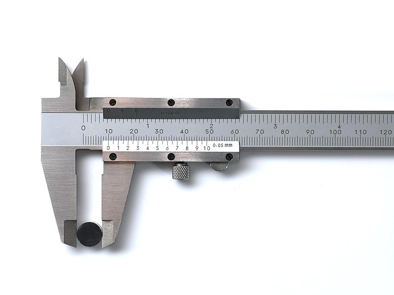{.myimg width="500"}

:::
::::::

### Las descripciones son mejores cuanto mejor es el instrumento de medida
\

:::::: {.columns}
::: {.column}

{.myimg width="500"}

:::
::: {.column}

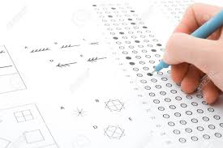{.myimg width="500"}

:::
::::::

## Reflexión 

\

<h3>
Qué pasaría si tuviésemos instrumentos **PERFECTOS**
</h3>

\

\

<h3>
Dónde dejaría eso a la **Psicología**
</h3>

\

\

<h3>
¿Son las **neurociencias** el final de la Psicología?
</h3>

<!-- ------------------------------------------- -->
## Qué es la Psicometría
\

<h3>
Es el conjunto de modelos técnicas y teorías que posibilitan la medición de variables psicológicas
</h3>

\

\
Posee múltiples áreas:

- Teoría de medición
- Teoría de los Test
- Escalamiento Psicológico
- Escalamiento Psicofísico
- Técnicas multivariadas

<!-- ------------------------------------------- -->
## Problemas que presenta la medición

\
\

### 1. No hay una única aproximación a la medida de un constructo

### 2. Las medidas psicológicas están basadas en muestras limitadas de conducta

### 3. La medida obtenida siempre tiene un error

### 4. Faltas de escalas con origen y unidades de medida bien definidos

### 5. Los constructos no pueden definirse en términos de definiciones operativas

\
\

<h3>
La Psicometría desarrolla métodos para minimizar estos problemas
</h3>

<!-- ------------------------------------------- -->

## Los test en Psicología y Educación

- Son imprescindibles en muchas tareas de estas disciplinas
- Su correcta utilización requiere de conocimientos específicos
- Su uso afecta a la vida de personas, a nivel profesional y personal
- El profesional debe potenciar las buenas prácticas en su uso
- Se debe conocer:
  - El proceso por el que se obtienen las puntuaciones
  - La información que proporcionan
  - **La información que no proporcionan**

<!-- ------------------------------------------- -->
## Los estándares en los test

:::::: {.columns}
::: {.column}

- En Psicometría son muy importantes los estándares
- Regulan la construcción, evaluación y utilización de los test
- Incorporan los nuevos conocimientos y definiciones
- Son gratuitos
- Los últimos son los de 2014 (traducción de 2018)
- Participan en su elaboración:
  - *American Educational Research Association*
  - *American Psychological Association*
  - *National Council on Measurement in Education*

:::
::: {.column}

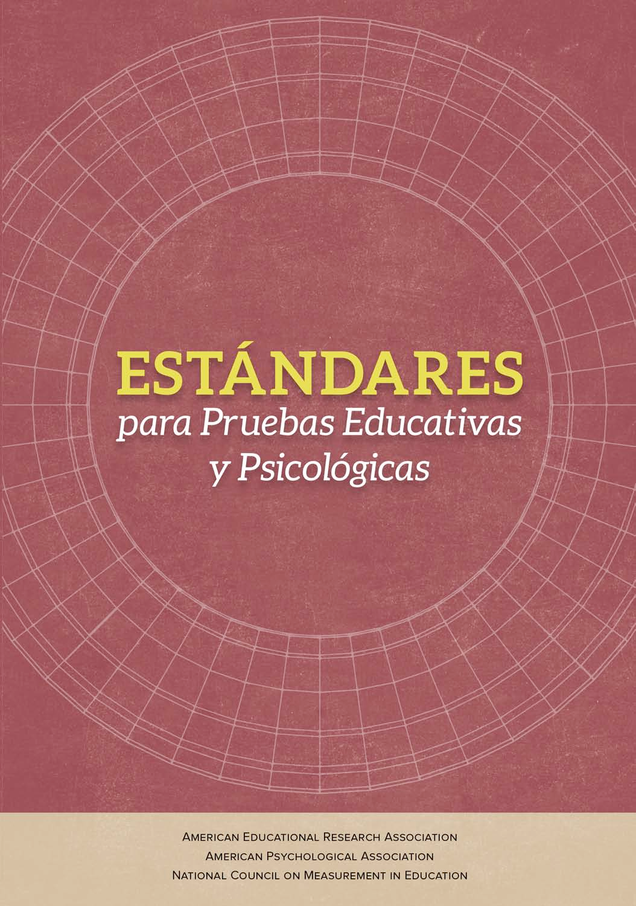{.myimg width="500"} 

:::
::::::

<!-- ------------------------------------------- -->
## Los test en el COP
\

El COP (Colegio Oficial de Psicólogos) tiene una comisión especial sobre test
\
\

<h3>
https://www.cop.es/index.php?page=objetivos-comision
</h3>

\
\

- Razonablemente activa
- Listados de test
- Tienen adaptaciones de los estándares internacionales
- Directrices para su uso
- Instrumentos de evaluación
- Informes de calidad

<!-- ------------------------------------------- -->
## Proceso de inferencia psicométrica
\

\

### Conceptos clave:
- Escalamiento
- Fiabilidad
- Validez

<!-- ------------------------------------------- -->
## Pregunta 
\
\
:::::: {.columns}
::: {.column}

<h3>
¿Un test puede ser no fiable y válido?
</h3>

:::
::: {.column}

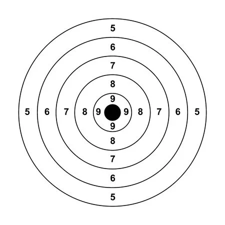

:::
::::::

<!-- ------------------------------------------- -->

## Concepto de test

### Definición

\

<h4 align="center">
Un test es un procedimiento de evaluación en el que se obtiene una muestra de la conducta de un examinado en un dominio especificado, que se evalúa posteriormente utilizando un procedimiento estandarizado 
</h4>

*Standards for Educational and Psychological Tests, AERA, APA y NCME, 2014*

\

\

### Características

- Es una muestra de la conducta
- Se evalúa un dominio específico (o rasgo o constructo)
- Hay una estandarización

<!-- ------------------------------------------- -->
## Concepto de constructo

Es Psicometría se utiliza habitualmente el término ***constructo***

\
\

<h3>
Características de la personalidad de una persona que no son directamente observables pero que se infieren a partir de la observación
</h3>

\

\

- Indica que puede ser solo una ***"construcción"*** del observador

- Por ejemplo: 
  - Le pasamos test de personalidad a GPT3 (o *Siri* o *Alexa*)
  - Acabarás asignándole propiedades de personalidad
  - Pero no las tiene

- Hoy en día se iguala al termino concepto o rasgo, como sinónimos

<!-- ------------------------------------------- -->

## Modelos utilizados en los test

:::::: {.columns}
::: {.column}

### TCT:

- **Teoría Clásica de los Test**
- *Spearman*, 1904
- Basada en los errores de medida y la puntuación verdadera
- Tiene problemas
- Es muy versátil
- Sigue siendo la más utilizada

:::
::: {.column}

### TG:

- **Teoría de la Generalizabilidad**
- Una extensión de la TCT
- Busca encontrar **Puntuaciones Universo**
- Es la unión de los Anova + Diseños experimentales + TCT
- Son puntuaciones independientes de algunos factores
- Hoy prácticamente en desuso

:::
::::::

### TRI:
- **Teoría de Respuesta al Ítem**
- Conceptualmente muy potente
- Conceptos más complejos
- Soluciona problemas de la TCT
- Muy utilizada a nivel académico pero poco aplicada

<!-- ------------------------------------------- -->
---

:::::: {.columns}
::: {.column}

  <h2>Clasificación de los Test</h2>

:::
::: {.column}

{.myimg .border  width="600"}

:::
::::::

<!-- ------------------------------------------- -->
## Clasificación de los test

\

### Por las consecuencias: 

- Altas consecuencias 
- Bajas consecuencias

\

### Planteamiento del problema:

- Respuesta seleccionada 
- Respuesta construida

\

### Área de comportamiento: 

- Cognitivos (ejecución máxima, aptitudes) 
- No cognitivos (personalidad, ejecución típica, actitudes)

<!-- ------------------------------------------- -->
## Clasificación de los test (*cont.*)

### Modalidad de aplicación: 

- Individuales ***vs*** colectivo 
- Oral ***vs***  lápiz y papel 
- Ordenador (computerizados)

\

### Demandas temporales: 

- Velocidad 
- Potencia

\

### Interpretación de las puntuaciones:

- Test referidos a norma (baremos) 
- Test referidos a criterio

<!-- ------------------------------------------- -->
## Clasificación de los test (*cont.*)

### Por el Método: 

- Test Psicométricos
- Test Proyectivos

\

 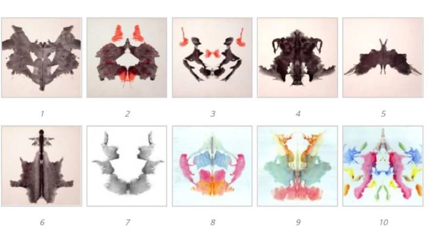 

<!-- ------------------------------------------- -->
## Clasificación de los test (*cont.*)

:::::: {.columns}
::: {.column}

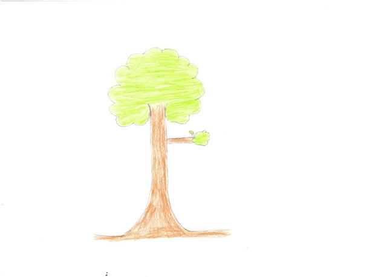

:::
::: {.column}

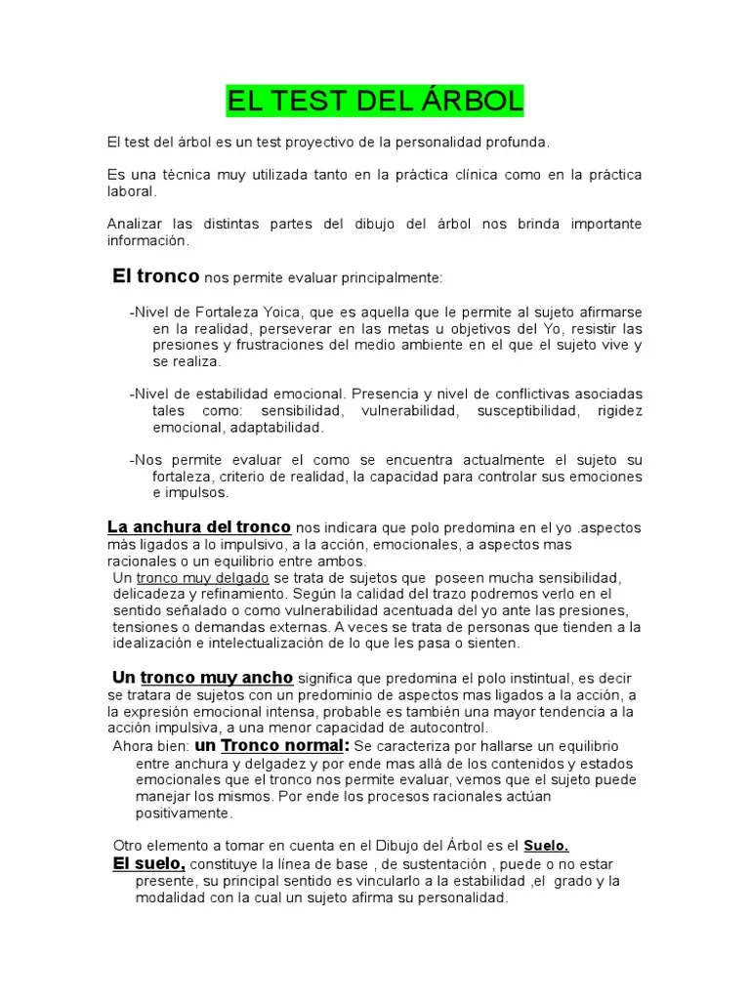{ width="600"}

:::
::::::

<!-- ------------------------------------------- -->
## Clasificación de los test (*cont.*)

 

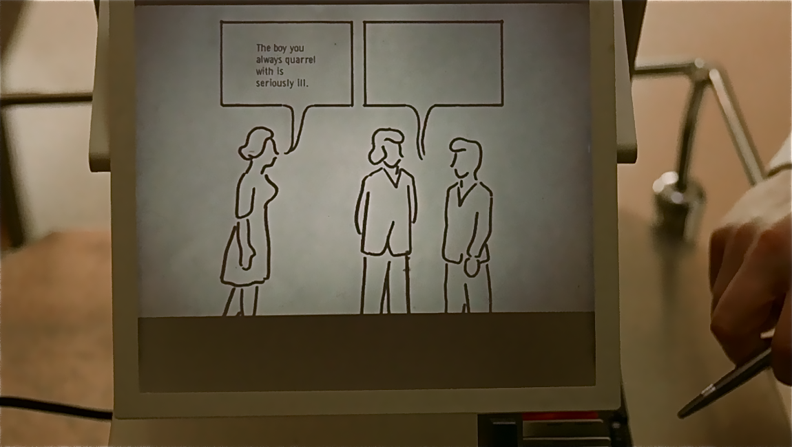{ width="500"} 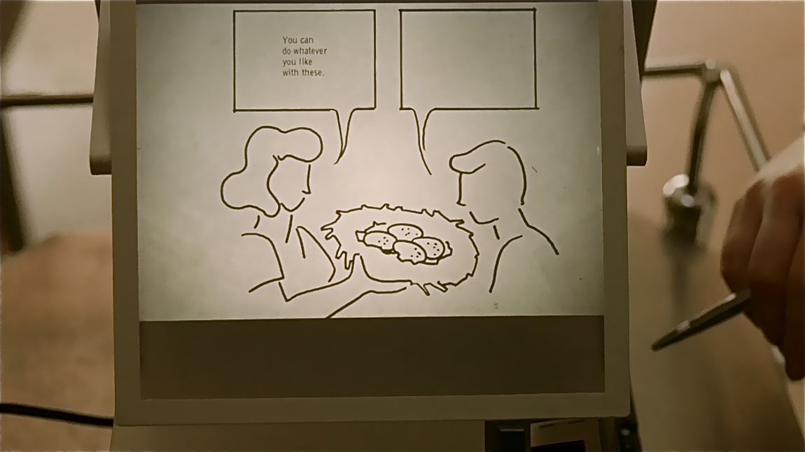{ width="500"}

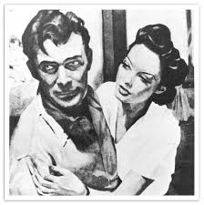{ width="400"} 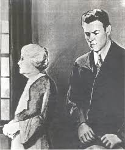{ width="400"} 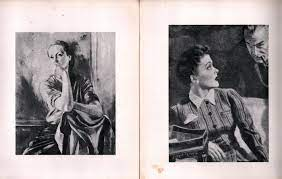{ width="400"}

<!-- ------------------------------------------- -->
## Clasificación de los test (*cont.*)

 
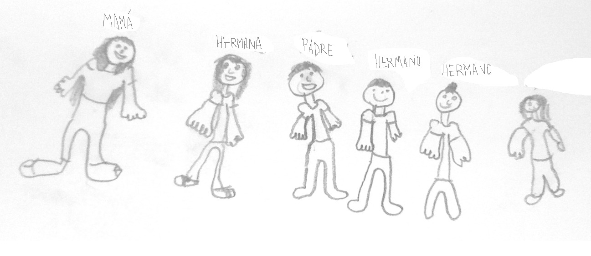{ width="400"}
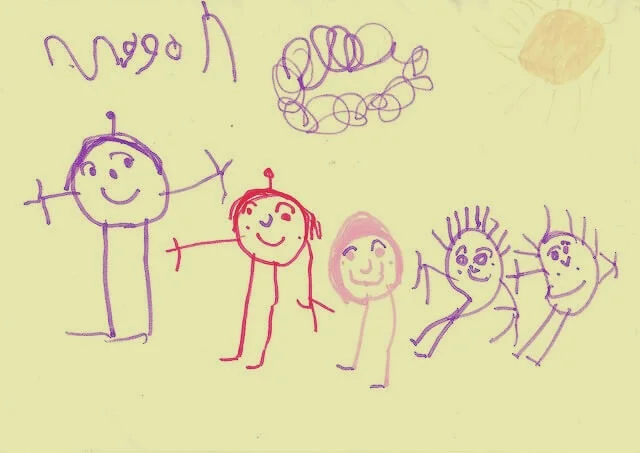{ width="400"}

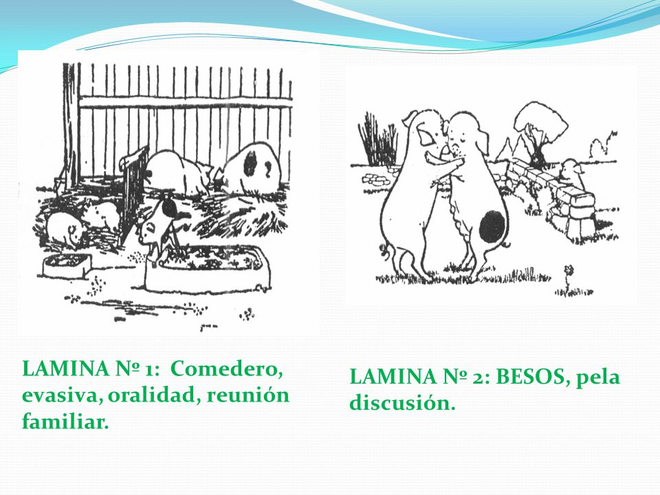{ width="800"}

<!-- ------------------------------------------- -->
## Clasificación de los test (*cont.*)

:::::: {.columns}
::: {.column}

### Psicométricos

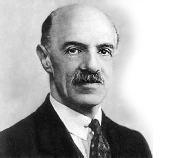{.myimg  width="300" height="300"}

- Respuesta cerrada
- Corrección numérica
- Corrección sencilla (mecanizada)
- Objetivos
- Personalidad Ortodoxa

:::
::: {.column}

### Proyectivos

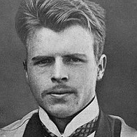{.myimg  width="300" height="300"}

- Respuesta abierta
- Corrección interpretada o categórica
- Corrección compleja 
- Subjetivos
- Personalidad Holística

:::
::::::

- La corrección de los proyectivos recuerda bastante a las *pseudociencias* como el horóscopo, la cábala o el tarot

- Poseen un conjunto de reglas pero son arbitrarias (parece que tienen sentido pero no tienen que ser ciertas)

<!-- ------------------------------------------- -->
## Clasificación de los test (*cont.*)
\
\

<h3>
¿Cuáles son mejores, los Psicométricos o los Proyectivos?
</h3>

\
\

<h3>
¿Cuáles utilizarías en tu trabajo diario?
</h3>

<!-- ------------------------------------------- -->
---

:::::: {.columns}
::: {.column}

  <h2>Polémicas con los Test </h2>

:::
::: {.column}

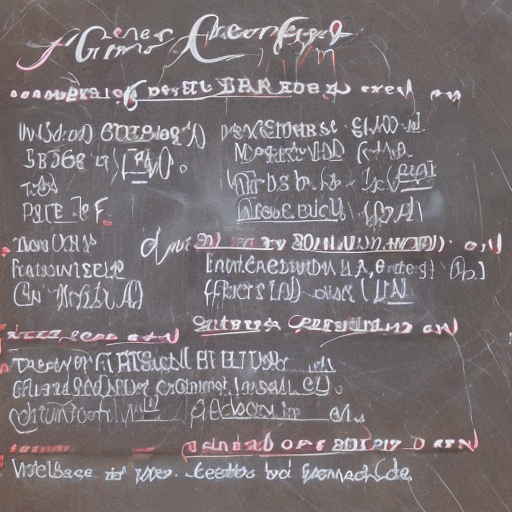{.myimg .border width="600"}

:::
::::::

<!-- ------------------------------------------- -->

## Polémicas con los test

 

:::::: {.columns}
::: {.column}

{.myimg width="400" height="400"}

:::
::: {.column}

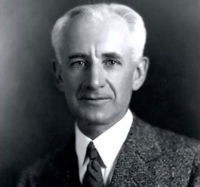{.myimg width="400" height="400"}

:::
::::::

- Primera guerra mundial
- Test Alpha y Beta del ejército americano (1917)
- Desarrollados por Robert Yerkes 
- Evaluaban las capacidades de los reclutas para ser asignados optimamente a puestos
- Se aplicaron a 1.750.000 reclutas
- Dos versiones:
  - Alfa: Para quienes no tuvieran problemas de lectura
  - Beta: Quienes no podían contestar al alpha
  

<!-- ------------------------------------------- -->
## Polémicas con los test (*cont.*)

:::::: {.columns}
::: {.column}

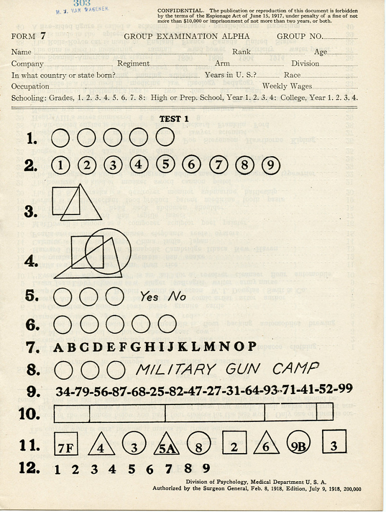{.myimg width="500"}

:::
::: {.column}

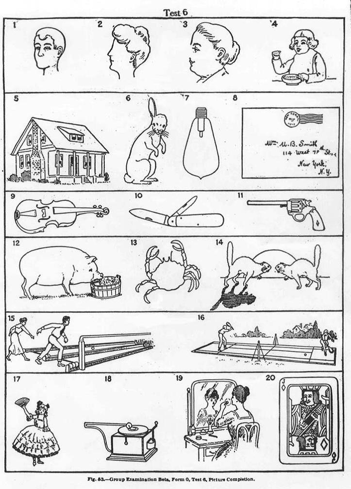{.myimg width="500"}

:::
::::::

\

Se puede ver un cuadernillo en esta dirección https://americanhistory.si.edu/collections/search/object/nmah_1213725

<!-- ------------------------------------------- -->
## Polémicas con los test (*cont.*)

Tres Conclusiones:
\
\

La edad mental de los blancos adultos norteamericanos se situó en 13 años, justo por encima del límite de la deficiencia mental. Muchos, a partir de este resultado lamentaron el hecho de la decadencia intelectual achacándolo a: reproducción incontrolada de los pobres y débiles mentales, difusión de la sangre negra, enturbiamiento de la estirpe nativa inteligente por la escoria que inmigraba desde el sur y el este de Europa

Los inmigrantes europeos pueden clasificarse según los países de origen. En muchas nacionalidades el hombre medio es dificiente. Personas de tez más oscura, procedentes del sur de europa son menos inteligentes que las de tez blanca. 

El negro, cuya edad mental es de 10,4 años se sitúa en el extremo inferior de la escala. Los negros fueron divididos en función de la intensidad del color considerándose inferiores intelectualmente a los más oscuros

<!-- ------------------------------------------- -->
## Polémicas con los test (*cont.*)

Aprovechan y pasan los test a diferentes colectivos, por ejemplo, de las prostitutas concluyen:

\
\
"*... de un 30 a 60 % eran débiles mentales y la mayoría deficientes profundas; y de un 15 a 25 tiene una inteligencia tan baja que lo más sensato sería recluirlas a perpetuidad (hasta donde permitan las leyes vigentes) en instituciones para débiles mentales*"

\

\

<h4>
Estos datos se utilizan para justificar el racismo, el hereditarismo, el determinismo biológico y la eugenesia
</h4>

\

\

Todo este episodio está increíblemente bien relatado en el capítulo 5 del libro "**La falsa medida del hombre**" de *Stephen J. Gould*

\

<h4>
Si la miseria de nuestros pobres no es causada por las leyes de la naturaleza, sino por nuestras instituciones, cuán grande es nuestro pecado.
</h4>

*Charles Darwin, El viaje del Beagle*

<!-- ------------------------------------------- -->
## Polémicas con los test (*cont.*)

No es la única polémica con los test:

- Siempre ha habido polémica con el concepto de inteligencia y su carácter hereditario

- Sistemáticamente aparecen poblaciones y colectivos con peor puntuaciones en inteligencia

- Los movimientos por los derechos humanos de los 60 obligan a una reflexión sobre estas cuestiones

\
Debate clásico entre dos posturas:

- El hereditarismo: da miedo porque "no te permite cambiar" y además se perpetua por las generaciones, pero podría ser cierto
- La “Tabla rasa” de Locke: garantiza la igualdad pero podría no ser cierta

\
El problema pueden ser tanto los datos que se obtienen como la interpretación que se hace de ellos

- Instrumentos muy sesgados hacia "hombres blancos de mediana edad y con estudios superiores"
- Interpretaciones muy sesgadas por el posicionamiento político o ideológico

\

<h4 align="center"> 
Por estas polémicas los estándares actuales introducen el concepto de **Equidad**
</h4>

<!-- ------------------------------------------- -->
## El verdadero problema de eugenesia

:::::: {.columns}
::: {.column}

### Vasili Arkhipov
{.myimg width="400"}

- Crisis de los misiles de cuba (1962)

:::
::: {.column}

### Stanislav Petrov
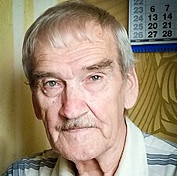{.myimg width="400"}

- Satélite de alerta temprana (1983)

:::
::::::

- [Enlace](https://www.microsiervos.com/archivo/mundoreal/vasili-arkhipov-otro-oficial-sovietico-que-probablemente-evito-una-guerra-nuclear.html)
- Aunque fuese moralmente aceptable
- ¿Qué seleccionar?
- Genética: 
  - Caracteres secundarios que salvan una especie (un humano por persona)
  - Amplia diversidad produce amplia adaptabilidad 

<!-- ------------------------------------------- -->
## Polémicas con los test (*cont.*)

Algunas cuestiones para reflexionar:

1. ¿Ciencia es igual a número y número es igual a ciencia?, ¿sólo se puede hacer ciencia con números?, ¿cualquier número es científico?, ¿qué deben cumplir los números para ser científicos?, ¿cómo deben obtenerse para ser ciencia?
1. ¿Qué es la eugenesia, el hereditarismo y el determinismo biológico?
1. ¿Por qué no es válida la explicación biologicista? (los más inteligentes deciden ir a la escuela). ¿Hay alguna forma de demostrar que esa afirmación es falsa?
1. Qué sabe la Psicología sobre la inteligencia innata, ¿eso existe?, ¿se puede medir la inteligencia innata? ¿cómo se podría concluir si la inteligencia es innata o depende de la experiencia, alguna sugerencia?
1. ¿Se puede ser imparcial en la ciencia o siempre estás sesgado por tus ideas?, ¿es eso frecuente en ciencia?, ¿cómo se puede controlar esto? ¿es imparcial Gould o también está sesgado en su crítica?
1. El trabajo de Yerkes ha sido especialmente útil para los psicólogos: inventa el tipo de test de lápiz y papel, inicio de la utilización en selección y empresas, expansión de la psicología. ¿Podemos extraer alguna lección positiva de todo esto?
1. ¿Hay diferencias entre usar el tamaño del cráneo y un test de personalidad para
seleccionar personas para un puesto? ¿Es eso eugenesia?
1. Por qué la tabla rasa, aunque fuese cierta, no garantiza la igualdad de oportunidades y la justicia

<!-- ------------------------------------------- -->
## Principios del modelo Psicométrico

\
\

### 1. Fiabilidad

### 2. Validez

### 3. Comparabilidad

### 4. Equidad

<!-- ------------------------------------------- -->

