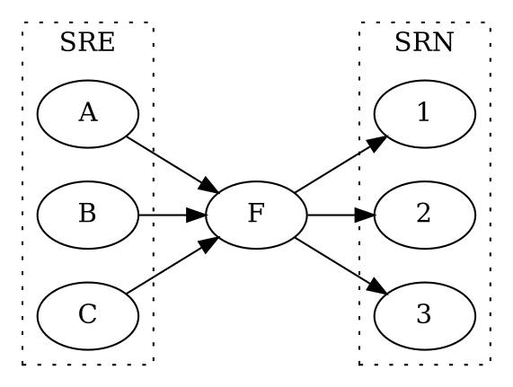
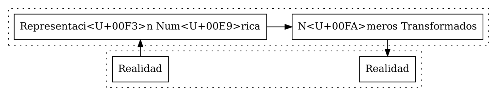
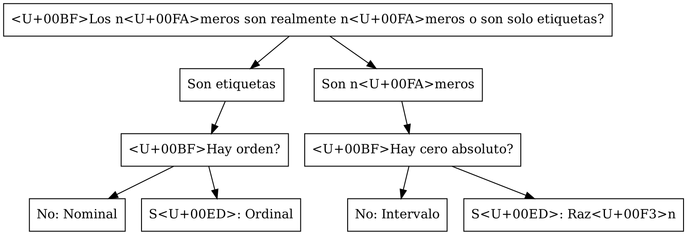

:::::: {.columns}
::: {.column}

  <h2>Teoría de la Medida</h2>

:::
::: {.column}

{.myimg .border width="600"}

:::
::::::

## Teoría de medida

- Tradicionalmente, fuera de la Psicología se ha dudado sobre la validez de las mediciones psicológicas

- Tanto en cuestiones de alto nivel (emociones, pensamientos, etc) como de bajo nivel (sensaciones)

- Incluso dentro de la propia Psicología (pe: *Psicoanálisis*)

Parece que los números que obtenemos en psicología no se comportan exactamente como números
\
Por ejemplo:

$$1 + 1 = 2$$
\

:::::: {.columns}
::: {.column}

#### Nivel alto (Emociones)

:::
::: {.column}

¿Te duele el doble si mueren tus dos padres que si muere solo uno?

:::
::::::
\

\

:::::: {.columns}
::: {.column}

#### Nivel medio (Cognición)

:::
::: {.column}

¿Dos personas contestando un test obtendrán el doble de CI?

:::
::::::
\

\

:::::: {.columns}
::: {.column}

#### Nivel bajo (Percepción)

:::
::: {.column}

¿Una bombilla de 80W se ve el doble de luminosa que una de 40W?

:::
::::::

<!-- ------------------------------------------- -->
## Cuatro momentos históricos interesantes:

### [*1901*] Teoría axiomática de Hölders
- Basada en el idealismo platónico
- *Medir es asignar números que representan magnitudes*
- Propiedad de la **concatenación**

\  

  
### [*1940*] Asociación Británica para el avance de la ciencia
- Dirigida por *Campbell*
- Se rechaza la posibilidad de medir incluso las sensaciones

\

### [*1946*] Artículo de **Stevens**
 - Publicado en *Science*
 - Se presentan las escalas de medida
 - *Medir es asignar números usando ciertas reglas*

  
<!-- ------------------------------------------- -->
## Cuatro momentos históricos interesantes (*cont.*)

### [*1979*] Congreso de Moscú para el avance de la ciencia
- Se evalúa la **Teoría Representacional**
- Se concluye que *justifica la medición de eventos mentales y se recomienda ser adoptada por todas las ciencias*
  

\
\

<h4>
Medir es conseguir una representación de **algún aspecto de la realidad** mediante sistemas numéricos
</h4>

\
\

- Justifica medir cualquier cosa, no solo magnitudes
- La clave es representar las relaciones entre los objetos
  
  
<!-- ------------------------------------------- -->
## Teoría Representacional

Supongamos tres pacientes agresivos (A, B y C), un test (F) y los números asignados por ese test (1, 2 y 3)

:::::: {.columns}
::: {.column}

:::
::: {.column}

- **SRE**: Sistema Relacional Empírico

- **SRN**: Sistema Relacional Numérico

- **F**: Es una regla o aplicación (nuestro test)

:::
::::::

Se cumple que:

$$A < B < C$$
$$1 < 2 < 3$$
\
**Homomorfismo**: Se dice que hay un homomorfismo cuando las relaciones que existen en el SRE se mantienen en el SRN

**Medir** es construir una F que sea homomórfica, es decir, que genere números que representen correctamente las relaciones entre los objetos

<!-- ------------------------------------------- -->
## Teoría Representacional (*cont.*)

Fíjate en los números 1, 2 y 3 que nos ha dado F y su relación con los pacientes

\

:::::: {.columns}
::: {.column}

$$1 < 2 < 3$$
$$A < B < C$$

Son homomórficos si los números quieren representar el "orden" de agresividad

:::
::: {.column}

$$1+2=3$$
$$A + B \neq C$$
No son homomórficos si los números quieren representar la "cantidad" de agresividad

:::
::::::

\
Esa es la clave de la Teoría de Stevens:

- ***F*** puede ser homomórfica para algunas relaciones pero no para otras

- Dependiendo de lo que sea capaz de representar F tenemos las famosas cuatro escalas de medida:

  - Razón
  - Intervalo
  - Ordinal 
  - Nominal

<!-- ------------------------------------------- -->
## Teoría Representacional (*cont.*)
\

<h3>
¿Por qué no medimos siempre en la escala de razón?
</h3>

\

Porque no podemos:

- La escala se determina por la interacción entre la naturaleza de la variable y la "calidad" de F

- Por ejemplo:

\

:::::: {.columns}
::: {.column}

El sexo/género, el lugar de nacimiento, etc son nominales, ya está, no se puede cambiar de escala

**El atributo no posee esas relaciones**

:::
::: {.column}

La Inteligencia podría ser de razón pero los test solo llegan a la de intervalo

**El atributo posee esas relaciones pero el instrumento de medida no es capaz de reflejarlas**

:::
::::::

<!-- ------------------------------------------- -->
## Transformaciones

Cualquier número se puede trasformar

:::::: {.columns}
::: {.column}

 
### Ordinal

$$A < B < C$$
$$1 < 2 < 3$$

$$\{1, 2, 3\} \rightarrow \{10, 25, 26\}$$
$$A < B < C$$
$$10<25<26$$

:::
::: {.column}

 
### Intervalo

$$A + B = C$$
$$1 + 2 = 3$$

$$\{1, 2, 3\} \rightarrow \{10, 25, 26\}$$
$$A + B = C$$
$$10+25\neq26$$

:::
::::::

\

- Dependiendo de la escala hay trasformaciones que se pueden hacer y otras no
- Si haces una transformación incorrecta acabas perdiendo el homomorfismo

<!-- ------------------------------------------- -->
## Transformaciones (cont.)

- Hacer cálculos es hacer transformaciones: sumar, multiplicar, calcular la media y otros estadísticos en realidad son transformaciones de la escala original

\
\

<h3>
Dependiendo de la escala hay estadísticos que se pueden calcular y otros que no
</h3>

<!-- ------------------------------------------- -->
## Qué ocurre si se pierde el homomorfismo

\
\

<h3>
Los números transformados no se pueden conectar con la realidad
</h3>

<!-- ------------------------------------------- -->

## Escalas de medida

Escala| Propiedad | Transformación|Estadísticos
|--|--|--|--|
Razón     |Distancias absolutas|$y=bx$| Media, varianza y derivados
Intervalo |Distancias relativas|$y=a+bx$| Media, varianza y derivados
Ordinal   |Ordenación |Monótonas crecientes| Mediana y derivados$^{2}$
Nominal   |Igualdad y desigualdad | Cualquiera que respete la igualdad/desigualdad| Moda y derivados$^{1}$

$^{1}$ Derivados: técnicas inferenciales basadas en esos estadísticos

$^{2}$ Estrictamente la mediana debería utilizarse en escalas de intervalo

- Derivados de la Moda: Muy pocos, $\chi^{2}$ y poco más

- Derivados de la Mediana: Logísticas ordinales y pocas cosas más 

- Derivados de la media y la varianza: **Casi toda la estadística**, las diferencias de medias, anovas, regresiones, etc.
\
\

<h3>
Es interesante conseguir el nivel de intervalo
</h3>

<!-- ------------------------------------------- -->
## Cómo distinguir la escala

\
\

\
La confusión suele producirse entre Ordinal e Intervalo
\
\
Por ejemplo:

- Estatus económico medido como ingresos (€/año): intervalo o razón
- Estatus económico medido como clase social (alta, media, baja): Ordinal

<!-- ------------------------------------------- -->
## Algunas cuestiones

- ¿La escala *Likert* es ordinal o de intervalo?
- ¿Los items dicotómicos (acierto/fallo), son de razón o nominal?
- ¿En qué escala están las magnitudes?
- ¿Se pueden calcular estadísticos de una escala inferior?
- ¿Se pueden calcular estadísticos de una escala superior?

\

<h3>
Los números no saben lo que son
</h3>

*Lord y Novick*

- En Psicometría se asume que los test miden en una escala de intervalo 
- Lo anterior es poco probable
- Posicionamiento utilitario de la Medición

