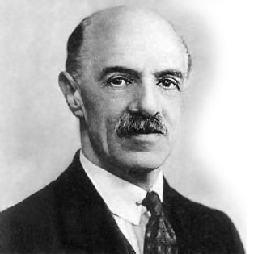
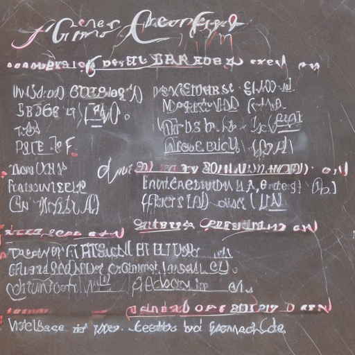
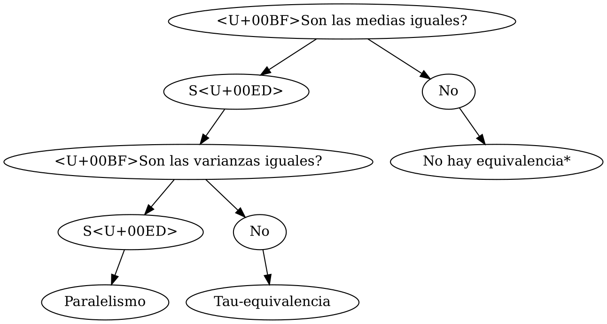

:::::: {.columns}
::: {.column}

<div class="jumbo">
  <h2>Teoría Clásica de los Test</h2>
</div>

:::
::: {.column}

{.myimg .border width="600"}

:::
::::::


<!-- ------------------------------------------- -->
## Introducción


:::::: {.columns}
::: {.column}

- Es un modelo de Puntuación Verdadera
- Busca corregir los errores de medida
- Formulado en 1904 por ***Spearman***
- Un tipo importante, la mitad de la estadística la inventó él (pe. el análisis factorial)

:::
::: {.column}

<center> 
{.myimg width="400"}
</center>

:::
::::::

\
\

- Está basada en supuestos:

  - Se establecen unos supuestos generales
  - De ellos se deducen unas conclusiones relevantes
  - Si los supuestos son ciertos las deducciones también deben serlo
  - Pero si no son ciertos las deducciones serán incorrectas

<!-- ------------------------------------------- -->
## Modelo


$$ X = V + E $$

- Donde:
  - $X$: Puntuación Empírica u observada
  - $V$: Puntuación Verdadera
  - $E$: Error

<hr>

- Es un modelo **intuitivo** e **indiscutible**

- Obviamente:

  - $E=X-V$
  - $V=X-E$


<!-- ------------------------------------------- -->
## Supuestos  

:::::: {.columns}
::: {.column}

<h2>1. $E(E)=0$</h2>

:::
::: {.column}

El valor esperado de los errores es 0

:::
::::::
<hr>


:::::: {.columns}
::: {.column}

<h2>2. $\rho_{EV}=0$</h2>

:::
::: {.column}

No hay correlación entre los errores y las puntuaciones verdaderas

:::
::::::
<hr>


:::::: {.columns}
::: {.column}

<h2>3. $\rho_{E_{1}E_{2}}=0$</h2>

:::
::: {.column}

No hay correlación entre los errores de dos test distintos (o dos partes diferentes del mismo test)

:::
::::::
<hr>


:::::: {.columns}
::: {.column}

<h2>4. $\rho_{E_{1}V_{2}}=0$</h2>

:::
::: {.column}

No hay correlación entre los errores y las puntuaciones verdaderas de dos test distintos (o dos partes diferentes del mismo test)

:::
::::::

\
\

- A priori parecen completamente razonables (y lo son)


<!-- ------------------------------------------- -->
## Resumiendo


Spearman establece dos grandes afirmaciones:

\

1. Los errores son aleatorios (y normales):

$$E(E)=0$$

$$\rho_{EV}=0$$

2. Los errores son independientes:

$$\rho_{E_{1}E_{2}}=0$$
$$\rho_{E_{1}V_{2}}=0$$

<!-- ------------------------------------------- -->
## ¿Es creíble el modelo?

- A medias
- Sobre todo problemas con el segundo supuesto $\rho_{EV}=0$

\
\
<div class="jumbo">
<h3>
La TCT es tan versátil y fácil de usar que compensa las *imperfecciones* del modelo
</h3>
</div>


<!-- ------------------------------------------- -->
## Deducciones del modelo


:::::: {.columns}
::: {.column}

$$E(x)=E(V)=\mu_{x}=\mu_{v}=V$$

:::
::: {.column}

Para un grupo: **La media de las empíricas es igual a la media de las verdaderas**

Para un único sujeto: La media empírica es igual a la puntuación verdadera

:::
::::::
<hr>


:::::: {.columns}
::: {.column}

$$\sigma_{EV}=0$$

:::
::: {.column}

La covarianza de los errores y las verdaderas es 0

:::
::::::
<hr>

:::::: {.columns}
::: {.column}

$$\sigma_{E_{1}E_{2}}=0$$


:::
::: {.column}

La covarianza entre entre los errores de dos test es 0

:::
::::::
<hr>

:::::: {.columns}
::: {.column}

$$\sigma_{XV}=\sigma_{V}^{2}$$


:::
::: {.column}

**La covarianza entre las empíricas y las verdaderas es la varianza verdadera**

:::
::::::

\
\


<!-- ------------------------------------------- -->
## Deducciones (*cont.*)

:::::: {.columns}
::: {.column}

$$\sigma_{X}^{2}=\sigma_{V}^{2}+\sigma_{E}^{2}$$

:::
::: {.column}

**La varianza empírica es igual a la varianza verdadera más la varianza error**

:::
::::::
<hr>


:::::: {.columns}
::: {.column}

$$ \rho_{XV}^{2}=\frac{\sigma_{V}^{2}}{\sigma_{X}^{2}}$$

:::
::: {.column}

**La correlación al cuadrado entre empíricas y verdaderas es la varianza verdadera entre la varianza empírica**

:::
::::::
<hr>


:::::: {.columns}
::: {.column}

$$\rho_{XE}^{2}=\frac{\sigma_{E}^{2}}{\sigma_{X}^{2}}$$

:::
::: {.column}

La correlación al cuadrado entre empíricas y errores es la varianza error entre la varianza empírica

:::
::::::
<hr>


:::::: {.columns}
::: {.column}

$$\rho_{XV}^{2}+\rho_{XE}^{2}=1$$

:::
::: {.column}

**La suma de las dos anteriores da 1**

:::
::::::


<!-- ------------------------------------------- -->
--- 
:::::: {.columns}
::: {.column}

<div class="jumbo">
  <h2>Paralelismo</h2>
</div>

:::
::: {.column}

{.myimg .border width="600"}

:::
::::::


<!-- ------------------------------------------- -->
## Paralelismo

### Definición
Dos test son paralelos si cumplen las siguientes condiciones:

:::::: {.columns}
::: {.column}

$$\left.\begin{matrix} X=V+E
\\ X'=V'+E'
\end{matrix}\right\} V=V'$$

:::
::: {.column}

$$\sigma_{E}^{2}=\sigma_{E'}^{2}$$

:::
::::::


### Consecuencias:

:::::: {.columns}
::: {.column}

  $$E(X)=E(X')=\mu_{x}=V$$

:::
::: {.column}

Las medias de los dos test son iguales

:::
::::::
<hr>

  
:::::: {.columns}
::: {.column}

$$\sigma_{X}^{2}=\sigma_{X'}^{2} \ \text{y} \ \sigma_{V}^{2}=\sigma_{V'}^{2}$$

:::
::: {.column}

Las varianzas empíricas y verdaderas son iguales

:::
::::::
<hr>


:::::: {.columns}
::: {.column}

$$\sigma_{XX'}=\sigma_{V}^{2}$$

:::
::: {.column}

Las covarianzas empíricas son la varianza verdadera

:::
::::::
<hr>


:::::: {.columns}
::: {.column}

$$\rho_{XX'}=\frac{\sigma_{V}^{2}}{\sigma_{X}^{2}}=\rho_{XV}^{2}$$

:::
::: {.column}

**La correlación entre empíricas es la fiabilidad**

:::
::::::


<!-- ------------------------------------------- -->
## Paralelismo (*cont.*)

:::::: {.columns}
::: {.column}

$$\sigma_{E}^{2}=\sigma_{X}^{2}(1-\rho_{XX'})$$

:::
::: {.column}

La varianza error se puede calcular como la varianza empírica por 1 menos la fiabilidad

:::
::::::
<hr>


:::::: {.columns}
::: {.column}

$$\sigma_{E}=\sigma_{X}\sqrt{1-\rho_{XX'}}$$

:::
::: {.column}

El **Error Tipico de Medida** (la desviación típica error) se puede calcular como la raiz de la anterior

:::
::::::
<hr>


:::::: {.columns}
::: {.column}

$$\rho_{X_{1}X_{2}}=\rho_{X_{1}X_{3}}=\dots= \rho_{X_{p-1}X_{p}}$$

:::
::: {.column}

Las correlaciones entre test paralelos son iguales

:::
::::::
<hr>

:::::: {.columns}
::: {.column}

$$\rho_{X_{1}Y}=\rho_{X_{2}Y}=\dots=\rho_{X_{p-1}Y}$$

:::
::: {.column}

Las correlaciones de test paralelos con un criterio externo (***y***) son iguales

:::
::::::


<!-- ------------------------------------------- -->
## Tau-equivalencia ($\tau$)

### Definición
Dos test son paralelos si cumplen las siguientes condiciones:

:::::: {.columns}
::: {.column}

$$\left.\begin{matrix} X=V+E
\\ X'=V'+E'
\end{matrix}\right\} V=V'$$

:::
::: {.column}

$$\sigma_{E}^{2}\neq\sigma_{E'}^{2}$$

:::
::::::


### Consecuencias:

:::::: {.columns}
::: {.column}

$$E(X)=E(X')=\mu_{x}=V$$

:::
::: {.column}

Las medias empíricas siguen siendo iguales

:::
::::::
<hr>

:::::: {.columns}
::: {.column}

$$\sigma_{V}^{2}=\sigma_{V'}^{2} \ \text{y} \ \sigma_{X}^{2}\neq\sigma_{X'}^{2}$$

:::
::: {.column}

Las varianzas verdaderas siguen siendo iguales **pero las empíricas no**

:::
::::::
<hr>

:::::: {.columns}
::: {.column}

$$\sigma_{XX'}=\sigma_{V}^{2}$$

:::
::: {.column}

La covarianza empírica sigue siendo la varianza verdadera

:::
::::::

<!-- ------------------------------------------- -->
## Tau-equivalencia (*cont*)

:::::: {.columns}
::: {.column}

$$\rho_{X_{1}X_{2}}\neq\rho_{X_{1}X_{3}}\neq\dots\neq\rho_{X_{p-1}X_{p}}$$

:::
::: {.column}

Las correlaciones entre los test Tau-equivalentes no son iguales

:::
::::::
<hr>

:::::: {.columns}
::: {.column}

$$\rho_{X_{1}Y}\neq\rho_{X_{2}Y}\neq\dots\neq\rho_{X_{p-1}Y}$$

:::
::: {.column}

Las correlaciones con un criterio externo tampoco son iguales

:::
::::::

<!-- ------------------------------------------- -->
## Otras equivalencias

Existen otras equivalencias entre test:

\

- Medidas esencialmente equivalentes o esencialmente tau-equivalentes
- Medidas linealmente equivalentes en puntuación verdadera o congenéricas
\
\

Pero no las vamos a estudiar


<!-- ------------------------------------------- -->
--- 

:::::: {.columns}
::: {.column}

<div class="jumbo">
  <h2>Evaluación empírica de las equivalencias</h2>
</div>

:::
::: {.column}

{.myimg .border width="600"}

:::
::::::


## Cómo conocer la equivalencia entre dos formas de un test

- Lo ideal sería comparar que:
$$V=V'$$
$$\sigma_{E}^{2}=\sigma_{E'}^{2}$$

- Tenemos que comparar cosas que sean empíricas:

  - Comparar las medias empíricas $\Rightarrow$ t de Student muestras relacionadas
  - Comparar las varianzas empíricas $\Rightarrow$ $F$ para la igualdad de varianzas
  
\

### Opcional: 

  - Si hay más de dos formas: mirar si las correlaciones entre ellos son iguales
  - Si hay un criterio externo: mirar si las correlaciones con él son iguales


<!-- ------------------------------------------- -->
## Regla de decisión

- La hemos simplificado para la clase

\

<center>
<div class="figure" style="text-align: center">

<p class="caption">plot of chunk unnamed-chunk-1</p>
</div>
</center>

\
\
[*] Podría haber algún tipo de equivalencia aunque las medias fuesen distintas (pe. formas congenéricas)


<!-- ------------------------------------------- -->
## Ejemplo de decisión


- Partimos de unos datos inventados (simulados con R) para el ejemplo:
  - x1: es la primera forma del test
  - x2: es la segunda forma del test (supuestamente paralela)
  - y: es una variable o criterio externa

\


```r
head(datos)
```

```
##   x1 x2   y
## 1 44 39 145
## 2 52 52 159
## 3 42 34 148
## 4 66 67 165
## 5 53 48 144
## 6 42 56 152
```

```r
summary(datos)
```

```
##        x1              x2              y        
##  Min.   :28.00   Min.   :23.00   Min.   :122.0  
##  1st Qu.:45.00   1st Qu.:42.75   1st Qu.:146.0  
##  Median :51.50   Median :52.00   Median :152.0  
##  Mean   :51.14   Mean   :50.81   Mean   :151.2  
##  3rd Qu.:57.00   3rd Qu.:59.00   3rd Qu.:157.0  
##  Max.   :74.00   Max.   :77.00   Max.   :178.0
```

<!-- ------------------------------------------- -->
## Diferencia de medias, muestras relacionadas con R


```r
t.test(datos$x1, datos$x2, paired=TRUE)
```

```
## 
## 	Paired t-test
## 
## data:  datos$x1 and datos$x2
## t = 0.42988, df = 99, p-value = 0.6682
## alternative hypothesis: true mean difference is not equal to 0
## 95 percent confidence interval:
##  -1.193207  1.853207
## sample estimates:
## mean difference 
##            0.33
```

<!-- ------------------------------------------- -->
## Igualdad de varianzas con R


```r
var.test(datos$x1, datos$x2)
```

```
## 
## 	F test to compare two variances
## 
## data:  datos$x1 and datos$x2
## F = 0.58518, num df = 99, denom df = 99, p-value = 0.008209
## alternative hypothesis: true ratio of variances is not equal to 1
## 95 percent confidence interval:
##  0.3937368 0.8697217
## sample estimates:
## ratio of variances 
##           0.585185
```

<!-- ------------------------------------------- -->
## Igualdad de correlaciones con R


```r
library(psych)

cor(datos$x1, datos$y)
```

```
## [1] 0.9080691
```

```r
cor(datos$x2, datos$y)
```

```
## [1] 0.6781416
```

```r
r.test(100, 0.9080691, 0.6781416)
```

```
## Correlation tests 
## Call:r.test(n = 100, r12 = 0.9080691, r34 = 0.6781416)
## Test of difference between two independent correlations 
##  z value 4.81    with probability  0
```
<hr>

\
Este test no sería exactamente correcto ya que las correlaciones no son independientes (x1 y x2 están relacionadas), sería más correcto usar la función *paired.r()* del paquete *psych*, pero no lo vamos a ver para simplificar

<!-- ------------------------------------------- -->
## Conclusión:

- Medias iguales: **Sí**
- Varianzas Iguales: **No**

\
\
<div class="jumbo">
<h3>
Son tau-equivalentes
</h3>
</div>

\
\

Además el contraste entre correlaciones confirma que no son paralelos


