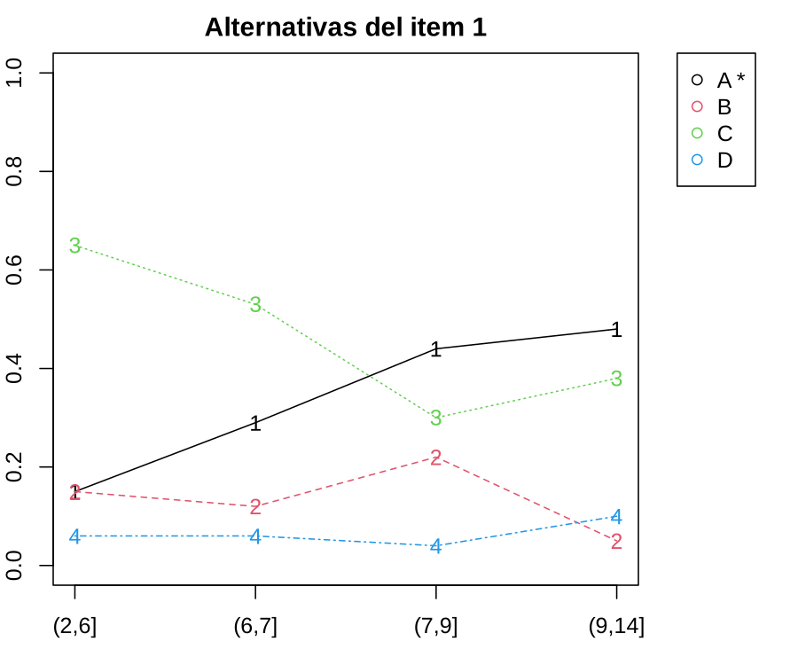

  


:::::: {.columns}
::: {.column}

<div class="jumbo">
  <h2>Construcción de Test</h2>
</div>

:::
::: {.column}

{.myimg .border width="600"}

:::
::::::


<!-- ------------------------------------------- -->
## Introducción

- Construir un test es costoso en esfuerzo y dinero
- Asegurarse de que va a ser útil (**Ojo doctorandos**)
- Seguir las recomendaciones de los estándares, AERA, APA y NCME (2014)
- Partir siempre de una buena teoría y un constructo bien definido
- Es necesaria experiencia previa
- Hay que diseñar un plan de validación 
- Diez fases en la construcción de un test (siguiendo a Muñiz, 2018)

<!-- ------------------------------------------- -->
## Fases en la construcción de un Test


### 1. Marco teórico

- Justificación y motivación
- Contexto de aplicación
- Uso e interpretación de las puntuaciones

\  
<hr>

  
### 2. Definición de la variable

- Definición operativa (cómo se va a medir)
- Elección de las conductas asociadas al atributo (y las que no)
- Cuidado con la sobrerrepresentación y la varianza irrelevante

\  
<hr>

### 3. Especificaciones

- Requerimientos de aplicación
- Tipo, número, longitud, formato, contenido y distribución de los ítems
- Especificaciones e instrucciones en la entrega del material, seguridad

<!-- ------------------------------------------- -->
## Fases en la construcción de un Test


### 4. Construcción de los items

- Es necesario construir muchos más items (2 a 3 veces)
- Tipos de Items
- Se ven a continuación

\  
<hr>

### 5. Edición

- Composición
- Edición
- Puntuación y corrección

\  
<hr>

### 6. Estudios Piloto

- Selección de la muestra piloto (cualitativo y cuantitativo)
- Análisis y resultados del estudio piloto (cualitativo y cuantitativo)
- Depuración, revisión, modificación o construcción de items

<!-- ------------------------------------------- -->
## Fases en la construcción de un Test

### 7. Selección de otros instrumentos de medida

- Justificación teórica
- Obtener evidencias de relación con variables externas
- Utilizar pruebas ya validadas

\  
<hr>

### 8. Aplicación del test

- Selección y tamaño de la muestra y tipo de muestreo
- Aplicación del instrumento de medida
- Control de calidad y seguridad de la base de datos

\  
<hr>

### 9. Propiedades Psicométricas

- Análisis de los ítems
- Fiabilidad
- Validez

<!-- ------------------------------------------- -->
## Fases en la construcción de un Test


### 10. versión final del test

- Informe
- Prueba final
- Manual


<!-- ------------------------------------------- -->
## Adaptación de un test

- No es solo traducirlo
- Hay permisos legales
- Evaluar que el constructo es relevante en la nueva cultura

- Se adaptan las diferencias lingüísticas, psicológicas y culturales pe: Halloween, Acción de gracias, etc.

- Los items deben tener un significado similar
- Ejemplos adaptados a la nueva cultura
- Evaluar si los items y las normas de aplicacion son adecuados

- Recoger muestra para el estudio y calcular las propiedades psicométricas y los baremos

- Determinar si los resultados son equivalentes a la versión original

\
<hr>
\

- https://www.cop.es/pdf/dtyatest.pdf


<!-- ------------------------------------------- -->
--- 


:::::: {.columns}
::: {.column}

<div class="jumbo">
  <h2>Análisis Convencional de los Items</h2>
</div>

:::
::: {.column}

{.myimg .border width="600"}

:::
::::::


<!-- ------------------------------------------- -->

## Índice de Dificultad ($ID_{j}$)

Definición: proporción de sujetos que aciertan un ítem


 $$ID_{j}=p_{j}=\frac{A}{N}$$

Donde:

- $p_{j}$: Es la proporción de aciertos del ítem j
- $A$: El número de aciertos del ítem j
- $N$: El número de intentos del ítem j

- Toma valores en [0, 1]
- Ojo: Es un índice invertido

- No tiene mucho sentido en:
  - El test es de velocidad: Saldría todos 1
  - El test es de personalidad: Se puede interpretar como comunalidad o tendencia grupal
  - El ítem no es dicotómico: En ese caso se puede calcular la media del ítem

<hr>

La media del test se puede calcular a partir de ellos

$$\mu_{X}=\sum_{j=1}^{n} ID_{j}$$

    
<!-- ------------------------------------------- -->
## Índice de Dificultad Corregido  ($IDc_{j}$)

El Índice anterior no tiene en cuenta los aciertos la azar

 $$IDc_{j}=\frac{A-\frac{F}{k-1}}{N}$$
 
Donde:

- $A$: El número de aciertos del ítem j
- $N$: El número de intentos del ítem j
- $F$: El número de fallos del ítem j
- $k$: El número de alternativas del ítem j

\

Fíjate que si quitamos el denominador (el promedio para todos los sujetos) es la fórmula que se utiliza para la corrección de exámenes:


$$Nota=A-\frac{F}{k-1}$$

Cuando el número de alternativas el elevado (mayor o igual a 5) es opcional quitar la penalización


<!-- ------------------------------------------- -->
## Ejercicio

Calcula el índice de dificultad de los items del siguiente test:

\

|   | 1 | 2 | 3 | 4 |
| - | - | - | - | - |
| A | 0 | 1 | 1 | 1 |
| B | 1 | 0 | 1 | 0 |
| C | 1 | 1 | 0 | 0 |
| D | 1 | 1 | 1 | 1 |
| E | 0 | 1 | 0 | 0 |

<!-- ------------------------------------------- -->
## Índice de Discriminación ($\rho_{jX}$)


Un ítem tiene poder de discriminación si es capaz de diferenciar a los que van a sacar una alta puntuación en el test de los que van a sacar una baja puntuación


$$\rho_{jX}=\frac{\mu_{p}-\mu_{x}}{\sigma_{X}}\sqrt{\frac{p_{j}}{q_{j}}}$$

Es la correlación que existe entre un ítem y la puntuación empírica total

\
<hr>
\

<center>

|Ítem|Test|Correlación|
|:---|---:|----:|
continuo|continuo|Pearson
dicotómico|continuo|Biserial-puntual
dicotomizado|continuo|Biserial
dicotómico|dicotómico|Phi
dicotomizado|dicotomizado|Tetracórica

</center>


## Correlación Biserial-puntual $\rho_{bp}$

Ítem dicotómico y test continuo

  $$\rho_{jX}\rightarrow\rho_{bp}=\frac{\mu_{p}-\mu_{x}}{\sigma_{X}}\sqrt{\frac{p_{j}}{q_{j}}}$$


Donde:

- $\mu_{p}$: Media en el test de los sujetos que aciertan el ítem
- $\mu_{X}$: Media del test
- $\sigma_{X}$: Desviación Típica del test
- $p_{j}$: Proporción de aciertos (el $ID_{j}$)
- $q_{j}$: Proporción de fallos (el $q_{j}=1-p_{j}$)

<hr>

Cuidado con la sobreestimación por solapamiento

<hr>

Calcular $\rho_{3X}$

## Correlación Biserial ($\rho_{b}$)

Ítem dicotomizado y test continuo

$$\rho_{jX}\rightarrow\rho_{b}=\frac{\mu_{p}-\mu_{x}}{\sigma_{X}}\frac{p_{j}}{y_{j}}$$
Donde:

- $y_{j}$: la ordenada en la normal estandarizada para la típica asociada al valor $p_{j}$ del ítem

- Calculas $p_{j}$ pe: $p_{j}=0.9$
- Buscas en la normal una probabilidad de 0.9 y ves qué típica le corresponde, pe: $p(0.9) \Rightarrow Z=1.28$
- Utilizas la fórmula de la normal:

$$\varphi(z)=\frac{1}{\sqrt{2\pi}}e^{\frac{-z^{2}}{2}}$$

- Obtienes un valor de $y_{j}=0.175$

<hr>


```r
p=0.9                       # Probabilidad a buscar
z = qnorm(p)                # Convertida a típica
y=1/sqrt(2*pi)*exp(-z^2/2)  # Su altura en la normal
y
```

```
## [1] 0.1754983
```

<!-- ------------------------------------------- -->
## Otros índices

\

### Índice de Fiabilidad del ítem:

$$IF_{j}=\sigma_{j}\rho_{jX}$$

\
<hr>
\

### Índice de Validez del ítem:

$$IV_{j}=\sigma_{j}\rho_{jY}$$

Donde: 

- $Y$ es un criterio externo al test 
- $\rho_{jY}$ se calcula con la correlación que corresponda


<!-- ------------------------------------------- -->
## Análisis de las alternativas del ítem

- Se puede analizar visualmente el comportamiento de las alternativas de cada ítem
- Nos indica si está bien construido

<hr>
- Calculamos la puntuación empírica x
- Partimos esa x en varios grupos (4 o 5, normalmente los cuartiles) 
- Clasificamos a los sujetos en cada grupo
- Para cada ítem creamos una tabla de grupo x alternativas

<hr>

:::::: {.columns}
::: {.column}


```
##      
##       (2,6] (6,7] (7,9] (9,14]
##   A *  0.15  0.29  0.44   0.48
##   B    0.15  0.12  0.22   0.05
##   C    0.65  0.53  0.30   0.38
##   D    0.06  0.06  0.04   0.10
```


:::
::: {.column}

<div class="figure" style="text-align: center">

<p class="caption">plot of chunk unnamed-chunk-3</p>
</div>


:::
::::::


