:::::: {.columns}
::: {.column}

<div class="jumbo">
  <h2>Validez: Estructura interna</h2>
</div>

:::
::: {.column}

{.myimg .border width="600"}

:::
::::::

---


- Son técnicas para comprobar la estructura interna de un test

- Lo que hacen es analizar las relaciones entre los items para ver si es coherente con la teoría

- Hay muchas técnicas:

  - Análisis factorial exploratorio (AFE)
  - Análisis factorial confirmatorio (AFC)
  - Las ecuaciones Estructurales (SEM)


<!-- ------------------------------------------- -->
## Antes de empezar

\


:::::: {.columns}
::: {.column}

### Principio de parsimonia o simplicidad

:::
::: {.column}


<center>  {.myimg height="200"} </center>


:::
::::::
\
<hr>
\

:::::: {.columns}
::: {.column}

### La varianza es información

:::
::: {.column}


<center> 

x|y
:--:|:--:
1|4
24|4
5|4
16|4
3|4
</center>


:::
::::::

<!-- ------------------------------------------- -->
## Antes de empezar (*cont.*)

\

:::::: {.columns}
::: {.column}

### Los datos pueden ser redundantes

:::
::: {.column}

<center> 

x|y
:--:|:--:
1|2
6|12
5|10
9|18
3|6
</center>


:::
::::::

\
<hr>
\

:::::: {.columns}
::: {.column}

### Perder variables no es perder información (o sí)

:::
::: {.column}


<center>

x|y
:--:|:--:
1|3
6|15
5|10
9|17
3|6
</center>

:::
::::::


<!-- ------------------------------------------- -->
## Antes de empezar (*cont.*)


### La técnica más antigua, los componentes principales (ACP)


:::::: {.columns}
::: {.column}


<center>

<div class="figure">
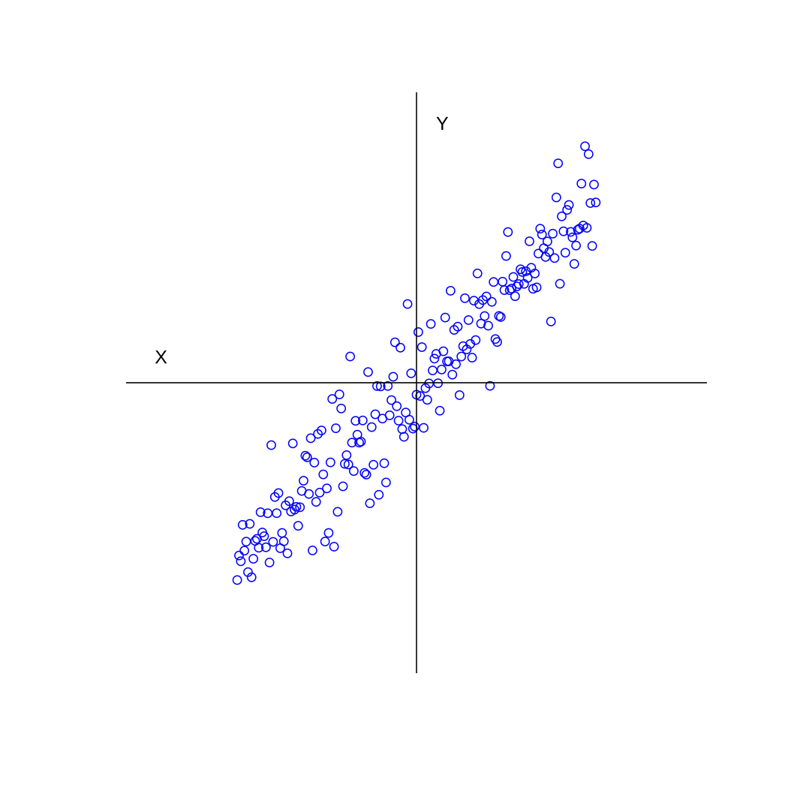{width=600px}
<p class="caption">plot of chunk unnamed-chunk-1</p>
</div>

|
:--:|:--:
Var X:| Alta (50%)
Var Y:| Alta (50%)

</center>


:::
::: {.column}


<center>
<div class="figure">
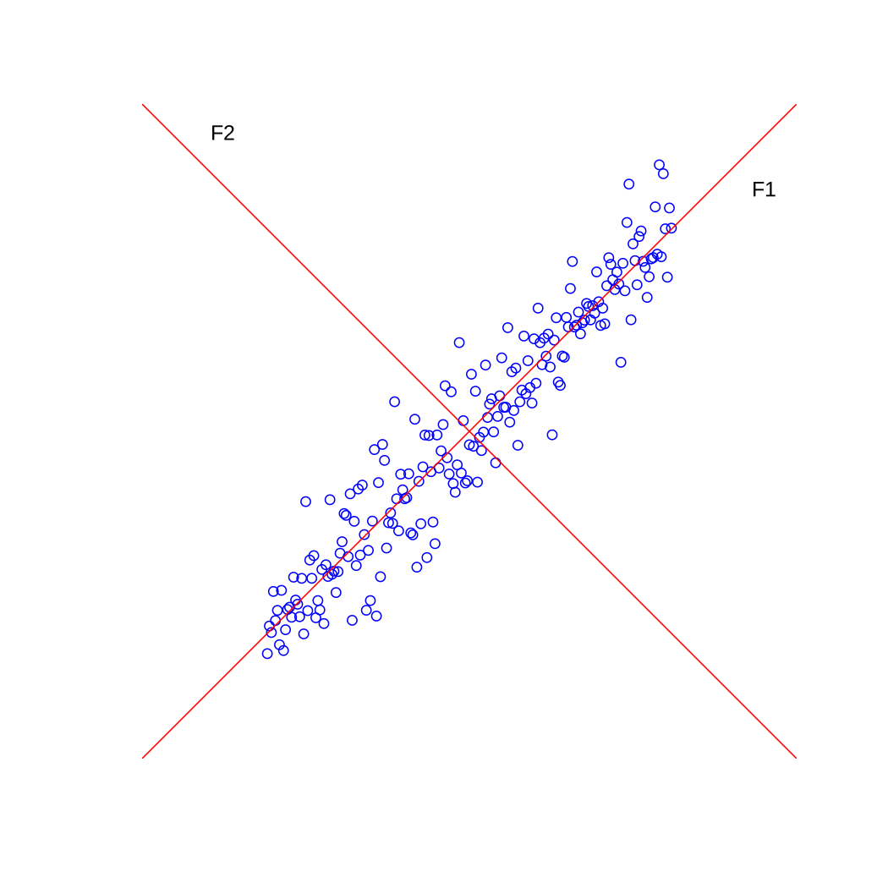{width=600px}
<p class="caption">plot of chunk unnamed-chunk-2</p>
</div>


|
:--:|:--:
Var F1:| MUY ALTA (90%)
Var F2:| MUY BAJA (10%)


</center>


:::
::::::

\
<hr>
\

### ¿Qué es F1 y F2?


<!-- ------------------------------------------- -->
---


:::::: {.columns}
::: {.column}

<div class="jumbo">
  <h2>Análisis Factorial</h2>
</div>

:::
::: {.column}

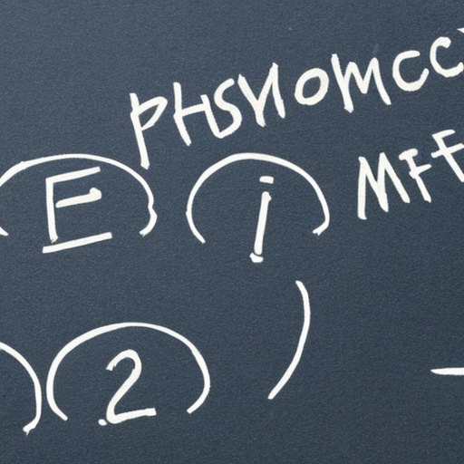{.myimg .border width="600"}

:::
::::::


<!-- ------------------------------------------- -->
## AFE

- Técnica multivariada de reducción de dimensinalidad
- Iniciado por *Spearman*
- Una de las técnicas más potentes y utilizadas en Psicología
- Su uso tiene cierta polémica

\

- Nunca falta en las evidencias de validez de un test
- Existe multitud de software para hacerlo pero R ofrece un enfoque más moderno y potente

\

- Se puede aplicar a cualquier variable 
- En Psicometría las variables de entrada son las respuestas de lo sujetos a los items


<!-- ------------------------------------------- -->
---

- Es como una regresión pero el nivel de análisis no son los sujetos sino las correlaciones entre las variables
- Se inicia introduciendo las matrices de correlaciones de los items

\
<hr>


<center>

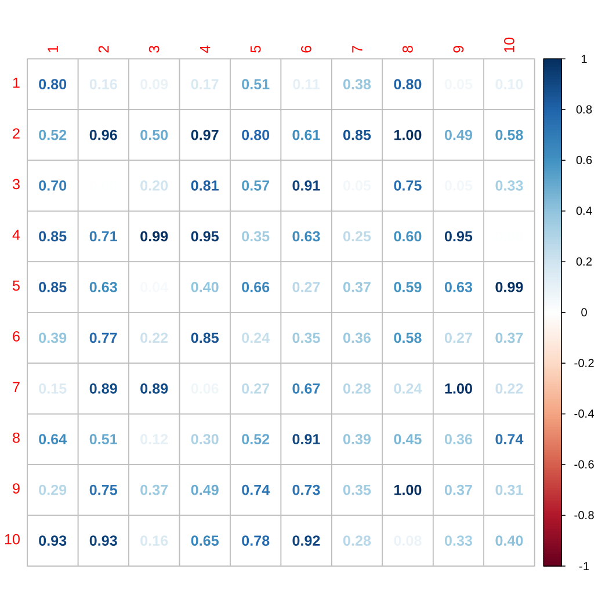
</center>

<!-- ------------------------------------------- -->
--- 

\
\

<center>
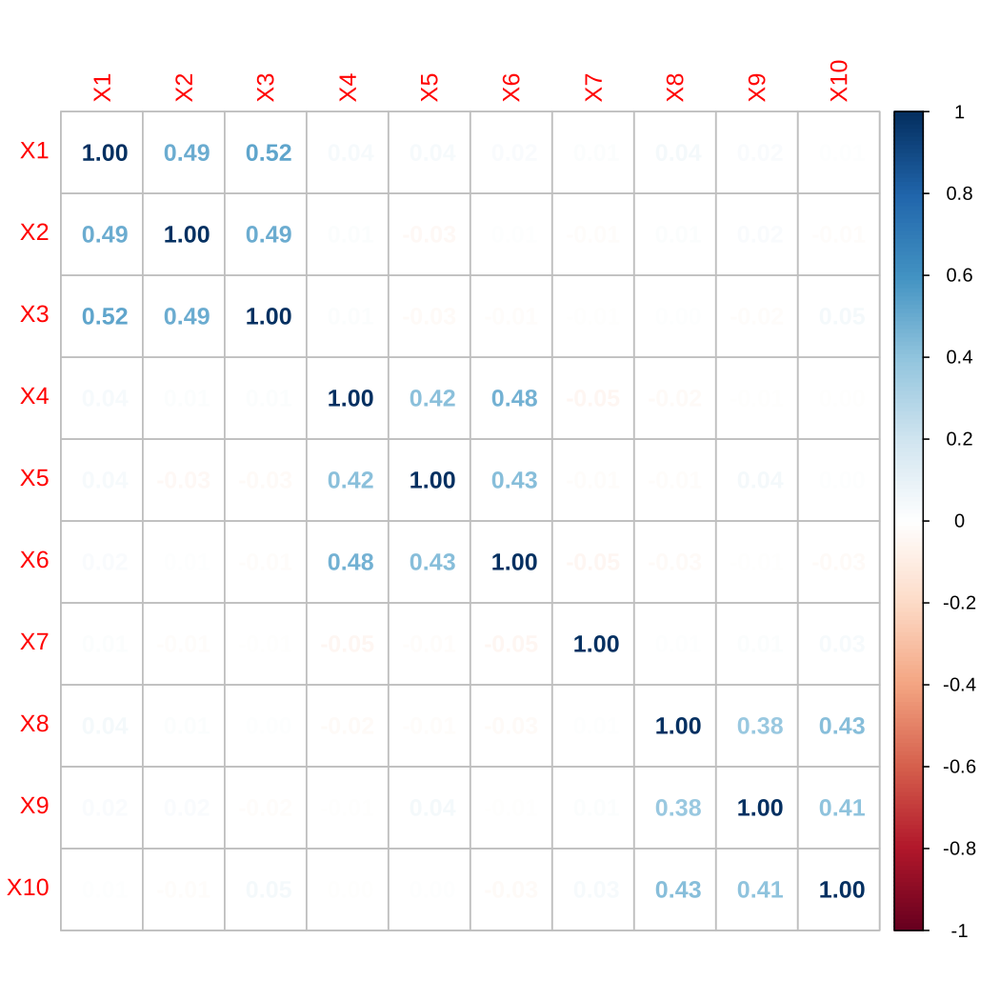
</center>


<!-- ------------------------------------------- -->
## modelo AFE

<center>
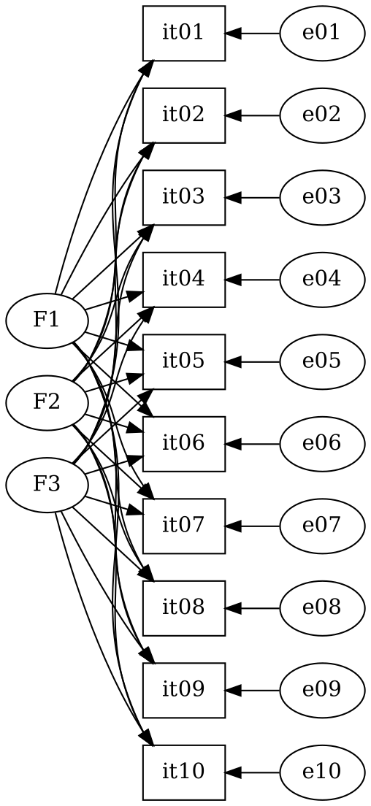
</center>


<!-- ------------------------------------------- -->
## Ecuación

$$x_{1}=\alpha_{11}F_{1}+\alpha_{21}F_{2}+\dots+\alpha_{j1}F_{j}+u_{1}$$
$$x_{2}=\alpha_{12}F_{1}+\alpha_{22}F_{2}+\dots+\alpha_{j2}F_{j}+u_{2}$$
$$\dots$$
$$x_{i}=\alpha_{1i}F_{1}+\alpha_{2i}F_{2}+\dots+\alpha_{ji}F_{j}+u_{i}$$
\
Donde:

:::::: {.columns}
::: {.column}

$i = 1 \dots n$ (items)

$j = 1 \dots n$ (items)

$x_{i}$: Puntuación (**estandarizada**) para ítem i

$\alpha_{ji}$: influencia del factor j sobre el ítem i


:::
::: {.column}

$F_{j}$: Valor del factor j

$u_{i}$: unicidad o error de j


:::
::::::


<hr>

- Hay tantas ecuaciones como items (variables)
- Cada ecuación contiene tantos términos como factores
- Todas incluyen el término error (**e**) o unicidad (**u**), son sinónimos

<!-- ------------------------------------------- -->
--- 

Matricialmente lo podemos escribir como:

\

$$x=AF+U$$

\
\

$$\begin{pmatrix}x_{1}\\x_{2}\\ \dots\\ x_{i} \end{pmatrix} = \ 
\begin{pmatrix} \
\alpha_{11}&\alpha_{21}&\dots&\alpha_{j1}\\ \ \alpha_{12}&\alpha_{22}&\dots&\alpha_{j2}\\ \dots&\dots&\dots&\dots&\\ \ \alpha_{1i}&\alpha_{2i}&\dots&\alpha_{ji}\\ \end{pmatrix} \
\
\begin{pmatrix}F_{1}\\ F_{2}\\ \dots\\ F_{j} \end{pmatrix} \ +\begin{pmatrix}u_{1}\\ u_{2}\\ \dots\\ u_{i}\end{pmatrix}$$


<!-- ------------------------------------------- -->
## Propiedades

\

:::::: {.columns}
::: {.column}

### Varianzas de las variables


:::
::: {.column}

$$Var(X_{i})=\alpha_{i1}^{2}+\alpha_{i2}^{2}+\dots+\alpha_{ij}^{2}+u_{i}^{2}=1$$


:::
::::::
<hr>

:::::: {.columns}
::: {.column}

### Comunalidad

:::
::: {.column}

$$h_{i}^{2}=\alpha_{i1}^{2}+\alpha_{i2}^{2}+\dots+\alpha_{ij}^{2}=\sum_{j}\alpha_{ij}^{2}$$

:::
::::::
<hr>

:::::: {.columns}
::: {.column}

### Unicidad

:::
::: {.column}

$$u_{i}^{2}=1-h_{i}^{2}$$

:::
::::::
<hr>


:::::: {.columns}
::: {.column}

### Correlación entre dos variables

:::
::: {.column}

$$\rho_{im}=\sum_{j}\alpha_{ij}\alpha_{mj}$$

:::
::::::


<!-- ------------------------------------------- -->
--- 

### Si el modelo es cierto, entonces:

\

La matriz de correlaciones (R) entre las variables se puede reproducir como 

$$R=AA'+U$$

R es una matriz cuya diagonal contiene las varianzas de los items (1) y fuera de ella las correlaciones

\
\

Es más útil estimar R*


$$R^{*}=AA'$$

R* tiene en la diagonal las comunalidades de las variables y fuera de ellas las correlaciones

\
<hr>
\

:::::: {.columns}
::: {.column}


<center>
### R 
</center>


$$
\begin{pmatrix}
 1& \rho_{11} & \rho_{12}\\ 
\rho_{11}&  1& \rho_{22}\\ 
\rho_{21} &  \rho_{22}& 1
\end{pmatrix}
$$


:::
::: {.column}

<center>
### R* 
</center>

$$
\begin{pmatrix}
 h_{1}^{2}& \rho_{11} & \rho_{12}\\ 
\rho_{11}&  h_{2}^{2}& \rho_{22}\\ 
\rho_{21} &  \rho_{22}& h_{3}^{2}
\end{pmatrix}
$$


:::
::::::


<!-- ------------------------------------------- -->
## Objetivo


\
Las correlaciones dependen de A (los pesos)
$$R^{*}=AA'$$

### Objetivo
\
Encontrar una matriz A que sea óptima en algún sentido, es decir:

- Que reproduzca lo mejor posible R o R*
- Que maximice las varianzas de los factores
- Que tengamos el mínimo número de factores
- etc.

\
\

Cada método de encontrar A tiene un objetivo diferente y por tanto unas ventajas y unos inconvenientes


<!-- ------------------------------------------- -->
## Procedimiento con Software estadístico

\
\

1. Introducción de datos
1. Extracción de factores
1. Elección del número de factores
1. Rotación de los factores
1. Indicadores de calidad
1. Interpretación


<!-- <!-- ------------------------------------------- -->
<!-- ## Antes de empezar dos cosas fundamentales -->
<!-- - Entender un grafico scree -->
<!-- - Interpretar una tabla de saturaciones -->


<!-- ------------------------------------------- -->
## 1. Introducción de datos

\

- Se puede calcular desde los datos RAW o ya calculadas las matrices de covarianzas o correlaciones


- Normalmente los metes raw y el programa te calcula las correlaciones

\
\

:::::: {.columns}
::: {.column}

<center>
### En formato RAW

\

Sj|$It_{1}$|$It_{2}$|$It_{3}$|...|$It_{i}$
-|-|-|-|-|-|
1|3|7|5|...|$x_{1i}$
2|4|5|2|...|$x_{2i}$
3|1|1|5|...|$x_{3i}$
...|...|...|...|...|...
n|3|2|5|...|$x_{ni}$


</center>


:::
::: {.column}

<center>
### En Correlaciones

\


Sj|$It_{1}$|$It_{2}$|$It_{3}$|...|$It_{i}$
-|-|-|-|-|-|
$It_{1}$|1.0|0.5|0.2|...|$\rho_{1i}$
$It_{2}$|0.5|1.0|0.7|...|$\rho_{2i}$
$It_{3}$|0.2|0.7|1|...|$\rho_{3i}$
...|...|...|...|...|...
$It_{i}$|$\rho_{i1}$|$\rho_{i2}$|$\rho_{i2}$|...|$x_{ii}$


</center>

:::
::::::

\
<hr>
\

El ejemplo está calculado con la función *fa* del paquete *psych*


<!-- ------------------------------------------- -->
## 2. Extración de los factores

- Elegimos un método para estimar las matrices
- Se construyen los factores

\

### Los nuevos factores tienen las siguientes características:

- Hay tantos como variables originales (F, A y R tienen la misma dimensión)
- Son autovectores
- Tienen un autovalor asociado 
- Ese autovalor indica cómo de explicativo es el factor
- Los autovalores están ordenados de mayor a menor
- Cada factor explica un porcentaje de la varianza de los datos
  
\
\

<center> 

F1|F2|F3|F4
-|-|-|-
50%|30%|20%|10%
</center>

<!-- ------------------------------------------- -->
## Métodos de estimación


Distintos métodos ofrecen distintas soluciones:

\

1. **Ejes principales**: Maximiza la comunalidad de las variables, requiere estimar previamente las comunalidades de las variables. Es uno de los métodos más empleado

1. **Componentes principales**: Reproducen R y no R*, pone las comunalidades a 1

1. **Imagen**: como ejes principales pero usando regresiones para estimar las comunalidades iniciales

1. **Alpha**: Optimizan la consistencia interna (alpha) del test (se busca aquella estructura que de más alfa)

1. **Residuos mínimos**: No necesita inicializar las comunalidades, está basado en  mínimos cuadrados como la regresión y busca reducir las diferencias entre R y la matriz de correlaciones original

1. **Máxima verosimilitud**: No es una Máxima Verosimilitud real como se verá en el tema de la TRI, considera que los datos provienen de una muestra en vez de una población


<!-- ------------------------------------------- -->
## Número de factores a retener


### Métodos clásicos

- Regla de Kaiser: autovalores mayores de 1
- Un porcentaje de varianza explicada (60%, 70%)
- Una discontinuidad en el Scree plot (gráfico de sedimentación)

<center> 

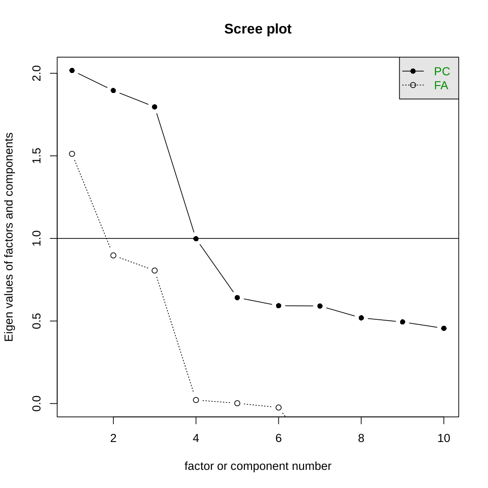
</center>

<!-- ------------------------------------------- -->
## Número de factores a retener


### Parallel 

- Es un algoritmo
- Compara los autovalores extraídos con los datos con muestras aleatorias

<center> 


```r
fa.parallel(mat)
```

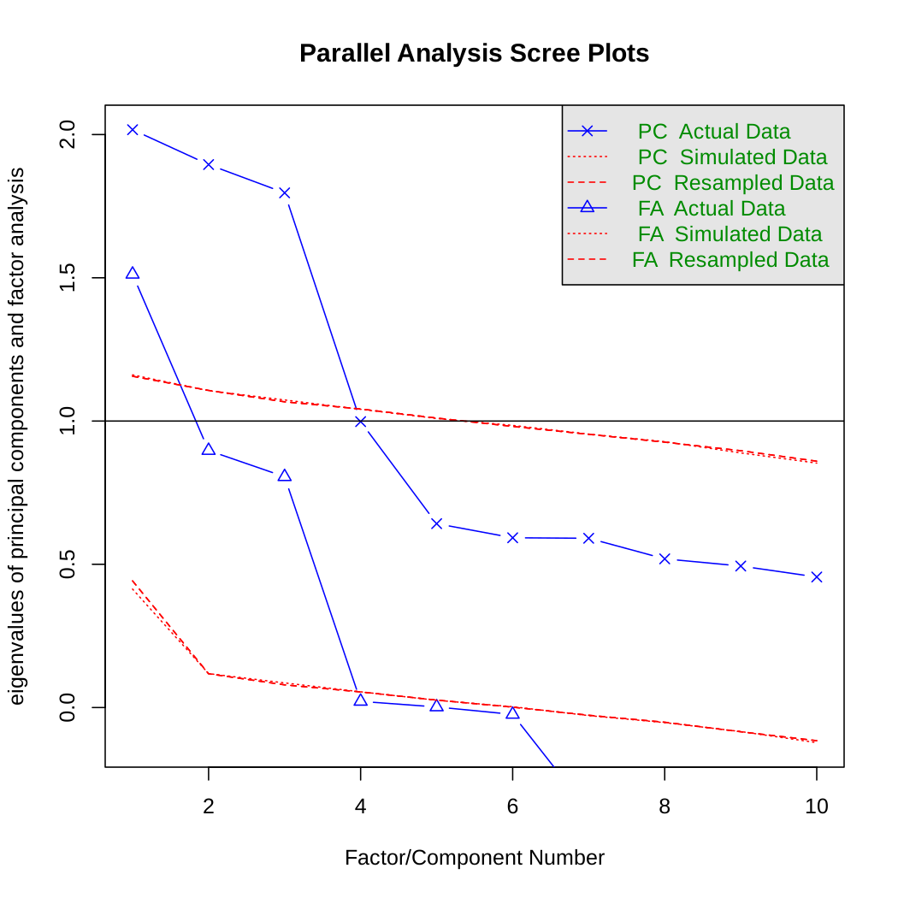

```
## Parallel analysis suggests that the number of factors =  3  and the number of components =  3
```
</center>


<!-- ------------------------------------------- -->
## Número de factores a retener


### MAP de Vellicer

- Es un algoritmo
- Busca encontrar la estructura factorial más simple


```r
VSS(mat)
```

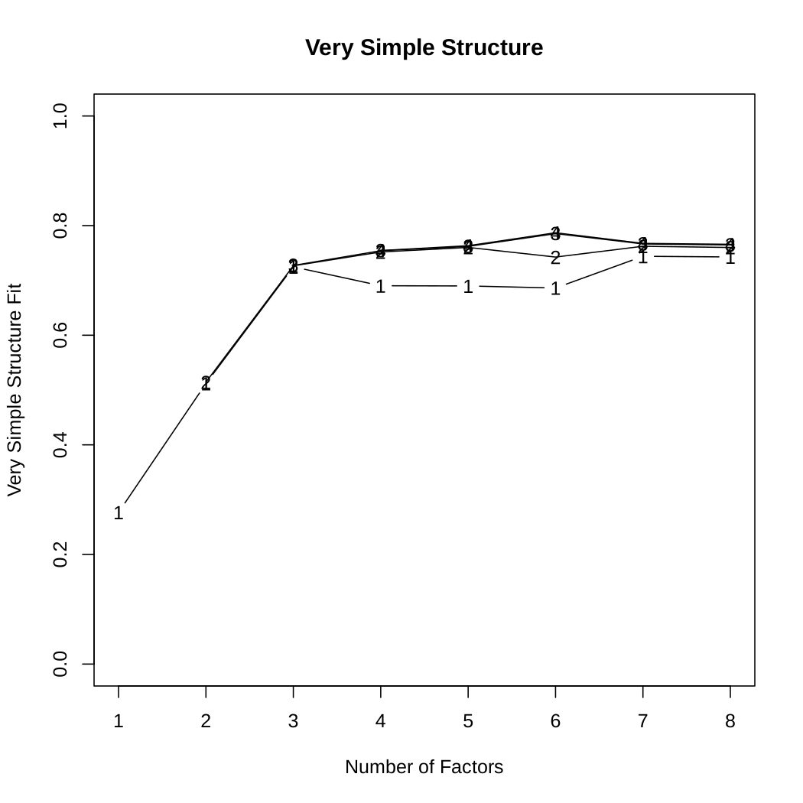

```
## 
## Very Simple Structure
## Call: vss(x = x, n = n, rotate = rotate, diagonal = diagonal, fm = fm, 
##     n.obs = n.obs, plot = plot, title = title, use = use, cor = cor)
## Although the VSS complexity 1 shows  7  factors, it is probably more reasonable to think about  3  factors
## VSS complexity 2 achieves a maximimum of 0.76  with  7  factors
## 
## The Velicer MAP achieves a minimum of 0.04  with  1  factors 
## BIC achieves a minimum of  -104.67  with  3  factors
## Sample Size adjusted BIC achieves a minimum of  -47.5  with  3  factors
## 
## Statistics by number of factors 
##   vss1 vss2   map dof   chisq     prob sqresid  fit  RMSEA  BIC SABIC complex
## 1 0.28 0.00 0.043  35 1.0e+03 2.1e-188     9.9 0.28 0.1665  764   875     1.0
## 2 0.51 0.51 0.049  26 4.7e+02  2.6e-82     6.7 0.51 0.1302  287   370     1.2
## 3 0.72 0.73 0.051  18 2.0e+01  3.5e-01     3.7 0.73 0.0096 -105   -47     1.0
## 4 0.69 0.75 0.085  11 7.0e+00  8.0e-01     3.4 0.75 0.0000  -69   -34     1.2
## 5 0.69 0.76 0.135   5 1.9e+00  8.6e-01     3.2 0.76 0.0000  -33   -17     1.2
## 6 0.69 0.74 0.186   0 2.7e-01       NA     2.9 0.79     NA   NA    NA     1.2
## 7 0.74 0.76 0.293  -4 2.3e-07       NA     3.2 0.77     NA   NA    NA     1.1
## 8 0.74 0.76 0.455  -7 1.5e-10       NA     3.2 0.77     NA   NA    NA     1.1
##    eChisq    SRMR eCRMS eBIC
## 1 2.2e+03 1.6e-01 0.177 1945
## 2 1.0e+03 1.1e-01 0.139  820
## 3 1.3e+01 1.2e-02 0.019 -111
## 4 5.2e+00 7.6e-03 0.015  -71
## 5 1.2e+00 3.6e-03 0.011  -33
## 6 1.5e-01 1.3e-03    NA   NA
## 7 1.4e-07 1.2e-06    NA   NA
## 8 8.9e-11 3.2e-08    NA   NA
```

<!-- ------------------------------------------- -->
## La matriz de saturaciones

Una vez elegido el número de factores calculamos el Análisis Factorial


```r
fa(mat, nfactors=3, rotate = "oblimin") # oblimin por defecto
```

```
## Factor Analysis using method =  minres
## Call: fa(r = mat, nfactors = 3, rotate = "oblimin")
## Standardized loadings (pattern matrix) based upon correlation matrix
##       MR1   MR2   MR3     h2   u2 com
## X1   0.72  0.04  0.02 0.5277 0.47 1.0
## X2   0.68 -0.01 -0.01 0.4667 0.53 1.0
## X3   0.72 -0.02 -0.01 0.5194 0.48 1.0
## X4   0.02  0.68  0.00 0.4665 0.53 1.0
## X5  -0.02  0.61  0.03 0.3749 0.63 1.0
## X6   0.00  0.70 -0.02 0.4906 0.51 1.0
## X7   0.00 -0.05  0.03 0.0037 1.00 1.5
## X8   0.01 -0.02  0.63 0.3930 0.61 1.0
## X9  -0.01  0.02  0.60 0.3644 0.64 1.0
## X10  0.00  0.00  0.68 0.4627 0.54 1.0
## 
##                        MR1  MR2  MR3
## SS loadings           1.51 1.34 1.22
## Proportion Var        0.15 0.13 0.12
## Cumulative Var        0.15 0.28 0.41
## Proportion Explained  0.37 0.33 0.30
## Cumulative Proportion 0.37 0.70 1.00
## 
##  With factor correlations of 
##      MR1   MR2   MR3
## MR1 1.00  0.02  0.03
## MR2 0.02  1.00 -0.02
## MR3 0.03 -0.02  1.00
## 
## Mean item complexity =  1
## Test of the hypothesis that 3 factors are sufficient.
## 
## df null model =  45  with the objective function =  1.72 with Chi Square =  1707.25
## df of  the model are 18  and the objective function was  0.02 
## 
## The root mean square of the residuals (RMSR) is  0.01 
## The df corrected root mean square of the residuals is  0.02 
## 
## The harmonic n.obs is  1000 with the empirical chi square  12.86  with prob <  0.8 
## The total n.obs was  1000  with Likelihood Chi Square =  19.67  with prob <  0.35 
## 
## Tucker Lewis Index of factoring reliability =  0.997
## RMSEA index =  0.01  and the 90 % confidence intervals are  0 0.03
## BIC =  -104.67
## Fit based upon off diagonal values = 1
## Measures of factor score adequacy             
##                                                    MR1  MR2  MR3
## Correlation of (regression) scores with factors   0.87 0.84 0.82
## Multiple R square of scores with factors          0.75 0.71 0.68
## Minimum correlation of possible factor scores     0.51 0.42 0.35
```


<!-- ------------------------------------------- -->
## 3. Rotación de factores

- Las matrices de saturaciones (o pesos) suelen tener valores en todos los factores

- Los factores se pueden transformar (rotar) para ayudar a la interpretación

- El objetivo es lograr una estructura simple que proporcione la mejor interpetación de los factores

- Son transformaciones de la matriz A según la matriz de transformación T
\
\

$$P=AT$$
\
<hr>
\

- Dos tipos de transformaciones:
  - Ortogonales
  - Oblicuas

### Inconveniente: Se "desconectan" aún un poco más de la realidad

<!-- ------------------------------------------- -->
## Rotación Ortogonal


:::::: {.columns}
::: {.column}


```
##   item    F1   F2
## 1    1  0.42 0.43
## 2    2  0.30 0.21
## 3    3  0.71 0.67
## 4    4 -0.25 0.18
## 5    5 -0.33 0.23
## 6    6 -0.69 0.79
```


:::
::: {.column}


```
##   item    F1    F2
## 1    1  0.40 -0.05
## 2    2  0.60  0.00
## 3    3  0.81 -0.05
## 4    4 -0.05  0.40
## 5    5 -0.02  0.42
## 6    6  0.01  0.80
```


:::
::::::

<hr>


<center>

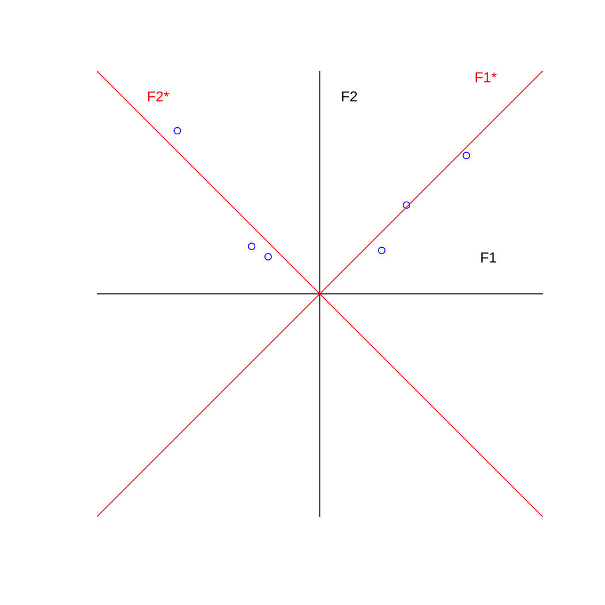

</center>

<hr>

- Ortogonales: Independientes (No relacionados)
- Más usadas:

  - *quartimax*: Simplifica el numero de factores, útil cuando queremos encontrar un factor general

  - *varimax*: Maximiza las varianzas, concentra mas varianza en los primeros factores

<!-- ------------------------------------------- -->
## Rotación Oblicua


:::::: {.columns}
::: {.column}


```
##   item    F1   F2
## 1    1  0.20 0.43
## 2    2  0.21 0.56
## 3    3  0.21 0.71
## 4    4 -0.22 0.80
## 5    5 -0.20 0.70
## 6    6 -0.21 0.55
```


:::
::: {.column}


```
##   item    F1   F2
## 1    1  0.30 0.01
## 2    2  0.50 0.09
## 3    3  0.70 0.04
## 4    4  0.00 0.80
## 5    5 -0.01 0.70
## 6    6 -0.08 0.55
```


:::
::::::

<hr>


<center> 

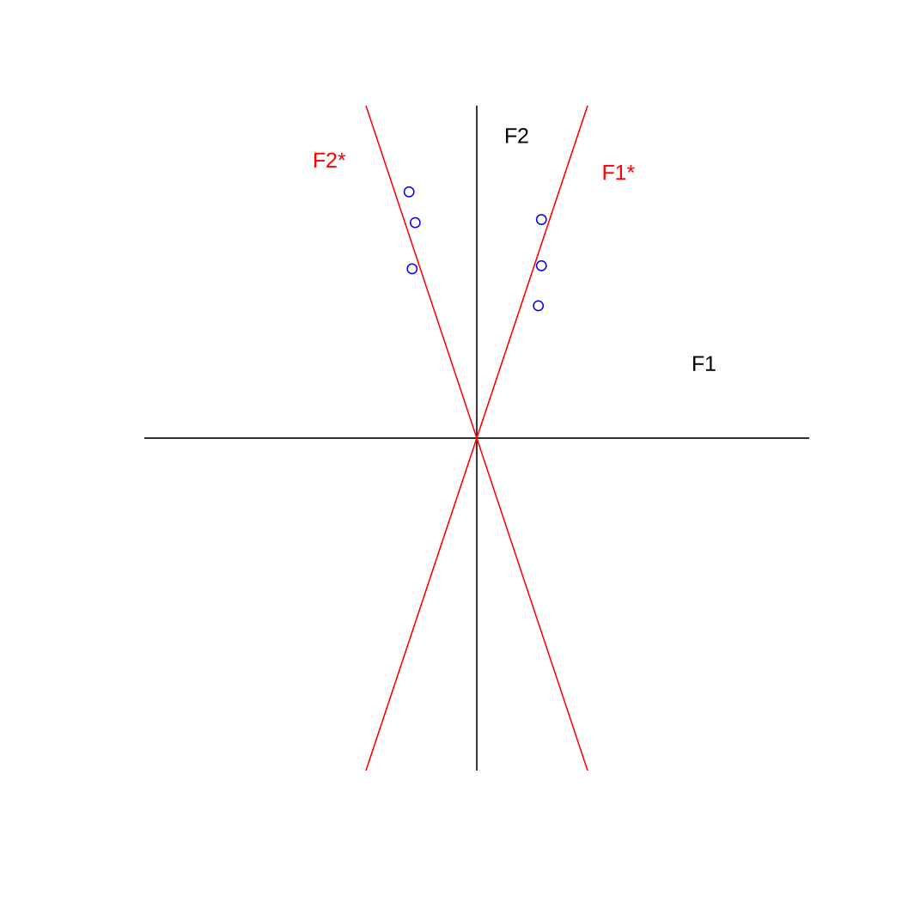

</center>

<hr>

- Oblicuas: No independientes (relacionadas)
- Más usadas: *Promax* y *Oblimin*


<!-- ------------------------------------------- -->
##  Rotación (*cont.*)


En las soluciones oblicuas es necesario aportar la matriz de correlaciones entre los factores


```
##       MR1    MR2    MR3
## MR1 1.000  0.017  0.031
## MR2 0.017  1.000 -0.022
## MR3 0.031 -0.022  1.000
```


<hr>
\

Se suele hablar de dos matrices distintas, el patrón factorial (P), la estructura factorial (S)

- El patrón factorial (P): indica la relación directa entre una variable y un factor
- La estructura factorial (S): indica la relación directa entre la entre una variable y un factor más la relación indirecta que llega a través de los otros factores

\

Ambas se relacionan de la siguiente forma:

$$S=P\Phi$$

- Donde $\Phi$ es la matriz de correlaciones
- En el caso de rotaciones ortogonales ($\Phi$) no existe (o es la matriz identidad) porque los factores son independientes

<hr>
\

### R te da la estructura factorial (S)


<!-- ------------------------------------------- -->
## 4. Interpretación de los factores


### El AFE no se utiliza para reducir la dimensionalidad sino para comprobar la estructura subyacente de los items

\
\

| Item                                                  |   | F1   | F2   | F3   |
| ----------------------------------------------------- | - | ---- | ---- | ---- |
| Tiende a reducir sus amistades a un grupo escogido    |   | **0.91** | 0.08 | 0.29 |
| Se encuentra cómodo entre mucha gente                 |   | **0.88** | 0.1  | 0.12 |
| Le molesta tener que hacer nuevas amistades           |   | **0.95** | 0.12 | 0.02 |
| Responde con dureza cuando alguien le ataca           |   | 0.15 | **0.95** | 0.17 |
| Cree que las dificultades solo detienen a los débiles |   | 0.11 | **0.78** | 0.03 |
| Es cierta la frase "Piensa mal y acertarás"           |   | 0.00 | **0.72** | 0.29 |
| A veces deja para mañana lo que podría hacer hoy      |   | 0.1  | 0.05 | 0.3  |

<!-- ------------------------------------------- -->
## Interpretación de los factores

La interpretación sustantiva de los factores se lleva a cabo sobre las matrices rotadas. 

- En principio pesos por debajo de 0.3 o no se interpretan o se hace muy cuidadosamente 

- La idea es determinar si el test posee la estructura que se supone que debe tener

\

:::::: {.columns}
::: {.column}

| Rasgo | Item | F1   | F2   | F3   |
| ----- | ---- | ---- | ---- | ---- |
| C     | 1    | **0.99** | 0.12 | 0.23 |
| C     | 2    | **0.94** | 0.12 | 0.00    |
| C     | 3    | **0.86** | 0.08 | 0.13 |
| C     | 4    | **0.85** | 0.11 | 0.06 |
| E     | 5    | 0.10  | **0.88** | 0.08 |
| E     | 6    | 0.29 | **0.82** | 0.19 |
| E     | 7    | 0.10  | **0.73** | 0.05 |
| P     | 8    | 0.21 | 0.21 | **0.84** |
| P     | 9    | 0.23 | 0.29 | **0.75** |
| P     | 10   | 0.25 | 0.15 | **0.94** |

:::
::: {.column}

| Rasgo | Item | F1   | F2   | F3   |
| ----- | ---- | ---- | ---- | ---- |
| C     | 1    | **0.86** | 0.25 | 0.18 |
| C     | 2    | **0.80** | 0.13 | 0.28 |
| C     | 3    | **0.72** | 0.12 | 0.27 |
| C     | 4    | **0.79** | 0.15 | 0.03 |
| E     | 5    | 0.25 | **0.86** | 0.09 |
| E     | 6    | 0.20  | **0.74** | 0.21 |
| E     | 7    | 0.10  | **0.92** | 0.26 |
| P     | 8    | **0.98** | 0.16 | 0.04 |
| P     | 9    | **0.78** | 0.29 | 0.13 |
| P     | 10   | **0.99** | 0.16 | 0.20  |

:::
::::::


## 5. Indicadores de calidad

- Son indicadores de cómo nuestro modelo factorial ajusta a los datos empíricos

- Los más utilizados:

<hr>
:::::: {.columns}
::: {.column}

### RMSR

:::
::: {.column}

- Root Mean Square of Residuals
- [0, 1]
- Mejor más **ALTO**

:::
::::::
<hr>

:::::: {.columns}
::: {.column}

### RMSE

:::
::: {.column}

- Root Mean Square Error of Approximation
- [0, 1]
- Mejor más **BAJO**
- IC al 90%

:::
::::::
<hr>

:::::: {.columns}
::: {.column}

### Tucker

:::
::: {.column}

- [0, 1]
- Mejor más **ALTO**

:::
::::::
<hr>

\

Se pueden producir *Heywoods*


<!-- ------------------------------------------- -->
## Puntuaciones factoriales

- En los test se suelen agrupar las puntuaciones que reflejan un mismo factor (parceling)
- Normalmente se suman y ya está, son muy sencillas
- Por ejemplo:
  - RN = it1 + it2 +it3
  - RV = it4 + it5 + it6 + it7

- El AFE permitiría construir puntuaciones para cada rasgo usando los pesos de cada variable en cada factor

- Eso tendría mucho mas sentido porque la influencia de cada variable varía en función del peso

$$F_{ij}= \sum w_{jk}X_{ij}$$
donde:

$w_{jk}$ es el peso que determina la importancia de ese ítem en ese factor 

- Aunque $w_{jk}$ dependen de las saturaciones existen diferentes procedimientos para calcularlos como las de regresión, Bartlett y Anderson-Rubin

- Una vez calculados se pueden transformar para ayudar en la interpretación o calcular baremos

- No es muy utilizado porque es más engorroso

<!-- ------------------------------------------- -->
## Puntuación factorial con R

\
\


```r
p <- fa(mat, nfactors=3, scores="regression")
head(p$scores)
```

```
##              MR1         MR2        MR3
## [1,] -0.05397644 -0.42576736 -0.7177449
## [2,] -0.16884335 -0.62591643  1.0202459
## [3,] -0.35171670 -0.83159808  0.8417798
## [4,] -0.35417296 -0.65798297  1.3219791
## [5,]  0.05068110  0.83820316  0.1219028
## [6,]  0.15488662 -0.06048269 -0.4136029
```


<!-- ------------------------------------------- -->
## Requisitos para el cálculo

### Tamaño muestral: 
- Regla clásica: 5 sujetos por variable y mínimo 100 sujetos
- Es más complicado, depende de las relaciones entre los items


\

### Escala de los items

- Se requiere que las puntuaciones sean cuantitativas y continuas, y la mayoría de las veces los items no lo son

- Incluso cumpliendo lo anterior suele tener problemas

\

Se recomienda:

- Partir de matrices de correlaciones tetracóricas y policóricas
- Hacer parcel de items que sean muy seguros de que van juntos (sustantivamente indiscutibles) y sobre ellos hacer el AFE


<hr>

En el curso vamos a partir de correlaciones


<!-- ------------------------------------------- -->
## Decisiones estadísticas vs decisiones sustantivas


### El AFE siempre ha sido polémico


- Usado en test multifactoriales
- Usado para medir la Inteligencia
- Distintas decisiones llevan a distintos resultados y distintas interpretaciones

\
<hr>


<div class="jumbo">
  <h4>Las decisiones sobre como realizar una AFE deben estar basada en cuestiones relacionadas con la teoría, no con cuestiones matemáticas o estadísticas
</h4>
</div>

<hr>

\

- A la hora de la verdad se mezcla todo un poco
- La información correlacional debería ser puesta a prueba con información experimental


<!-- ------------------------------------------- -->
## Avanzado: Factores de orden superior

- Es posible calcular factores de segundo orden u orden superior
- 16PF (Cattel), Big Five, etc.
- Se calculan sobre la matriz de correlaciones de los primeros factores (no se puede llevar a cabo con rotaciones no ortogonales)


<center>
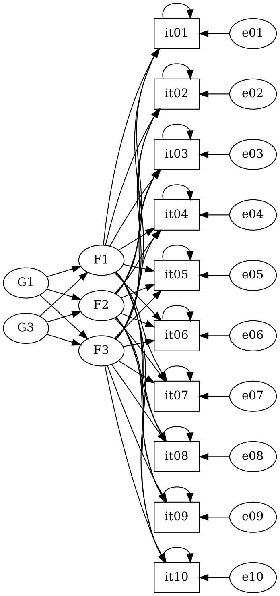
</center>


<!-- ------------------------------------------- -->
## Avanzado: Modelos Bifactor

- Muy de moda en los últimos años
- Es un modelo completo (se estiman las puntuaciones de los sujetos, no las correlaciones entre variables)
- Se estiman con AFC

<center>

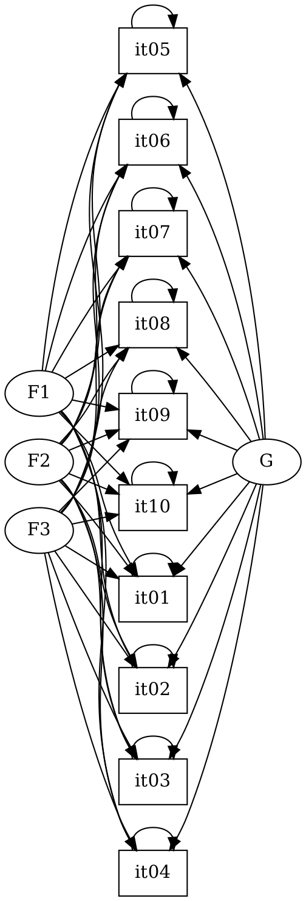


