:::::: {.columns}
::: {.column}

  <h2>TRI: Conceptos básicos</h2>

:::
::: {.column}

{.myimg .border width="600"}

:::
::::::

## Introducción

- Nuevo enfoque
- Resuelve problemas de la TCT
- No contradice a la TCT, es algo diferente
- Lo importante es el ítem no el test
- Origen en los años 30 y 40
- Pioneros: Richardson (1936), Lawley (1943), Tucker (1946), Lord (1952), Birnbaum (1957), Rasch (1960), etc...
- Imprescindible un ordenador para los cálculos
- Alto estatus académico
- Estatus aplicado medio-bajo

## Grandes problemas de la TCT

- No hay invarianza de las propiedades de los sujetos
  - El mismo sujeto obtiene dos puntuaciones distintas en dos test que miden el mismo rasgo
 
- No hay invarianza de las propiedades de los instrumentos
  - Todos los descriptores del test: Fiabilidad, validez, etc., cambian si cambia la muestra

- El error de medida es constante para todos los niveles del rasgo

$$\rho_{EV}=0$$

- La TCT no consigue demostrar que las mediciones se producen a nivel de intervalo

 

**En PRINCIPIO**, la TRI ofrece soluciones a estos problemas

## Curva Característica del Ítem (*CCI*)

- Es el concepto fundamental
- Toda la TRI esta basada en ella
- Es muy intuitiva y lógica

plot of chunk unnamed-chunk-2

Donde:

- $\theta$: Es el rasgo que estamos midiendo (*inteligencia, personalidad, etc...*)
- $P(\theta$): Es la probabilidad de superar (acertar) el ítem para cada nivel de $\theta$

## CCI (*cont.*)

- Cada ítem tiene su propia CCI
- Esta forma de S (o sigmoide) es la más adecuada:
  - Una función lineal daría probabilidades fuera del rango [0, 1]
  - Una función escalón no es realista en la naturaleza
  
- Estas CCI **describen** el comportamiento del ítem, no lo crean, la lógica es:
  - Construyo items
  - Se lo paso a muchos sujetos 
  - Describo cómo se comporta cada ítem usando esas CCI

- Para hacer esa descripción permito que las CCI sean diferentes a través de varios parámetros

## Parámetros en la CCI

- Tres parámetros: a, b y c
- A veces también un cuarto parámetro: d (no muy usado en *Psicometría*)

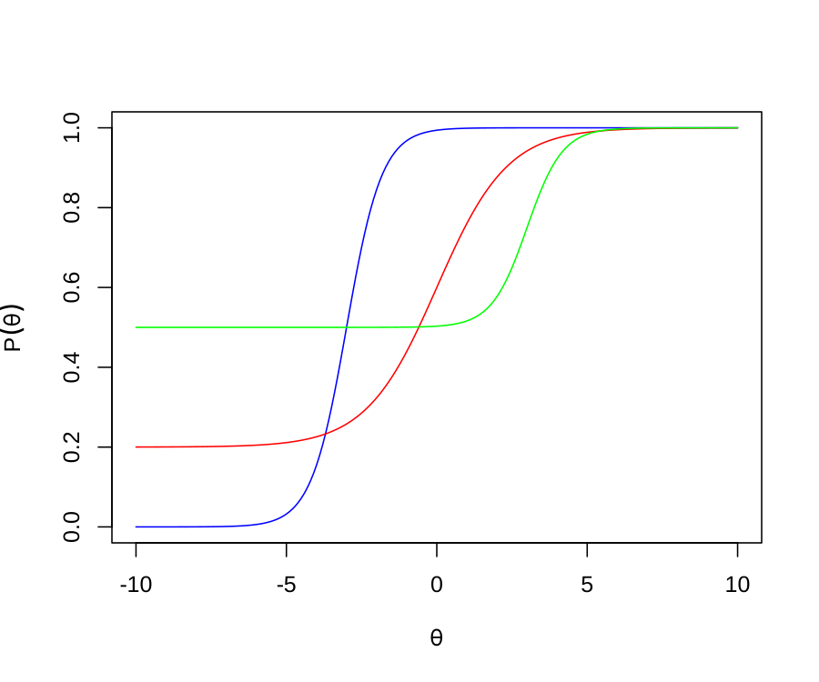

plot of chunk unnamed-chunk-3

## Parámetro b

- Es la dificultad del ítem
- Está en la escala de $\theta$
- Mayor valor implica mayor dificultad (más valor del rasgo para superar el ítem)
- Parecido (pero no equivalente) a la dificultad del ítem en la TRI

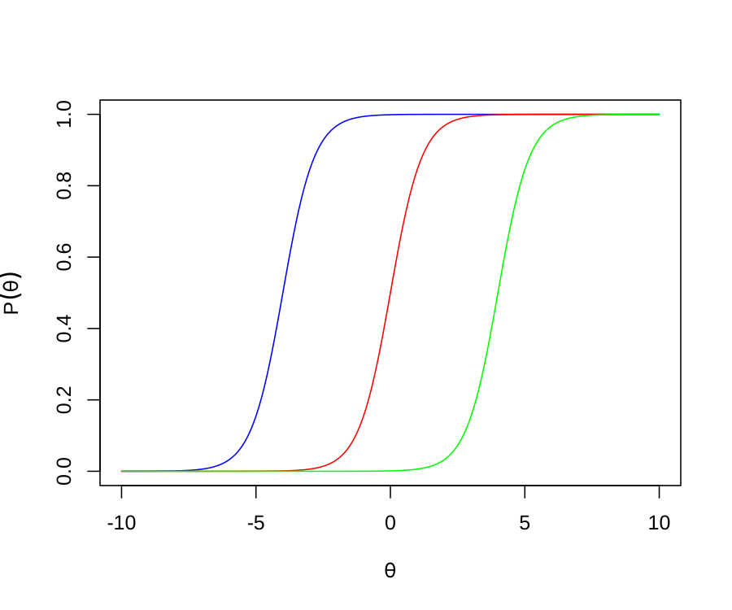

plot of chunk unnamed-chunk-4

- Ojo, que en la TCT va en - y la TRI en +

- Valor de b para el ítem rojo (P=0.5), b=0

- Rango: [-$\infty$ y +$\infty$]

## Parámetro a

- Es la discriminación del ítem
- Es la pendiente de la CCI, a mayor valor mayor pendiente
- Se define como la tangente de la función por lo que está en su propia escala
- Va entre $-\infty$ y $+\infty$ pero los valores habituales son entre 0.5 y 1

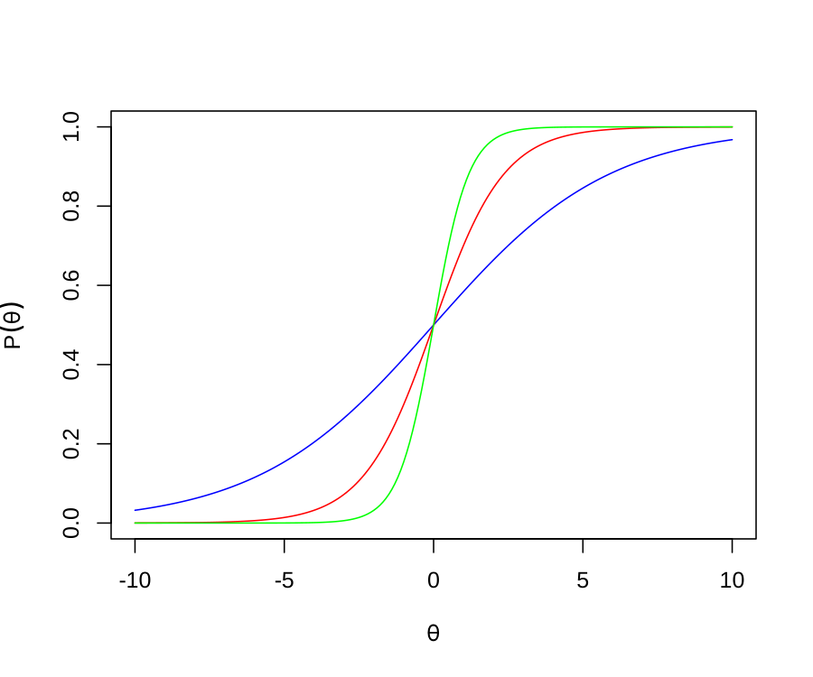

plot of chunk unnamed-chunk-5

- ¿Qué significa una a < 0?
- Al pasar de 1 va creciendo sistemáticamente hasta convertirse en la función escalón

## Parámetro c

- Es la probabilidad de acertar al azar el ítem
- En inglés es *guessing* (adivinación)
- Está en la escala de $P$, por lo tanto va entre 0 y 1

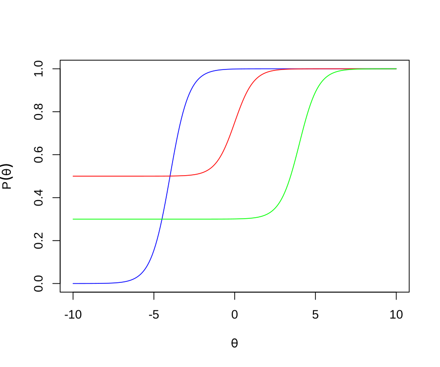

plot of chunk unnamed-chunk-6

- El ítem azul es poco realista, siempre se tiene una posibilidad de acertar al azar (salvo que sea un ítem de generar la respuesta)
- ¿Cuantas alternativas tiene el ítem verde?
- Si el ítem rojo tiene 3 alternativas, qué ha pasado, qué nos indica

## Parámetro d

- No se usa mucho en Psicometría

- Sí en otras disciplinas, pe: psicofísica
  - Se supone que siempre hay un nivel de rasgo para una P=1
  - Eso no ocurre en Psicofísica, pe: detectar un sonido a x dB
- Es el valor máximo de la función
- En inglés es *Inattention*

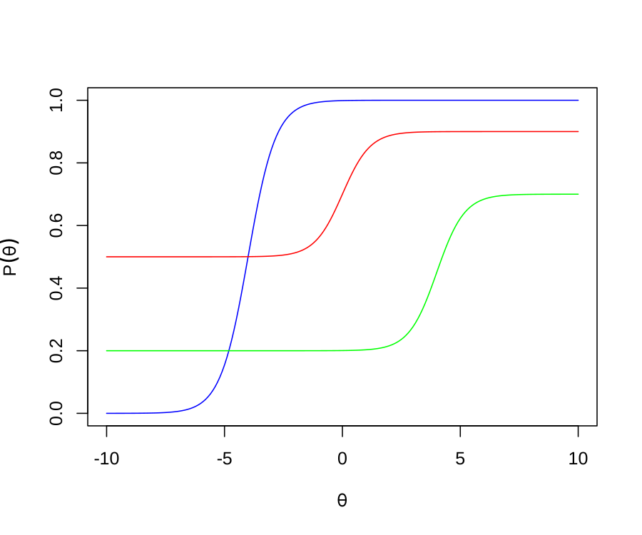

plot of chunk unnamed-chunk-7

- Comprime la función entre 0 y d
- Estña en la escala de $P$

## <!-- Sección Nueva -->

:::::: {.columns}
::: {.column}

  <h2>Modelos de la TRI</h2>

:::
::: {.column}

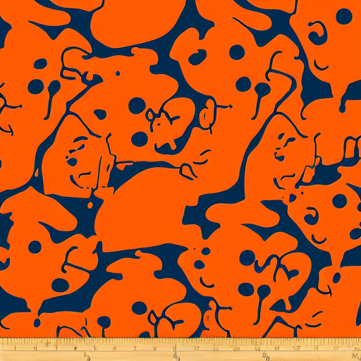{.myimg .border width="600"}

:::
::::::

## Modelos logísticos y modelos ojivales

- Hay muchas formas de dibujar una función sigmoide
- Las más habituales:
  - La curva normal acumulada (modelos de ojiva normal)
  - La función logística (modelos de ojiva logística)

## Modelo de ojiva normal

- Si en la tabla de la normal hacemos el dibujo con los valores de $\theta$ = [-2, 0, +2] se ve como es una S perfecta
  
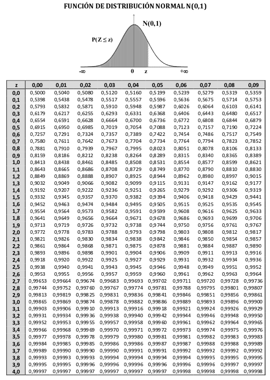{width=100%}  

  
## Modelo de ojiva normal (*cont.*)

$$P(\theta)=\int_{-\infty}^{\theta}\frac{1}{\sqrt{2\pi}}e^{-\frac{1}{2}\theta^{2}}d\theta$$

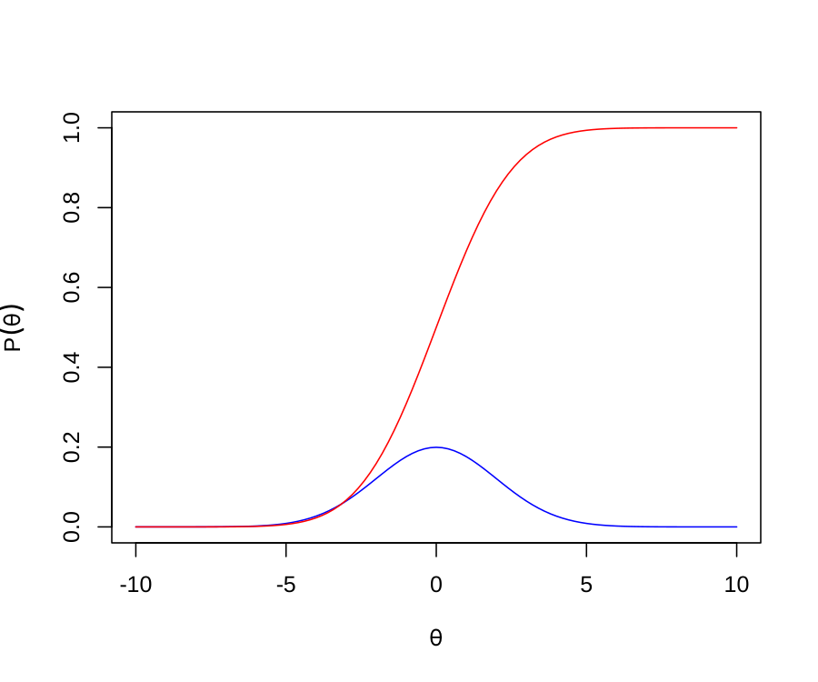

plot of chunk unnamed-chunk-8

## Modelo logístico

$$P(\theta)=\frac{e^{\theta}}{1+e^{\theta}}=\frac{1}{1+e^{-\theta}}$$

- En clase vamos a utilizar la primera expresión porque yo creo que es un poco más clara

Ejercicio: dibujar la función logística para los valores de $\theta$ = [-2, 0, +2]

<!-- ------------------------------------------- -->
## Propiedades del Modelo logístico

### Se puede expresar como un Odd Ratio

$$\frac{P(\theta)}{1-P(\theta)}=e^{\theta}$$

- Recordamos qué es un Odd Ratio:
  - Probabilidad de que suceda algo partido de la probabilidad de que no suceda
  - Una buena parte de la estadística y la investigación está definida en OR
  - Pe: Probabilidad de acabar psicología frente a no acabar psicología
    $$OR=\frac{0.9}{1-0.9}=9$$
    Es 9 veces más probable que acabes psicología que no la acabes
  - Pe: Probabilidad de morir de cáncer frente a no morir de cáncer
    $$OR=\frac{0.2}{1-0.2}=0.25$$
    Es un cuarto más probable morir de cáncer que no morir o, invirtiendo:
    $$OR=\frac{0.8}{1-0.8}=4$$
    Es un cuatro veces más posible no morir de cáncer que morir
 
- Se ha visto en DIF y se verá el año que viene en **Evaluación de Procesos**

<!-- ------------------------------------------- -->
## Propiedades del Modelo logístico

### Se puede "linealizar" (hacer una recta en vez de una S)

- Es posible linealizar la función calculando el logaritmo neperiano de la expresión anterior
- Se suele llamar función $logit$

$$L=logit(P(\theta))=ln\frac{P(\theta)}{1-P(\theta)}=lne^{\theta}=\alpha+\beta\theta$$

- Donde $\alpha$ y $\beta$ son dos constantes que dependen del modelo que utilicemos (1, 2 o 3 parámetros)
- En el caso de la ecuación anterior son 0 y 1

:::::: {.columns}
::: {.column}

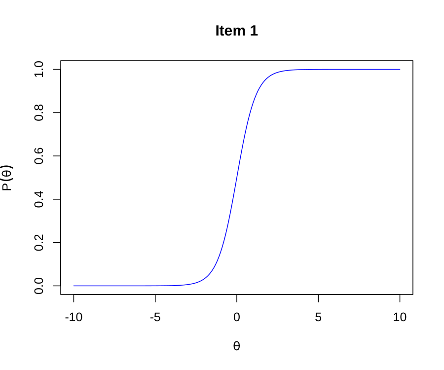

plot of chunk unnamed-chunk-9

:::
::: {.column}

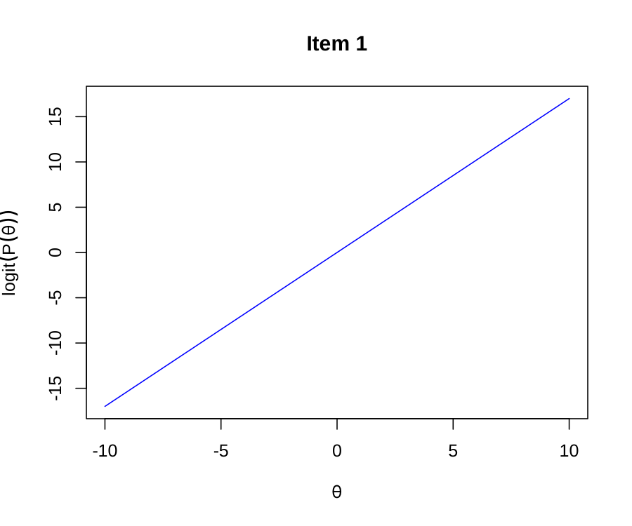

plot of chunk unnamed-chunk-10

:::
::::::

## Compración entre modelos

:::::: {.columns}
::: {.column}

**Logísticos**

- Muy simples
- Muy rápidos en el ordenador
- peores propiedades estadísticas
- Conecta con los odds-ratio
- modelos logit

:::
::: {.column}

**Ojiva normal**

- Muy complejos
- Muy lentos en el ordenador
- Excelentes propiedades estadísticas 
- modelos probit

:::
::::::

- Haley (1952) demuestra que cuando se introduce D=1.7 las dos curvas difieren en menos de 0.01 para todo el continuo
- La mayoría de los trabajos se ha realizado usando el modelo logístico
- Aquí solo veremos el logístico

## Rasch

:::::: {.columns}
::: {.column}

Sólo tiene un parámetro: 

- b, la dificultad

:::
::: {.column}

$$P(\theta)=\frac{e^{D(\theta-b)}}{1+e^{D(\theta-b)}}$$

:::
::::::

:::::: {.columns}
::: {.column}

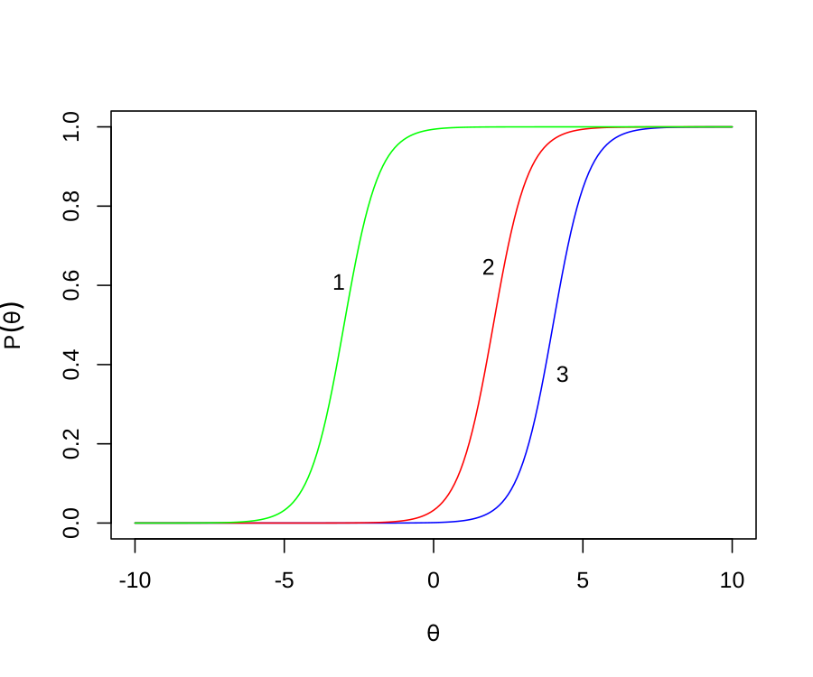

plot of chunk unnamed-chunk-11

:::
::: {.column}

| item | b   |
| ---- | --- |
| 1    | \-3 |
| 2    | 2   |
| 3    | 4   |

 

:::
::::::

## Birnbaum

:::::: {.columns}
::: {.column}

Depende de dos parámetros:

- b: dificultad
- a: discriminación

:::
::: {.column}

$$P(\theta)=\frac{e^{Da(\theta-b)}}{1+e^{Da(\theta-b)}}$$

:::
::::::

:::::: {.columns}
::: {.column}

 

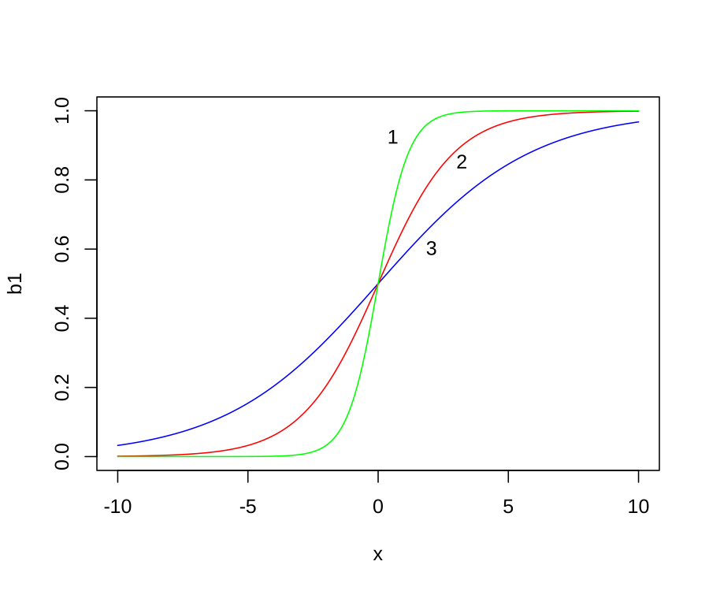

plot of chunk unnamed-chunk-12

:::
::: {.column}

 
| item | b | a   |
| ---- | - | --- |
| 1    | 0 | 1   |
| 2    | 0 | 0.8 |
| 3    | 0 | 0.2 |

:::
::::::

## (3P)

:::::: {.columns}
::: {.column}

Tiene los tres parámetros:

- b: dificultad
- a: discriminación
- c: acierto al azar

:::
::: {.column}

$$P(\theta)=c+(1-c)\frac{e^{Da(\theta-b)}}{1+e^{Da(\theta-b)}}$$

:::
::::::

:::::: {.columns}
::: {.column}

 

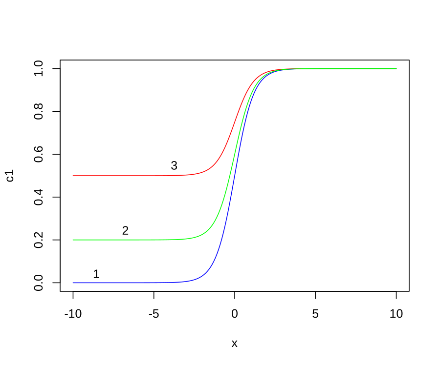

plot of chunk unnamed-chunk-13

:::
::: {.column}

 
| item | b | a | c   |
| ---- | - | - | --- |
| 1    | 0 | 1 | 0   |
| 2    | 0 | 1 | 0.2 |
| 3    | 0 | 1 | 0.5 |

:::
::::::

## Elección del modelo más adecuado

- Principio de parsimonia $\Rightarrow$ **Modelo más simple que sea explicativo**
- Más parámetros $\Rightarrow$ más sujetos

|Modelo|Sujetos|
|:------|-------:|
|TCT|200|
|TRI (1PL)|500|
|TRI (2PL)|700|
|TRI (3PL)|1000|

- Procedimiento:

1. Se ajusta el modelo más sencillo (1PL)
1. Se comprueba el ajuste del modelo a los datos
1. Se ajusta el modelo superior (2PL)
1. Se comprueba el ajuste del modelo a los datos 
1. Se comprueba si el ajuste mejora **significativamente** con el modelo 2PL
   - Si no mejora te quedas con el más sencillo (1PL) y paras
   - Si mejora te quedas con el complejo (2PL)
1. En caso de quedarte con el 2PL haces la misma comprobación con el 3PL

## Supuestos de la TRI

### 1. Unidimensionalidad
- $P(\theta)$ depende exclusivamente de $\theta$ y no de otros factores
- Se puede poner a prueba con Análisis Factorial
- Si no se cumple:
  - No es especialmente peligroso, la TRI es robusta a su violación
  - Arreglar/eliminar items
  - utilización de modelos multidimensionales (pe: LLTM)
  
  

  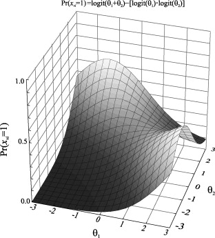
  

  
## Supuestos de la TRI (*cont.*)

### 2. Independencia

- La respuesta a un ítem es independiente de las respuestas anteriores
  - No hay aprendizaje
  - No hay cansancio
  

$$P(U_{1}, U_{2},\dots ,U_{n}|\theta) = P(U_{1}|\theta) P(U_{2}|\theta) \dots P(U_{n}|\theta)$$

- Es un supuesto habitual en estadística
- Es fácil que se cumpla (pero no siempre)
- La TRI es razonablemente robusta a su violación
- La existencia de este supuesto permite estimar las $\theta$ de los sujetos de una forma mucho más sencilla

Resolver el Ejercicio 4, A y B

## Cómo entender la TRI

Resolver el Ejercicio 4, C y construir la siguiente tabla
\
\

 

|       | \-2 | \-1 | 0 | +1 | +2 |
| ----- | --- | --- | - | - | - |
| CCI 1 |     |     |   |   |   |
| CCI 2 |     |     |   |   |   |
| CCI 3 |     |     |   |   |   |
| CCI 4 |     |     |   |   |   |

<!-- ------------------------------------------- -->
---

:::::: {.columns}
::: {.column}

  <h2>TRI al estilo TCT</h2>

:::
::: {.column}

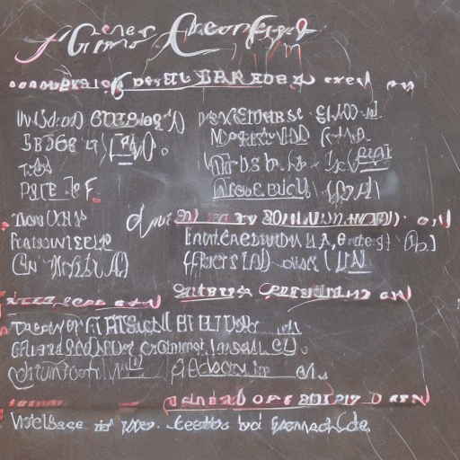{.myimg .border width="600"}

:::
:::::: 

## Curva Característica del Test (*CCT*)

- Es posible dar las $\theta$ como si fuesen puntuaciones empíricas de la TCT
- Refleja la puntuación que se habría sacado en la TCT ($x$) en función de la cantidad de rasgo del sujeto ($\theta$)

$$CCT=\sum_{i=1}^{n} P_{i}(\theta)$$

- Ojo fíjate en qué escala está CCT y la CCI

## Puntuación verdadera

- En la TRI lo importante es $\theta$ que es invariante entre distintos test
- Se puede calcular un equivalente a la $x$ de la TCT
- No es más que el valor en la CCT para un sujeto con una $\theta$ dada

$$V_{j}=\sum_{i=1}^{n} P_{i}(\theta_{j})$$

\

### OJO, $\theta$ es invariante pero $V_{j}$ no

| |**$\theta$**|**$V_{j}$**|
|----| ---- | ---- |
Test 1 (tiene 10 items)|1.25|6  
Test 2 (tiene 30 items)|1.25|18 

<!-- ------------------------------------------- -->
## Error típico de medida para V

- Junto a la V se puede calcular una desviación típica error
- Recuerda que es una función

$$\sigma_{E}^{2}=\sum P_{i}(\theta_{j})Q_{i}(\theta_{j})$$

Y con ella calcular Intervalos de Confianza

$$IC: V \pm |Z_{\alpha/2}| \sigma_{E}^{2}$$

